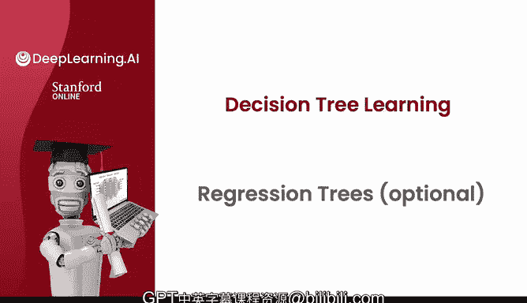
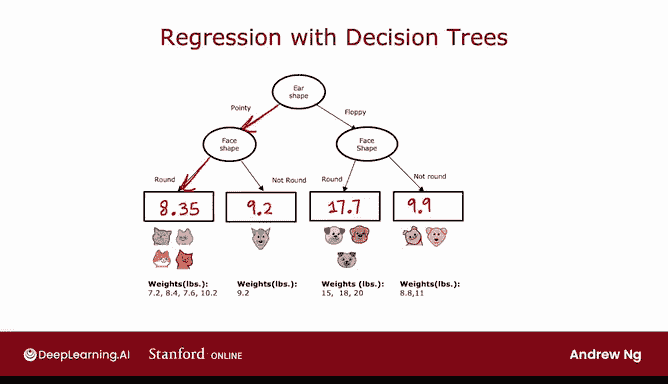
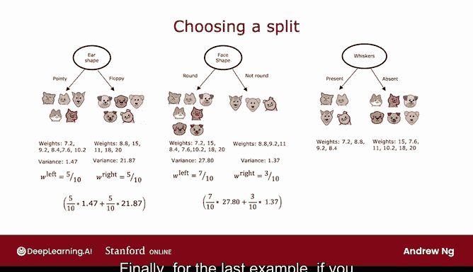

# 吴恩达《机器学习》｜machine-learning（中英字幕-deepseek翻译） - P99：57_04_06_回归树（可选）.zh_en - GPT中英字幕课程资源 - BV1MN4y1S7DE

So far we've only been talking about decision trees as classification algorithms in this optional video we'll generalize decision trees to be regression algorithms so that we can predict a number let's take a look The example I'm going to use for this video would be to use the discrete value features that we had previously。

That is these features X in order to predict the weight of the animal Y， so just to be clear。

 the weight here， unlike a previous video is no longer an input feature instead this is the target output Y that we want to predict rather than trying to predict whether or not an animal is or is not a cat。

This is a regression problem because we want to predict a number why let's look at what a regression tree will look like。

Here I've already constructed a tree for this regression problem where the root node splits on ear shape and then the left and right subtre split on face shape and also face shape here on the right。

 and there's nothing wrong with a decision tree that chooses to split on the same feature in both the left and right sub branchesches is perfectly fine if the splitting algorithm chooses to do that。

If during training you had decided on these splits。

 then this node down here would have these four animals with weights， 7。28。47。6 and 10。2。

 this node would have this one animal with weight， 9。2 and so on， for these remaining two nodes。

So the last thing we need to fill in for this decision tree is。

If there's a test example that comes down to this node。

 what is the weight that we should predict for an animal with  pointy years and a round face shape？

The decision tree is going to make a prediction based on taking the average of the weight in the training samples down here and by averaging these four numbers。

 it turns out you get 8。35。If on the other hand， an animal has  point0 ears and a knot round face shape。

 then it will predict 9。2。Or 9。20 pounds。Because there's a weight to of this one anywhere down here。

 and similarly， this would be 17。70 and 9。90。 So what this model will do is。Given a new test example。

 follow the decision notes down as usual until it gets to a leaf node and then predict that value at the leaf node。

 which I had just computed by taking an average of the weights of the animals that during training had gotten down to that same leaf node。

So if you were constructing a decision tree from scratch using this data set in order to predict the weight。

 the key decision， as you've seen earlier this week will be how do you choose which feature to split on let me illustrate how to make that decision with an example at the root note one thing you could do is split on the ear shape and if you do that you end up with left and right branches of the tree with five animals on the left and right with the following weights。

If you were to choose the split on the face shape， you end up with these animals on the left and right with the correspondinging weights that are written below。

 and if you were to choose to split on whiskers being present and absent， you end up with this。

So the question is。Given these three possible features to split on at the root node。

 which one do you want to pick that gives the best predictions for the weight of the animal when building a regression tree rather than try to reduce entropy。

 which was that measure of impurity that we had for a classification problem。

 we instead tried to reduce the variances of the weight of the values y at each of these subsets of the data。

So if you've seen the notion of variance in other contexts， that's great。

 this is the statistical or mathematical notion of variance that we' use in a minute。

 but if you've not seen how to compute the variance of a set numbers before， don't worry about it。

 all you need to know for this slide is that variance informly computes how widely a set of numbers varies。

So for this set numbers， 7。29。2 and so on up to 1。2 it turns out the variance is 1。47。

 so it doesn't vary that much， whereas here 8。81511，18 and 20， these numbers go all the way from 8。

8 all the way up to 20 and so the variance is much larger， turns out that the variance of 21。

87 and so the way it will' evaluate the quality of this split is will' compute same as before W left and W right as the fraction of examples that went to the left and right branches。

And the average variance after the split is going to be 510， which is w left times 1。47。

 which is the variance on the left， and then plus 510s times the variance on the right， which is 21。

87。So this weighted average variance plays a very similar role to the weighted average entropy that we had used when deciding what split to use for a classification problem and we can then repeat this calculation for the other possible choices of features to split on here in the tree in the middle。

 the variance of these numbers here turns out to be 27。80， the variance here is 1。37。

And so with W left equals 7/10th and W write is c1， and so with these values。

 you can compute the weight of variance as follows。Finally， for the last example。

 if you were to split on the whiskers feature， this is the variance on the left and right。

 there's W left and W right， and so the weight of variance is this。

A good way to choose a split would be to just choose the value of the weight to variance that is lowest。

Similar to when we're computing information gain， I'm going to make just one more modification to this equation。

 just as for the classification problem， we didn't just measure the average weighted entropy。

 we measured the reduction in entropy and that was information gain for a regression tree we also similarly measure the reduction in variance。

Turns out if you look at all of the examples in the training set。

 all 10 examples and compute the variances of all of them。

The variance of all the examples turns out to be 20。51。

And that's the same value for the root node in all of these， of course。

 because it's the same 10 examples at the root node。And so。

What will actually compute is the variance of the roots node， which is 20。

51 minus this expression down here， which turns out to be equal to 8。84。And so at the root note。

 the variance was 20。51 and after splitting on ear shape。

 the average weight of variance at these two nodes is 8。84 lower， so the reduction in variance is 8。

84 and similarly， if you compute the expression for reduction in variance for this example in the middle is 20。

51 minus。This expression that we had before， which turns out equal equal to 0。64。

 So this is a very small reduction in variance。 And for the whiskers feature。

 you end up with this which is。6。22。So between all three of these examples， 8。

84 gives you the largest reduction in variance， so just as previously we would choose the feature that gives you the largest information gain for a regression tree you would choose the feature that gives you the largest reduction in variance。

 which is why you choose ear shape as the feature to split on。

Having chosen that year shape features is split on you now have。

Two subsets of five examples in the left and right sub branchesches and you would then again。

 we say recursively， but you take these five examples and build a new decision tree focusing on just these five examples again。

 evaluating different options of features to split on and picking the one that gives you the biggest variance reduction and similarly on the right and you keep on splitting until you meet the criteria for not splitting any further and so that's it with this technique you can get your decision tree to not just carry out classification problems but also regression problems。

So far we've talked about how to train a single decision tree it turns out if you train a lot of decision trees。

 we call this an ensemble of decision trees， you can get a much better result Let's take a look at why and how to do so in the next video。

😊。