# 吴恩达《机器学习》｜machine-learning（中英字幕-deepseek翻译） - P9：09_01_01_线性回归模型第一部分.zh_en - GPT中英字幕课程资源 - BV1MN4y1S7DE

In this video， we'll look at what the overall process of supervised learning is like。Specifically。

 you see the first model of this course， a linear regression model that just means fitting a straight line to your data is probably the most widely used learning algorithm in the world today。

 and as you get familiar with linear regression many of the concepts you see here will also apply to other machine learning models。

 models that you see later in this specialization。Let's start with a problem that you can address using linear regression。

 say you want to predict the price of a house based on the size of a house。

 This is an example we see in earlier this week。We're going to use the data on house sizes and prices from Portland。

 a city in the United States here with a graph where the horizontal axis is the size of the housing square feet。

 and the vertical axis is the price of house in thousands of dollars。

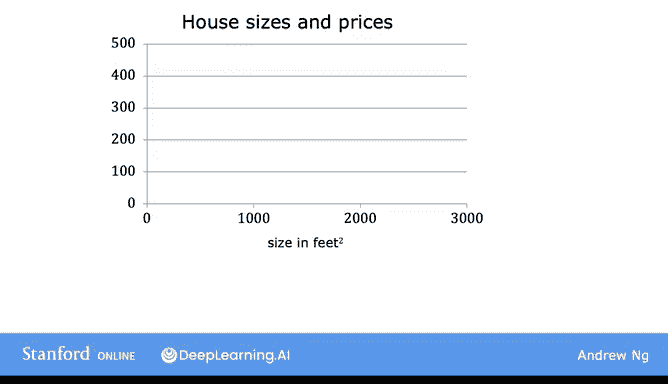

Let's go ahead and plot the data points for various houses in the data。Here at each data point。

 each of these little crosses is a housese with a size and the price that it most recently was sold for。

Now， let's say you're a real estate agent in Portland and you're helping a client sell her house。

 and she's asking you， how much do you think you're going get for this house？

This data set might help you estimate the price she could get for it。

You start by measuring the size of thehull， and it turns out that herhu is 1250 square feet。

 How much do you think this house could sell for。One thing you could do is you can build a linear regression model from the dataset set。

 your model will fit a straight line to the data， which might look like this。

And based on this straight line fit to the data， you can kind of see that if a house is 1。

250 square feet。It will intersect the bested line over here。

And if you trace that to the vertical axis on the left， you can see the prices may around here。

 say about $220，000。 So this is an example of what's called a supervised learning model。

 We call this supervised learning because you are first training your model by giving a data that has the right answers because you give the model examples of houses with both the size of the house as was the price that the model should predict for each house。

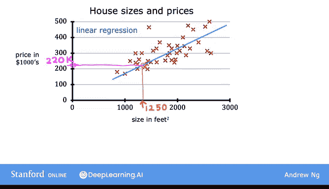

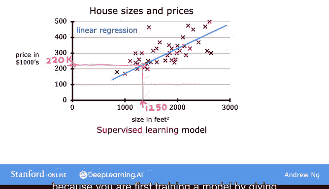

Where here the prices that is the right answers are given for every house in the data set。

This linear regression model is a particular type of supervised learning model。

 is color a regression model because it predicts numbers as the output like prices and dollars。

 Any supervised learning model that predicts a number such as 220000 or 1。5 or negative 33。

2 is addressing what's called a regression problem。

 So linear regression is one example of a regression model but there are other models for addressing regression problems 2。

 and we'll see some of those later in course 2 of this specialization。

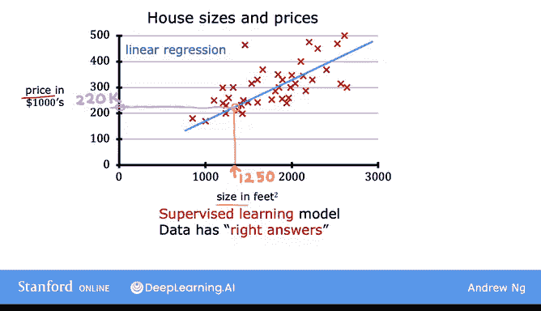

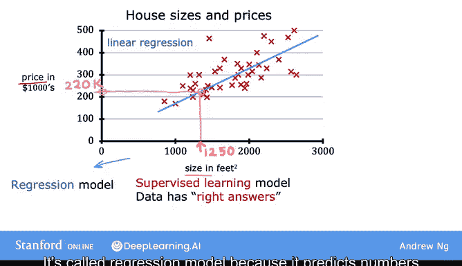

And just to remind you， in contrast with the regression model。

 the other most common type of supervised learning model is called a classification model。

 a classification model predicts categories or discrete categories such as predicting if a picture is of a cat miow or a dog wolf。

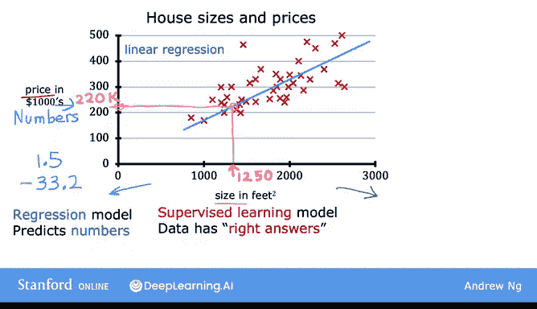

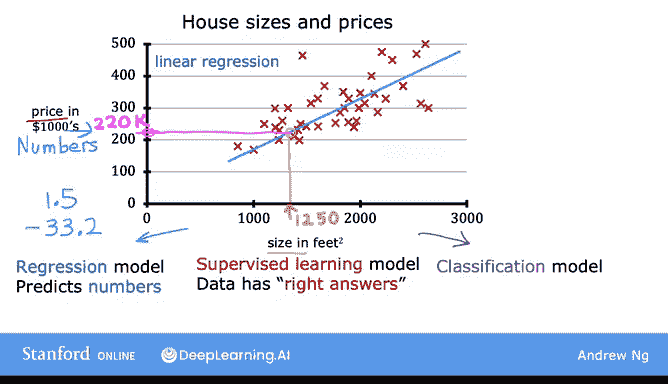

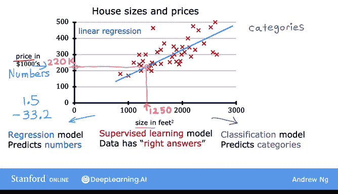

Or if given the medical record， it has to predict if a patient has a particular disease。

You see more about classification models later in this course as well。

 so as a reminder about the difference between classification and regression， in classification。

 there are only a small number of possible outputs if your model is recognizing cat's versus dogs that's two possible outputs or maybe you're trying to recognize any of 10 possible medical conditions in a patient。

So if there's a discrete finite set of possible outputs， we call it a classification problem。

 whereas in regression there are infinitely many possible numbers that the model could output。

In addition to visualizing this data as a plot here on the left。

There's one other way of looking at the data that would be useful。

 And that's a data table here on the right。 The data comprises a set of inputs。

 This would be the size of the house， which is this column here。

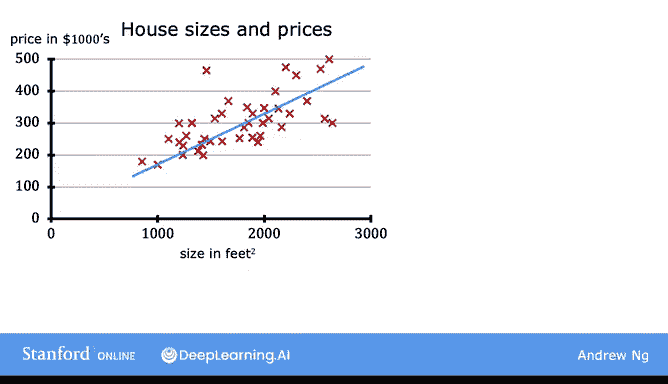

It also has outputs。 You're trying to predict the price， which is this column here。

Notice that the horizontal and vertical axis correspond to these two columns， the size。

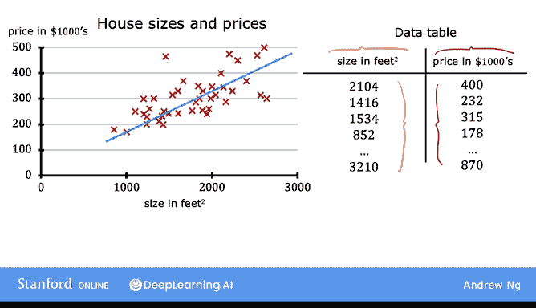

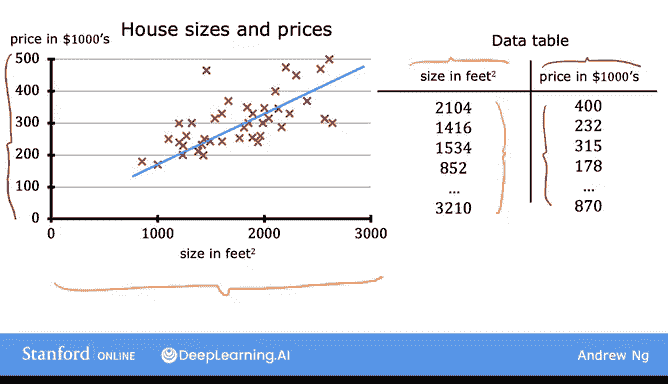

And the price。And so if you have， say，47 rows in this data table。

 then there are 47 of these lower crosses on the plot of the left。

 each cross corresponding to one row of the table。

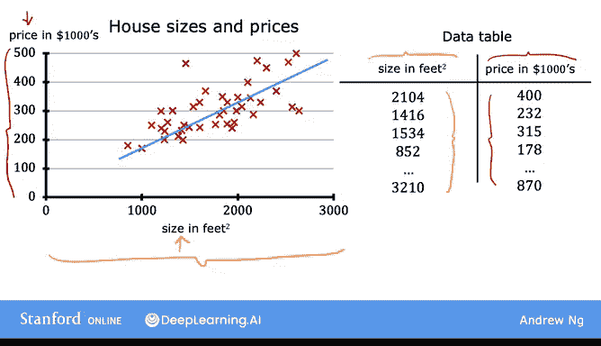

For example。The first row of the table is a house with size 2104 square feet。 So that's。

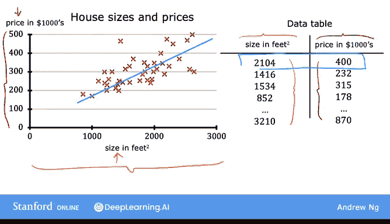

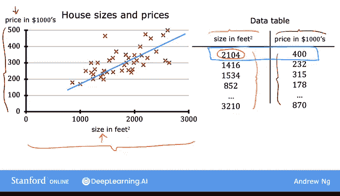

Around here。And this house sold for $400，000， which is around here。

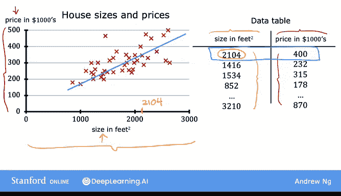

So this first row of the table is plotted as this data point over here。

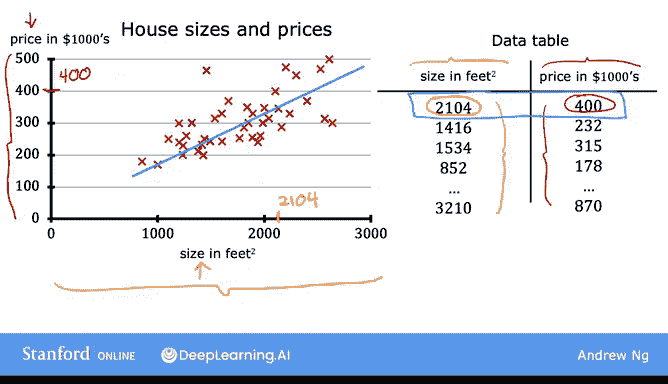

Now， let's look at some notation for describing the data。

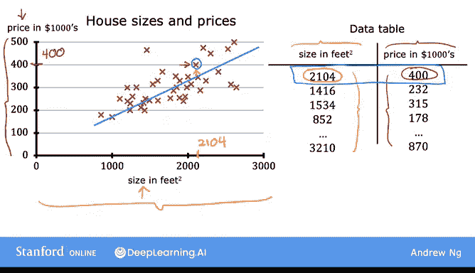

This is notation that you find useful throughout your journey in machine learning。

As you increasingly get familiar with machine learning terminology。

 this would be terminology that you can use to talk about machine learning concepts with others as well。

 since a lot of this is quite standard across AI。You' be seeing this notation multiple times into specialization。

 so it's okay if you don't remember everything the first sign through。

 it will naturally become more familiar over time。The data that you just saw and that is used to train the model is called a training set。

Note that your client's Hu is not in this data set because it's not yet sold。

 so no one knows what this price is。So to predict the price of your client's health。

 you first train your model to learn from the training set and that model can then predict your client's health's price。

In machine learning， the standard notation to denote the input here is lowercase X。

 and we call this the input variable is also called a feature or an input feature。For example。

 for the first house in your training set， x is the size of the house， so x equals 2，104。

The standard notation to denote the output variable， which you're trying to predict。

 which is also sometimes called the target variable， is lowercase y。And so here。

 why is the price of thehu？And for the first chain example， this is equal to 400。 So y equals 400。

So the data has one row for each house， and in this bi training set。

 there are 47 rows with each row representing a different training example。

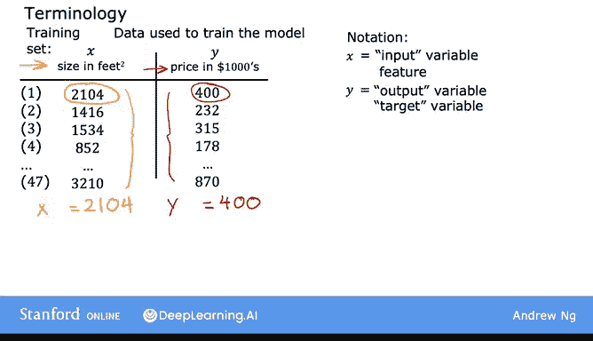

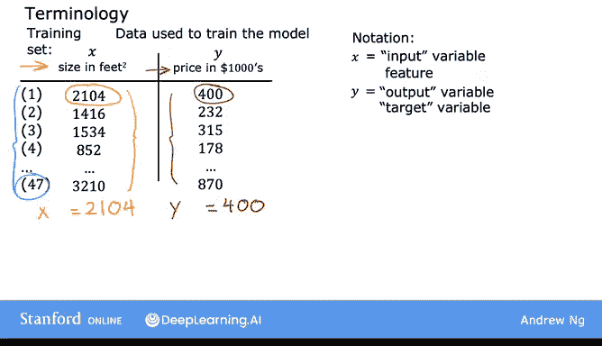

We're going to use lowercase M to refer to the total number of training examples。

 and so here M is equal to 47。

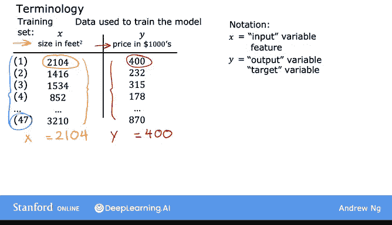

To indicate a single training example， we're going to use the notation parentheses x comma y。

 So for the first training example， x comma Y， this pair of numbers is 2，104， comma 400。

Now we have a lot of different training examples， we have 47 of them in fact。

 so to refer to a specific training example， this will correspond to a specific row in this table on the left。

I'm going to use the notation x superscript in parentheses I comma， Y superscript in parentheses I。

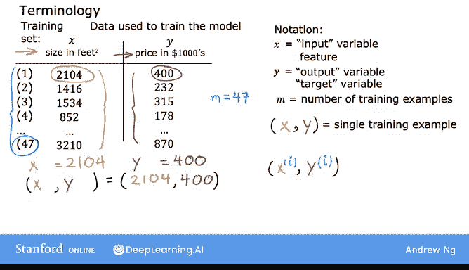

The superscript tells us that this is the IF training example。Such as。The first。

 second or third up to the 47th training is Apple。I here refers to a specific row in the table。

So for instance， here is the first example。When I equals one in the training set。

And so x super strip1。Is equal to 2104。 and y superscript 1 is equal to 400。

And let's add the superscript one here as well。Just a note。

 this super stripped eye in parentheses is not exponentation。 so when I write this。

This is not X squared。This is not X power 2。 It just refers to the second training example。

 So this I is just an index in the training set and refers to row I in the table。

In this video you saw what a training set is like as well a standard notation for this driving this training set in the next video let's look at what it'll take to take this training set that you just saw and feed it to learning algorithm so that the algorithm can learn from this data Let's see that in the next video。

