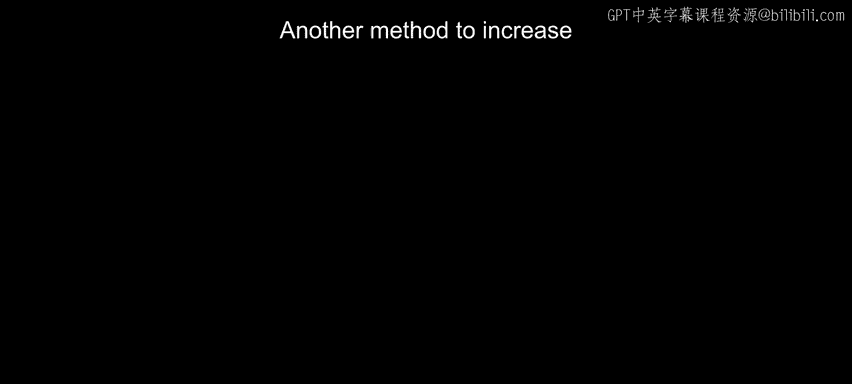
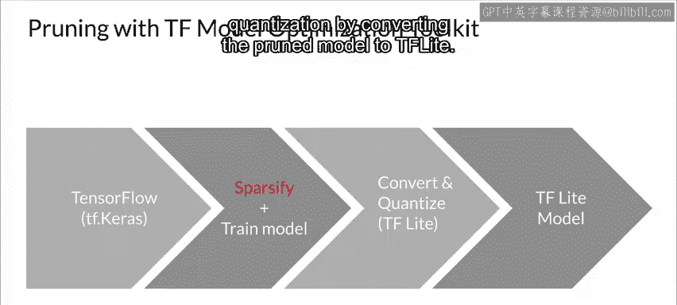
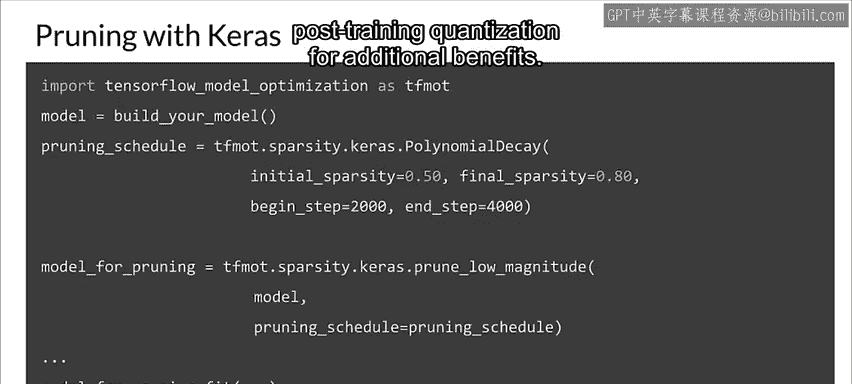
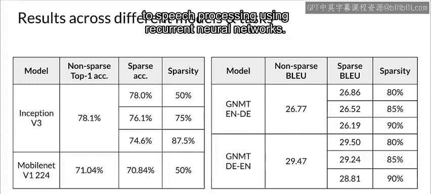

# 吴恩达《机器学习工程师的生产实践（MLOps）Machine Learning Engineering for Production》中英字幕 - P100：22_剪枝.zh_en - GPT中英字幕课程资源 - BV1pi4y167g5

Another method to increase the efficiency of models is to remove parts of the model that did not contribute substantially to producing accurate results。

 This is referred to as pruning。 Let's discuss that Now。

 Opimizing machine learning programs can take several different forms。 Fortunately。

 neural networks have proven resilient to various transformations aimed at the goal。

When you consider more extensive neural networks with more layers and nodes。

 reducing their storage and computational cost becomes critical。

 especially for some real time applications。Model compression can be used to address this problem as machine learning models were pushed into embedded devices like mobile phones。

 compresspressing neural networks grew in importance。

 Pruning and deep learning is a biologically inspired concept that we'll discuss next。😊。

Pruning aims to reduce the number of parameters and operations involved in generating a prediction by removing network connections。

 so with pruning you can lower the overall parameter count in the network。

Networks generally look like the one on the left。Here。

 every neuron in a layer has a connection to the layer before it。

 But this means we have to multiply a lot of floats together。Ideally。

 we only connect each neuron to a few others and save on doing some of the multiplications。

 if we can find a way to do that without too much loss of accuracy。

That's the motivation behind pruning。Connection sparsity has long been a foundational principle in neuroscience research。

 and as it is one of the critical observations about the neocortex。Everywhere you look in the brain。

 the activity of neurons is always sparse， but common neural network architectures have a lot of parameters。

 which generally aren't sparse。 Take， for example， Resnet 50。 It has almost 25 million connections。

This means that during training we need to adjust 25 million weights。

 doing that is relatively costly to say the least。So there is a need to fix this somehow。

 The story of sparsity in neural networks starts with pruning。

 which is a way to reduce the size of the neural network through compression。

So reducing the number of parameters would have several benefits。

A sparse network is not only smaller， but it is also faster to train and use。

 where hardware is limited， such as in embedded devices or smartphones。

 speed and size can make or break a model。 Also， more complex models are more prone to overfitting。

 So in some sense， restricting the search space can also act as a regularizer。However。

 even when all that' said， it's not a simple task， since reducing the model's capacity can also lead to a loss of accuracy。

So as in many other areas， there is a delicate balance between complexity and performance。Now。

 let's take a more in depth look at some of the challenges and potential solutions。

Let's start with a little history。The first major paper advocating Sprsity in neural networks dates back from 1990。

 written by Janon Lacoon， John S。 Denker and Sarah A Sala。

 and was given the rather provocative title of Op brain damage。At the time。

 post pruning neural networks was to compress trained models was already a popular approach。

Pruning was mainly done by using magnitude as an approximation for saliency to determine less useful connections。

 The intuition being that smaller magnitude weights have a smaller effect in the output and hence。

 are less likely to have an impact in the model outcome， if pruned。

It was a sort of iterative pruning method， the first step was to train a model and then the salliency of each weight was estimated。

 which was defined by the change in the loss function upon applying a perturbation to the nus in the network。

The smaller the change， the less the effect the weight would have on the training。Finally。

 they eliminate the weights with the lowest salliency。This is equivalent to setting them to zero。

Finally， this pruned model was retrained。One particular challenge arises with this method when the prune network is retrained。

It turned out that due to its decreased capacity， retraining was much more difficult。

The solution to his problem arrived later， along with an insight called the lottery ticket hypothesis。

The probability of winning the jackpot of a lottery is very low。For example。

 if you're playing powerball， you have odds of exactly one in about3 million for the winning ticket what are your chances if you purchase N tickets？

So if the probability of winning is one over three million， right？

Then what about the chances of not winning， it's the complement of1 minus P。

Extend this when buying n tickets and we have the probability of 1 minus P to the power of N。

From this， it follows that the probability of at least one of them winning is simply the compliment again。

 What does this have to do with neural networks。Before training。

 the weights of a model are initialized randomly。Can it happen that there is a sub network of a randomly initialized network which won the initialization lottery？

Some researchers set out to investigate the problem and answer the question。 Most notably。

 Frankel and Carbon in 2019 found that fine tuning the weights after training was not required for these new prune networks。

In fact， they showed that the best approach was to reset the weights to their original value and then retrain the entire network。

 This would lead to models with even higher accuracy compared to both the original dense model and the post pruning plus fine tuning approach proposed by Han and colleagues。

This discovery LED them to propose an idea considered wild at first。

 but now commonly accepted that over parameterized dense networks containing several sparse sub networks with varying performances and one of these sub networks is the winning ticket。

 which outperforms all others。However， there were significant limitations to this method。 For one。

 it does not perform well for larger scale problems and architectures。 in the original paper。

 the authors stated that for more complex data sets like imagenet and deeper architectures like Resnet The method fails to identify the winners of the initialization lottery in general。

 achieving a good sparsity accuracy trade off is a difficult problem is a very active research field and the state of the art keeps improving。

Tensorflow includes a kis based weight pruning API， which uses a straightforward。

 yet broadly applicable algorithm designed to iteratively remove connections based on their magnitude during training。

Fundamentally， a final target's varsity is specified， along with a schedule to perform the pruning。

In this figure， you can see that during training， a pruning routine will be scheduled to execute。

 removing the weights with the lowest magnitude values that are closest to 0 until the current sparsity target is reached。

Every time the pruning routine is scheduled to execute。

 the current sparsity target is recalculated starting from 0% until it reaches the final target sparsity at the end of the pruning schedule by gradually increasing it。

 according to a smooth ramp up function。Just like the schedule。

 the ramp up function can be tweaked as needed。 For example， in certain cases。

 it may be convenient to schedule the training procedure to start after a certain step when some convergence level has been achieved or end pruning earlier than the total number of training steps in your training program to further finet the system at the final target sparsity level。

 Sprsity increases as training proceeds。 So you need to know when to stop。

That means at the end of the training procedure， the tensors corresponding to the pruned carerous layers will contain zeroes where weights have been pruned。

 according to the final sparsity target for the layer。

 An immediate benefit that you can get out of pruning is disc compression。

 That's because sparse tensors are compressible。Thus。

 by applying simple file compression to the prune Tensorflow checkpoint or the converted Tensorflow light model。

 we can reduce the size of the model for storage and or transmission in some cases you can even gain speed improvements in CPU and machine learning accelerators that exploit integer precision efficiencies。

Moreover， across several experiments， we found that weight pruning is compatible with quantization。

 resulting in compound benefits。In the upcoming exercise。

 we show we can further compress the prune model from two megabytes to just about half of a megabyte by applying post training quantdization。

In the relatively near future， Tenserflow light will add first class support for sparse representation and computation。

 thus， expanding the compression benefit to runtime memory and unlocking performance improvements。

 Since sparse tensors allow you to skip otherwise unnecessary computations involving the zeroed values。

😊，Or depending on when you're watching this， it may already be included。To use the pruning API。

 you first create a TensorFlow CAis model。Then we add sparsity to some of the layers in the model and retrain it or train it。

Finally， you can also reap the benefits of quantitization by converting the pruned model to TF light。

Let's apply pruning to the whole model in this example， you start with 50% sparsity。

 so 50% zeros in weights and end up with 80% sparsity。

You can also prune only a part of the model or specific layers for model accuracy improvements。

 Later， you'll see how to create sparse models with the Tensorflowlow Model optimization toolkit API for both Tensorflowlow and TF light。

 You then combine pruning with post training quantization for additional benefits。

Also， this technique can be successfully applied to different types of models across distinct tasks。

 from image processing convolutional based neural networks to speech processing using recurrent neural networks。

 This table shows some of these experimental results。😊。

Well， that was quite a week。 We started with understanding dimensionality and looked at a few ways to control it and reduce it。

Then we went into some resource constrain scenarios， including mobile and Io applications。

 We looked at some of the issues around that and ways to deal with that as well。

 including quantization of a couple of different kinds and pruning。 I hope you enjoyed it。

 I thought it was a great week and we'll see you next time。😊。

