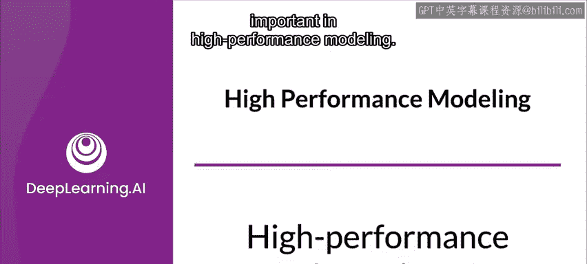
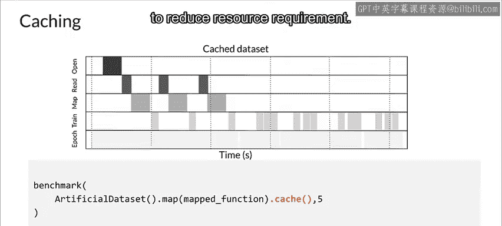

# 吴恩达《机器学习工程师的生产实践（MLOps）Machine Learning Engineering for Production》中英字幕 - P102：24_高性能数据输入.zh_en - GPT中英字幕课程资源 - BV1pi4y167g5

Accellererators are a key part of high performance modeling， training and inference。

But accelerators are also expensive， so it's important to use them efficiently。

That means keeping them busy， which requires you to supply them with enough data fast enough。

 That's why high performance ingestion is important in high performance modeling。 Let's discuss that。

 now。

So let's discuss why input pipelines are often needed for training models and the issues around applying transformations on data。

 General， transformations deal with preprocessing tasks that tend to add overhead to your training input pipeline。

 for example， when augmentbetting huge image classification data sets。

 Many of these transformations are often applied element wise As a result。

 if it takes too long to apply transformations， this can lead to the CPU being underutilized while it waits for data。

And it's not just limited to the transformations at times you could have data that simply cannot fit into memory。

 and it often becomes a challenge to build a scalable input data pipeline that will feed your data fast enough to keep your training processors busy。

In the end， the goal should be to efficiently utilize the hardware available and reduce the time required to load the data from the disk and also reduce the time required for pre processing it。

Input pipelines are an important part of many training pipelines。

 but there are often similar requirements for inference pipelines as well。

In the larger context of a training pipeline such as a TFX training pipeline。

 a high performance input pipeline would be part of the trainer component and possibly other components like transform that may need to do quite a bit of work on the data。

There are many ways to design an efficient input pipeline。

 One framework that can help is Tensorflow data or TF do data。

 Let's consider TF data as an example of how to design an efficient input pipeline。

 You can view input pipelines as an ETL process， providing a framework to facilitate applying performance optimization。

The first step involves extracting data from data stores that may be either local or remote。

 like hard drives， SSDs， cloud storage and HDFs。 In the second step。

 data often needs to be pre processed。 This includes shuffling， batching and repeating data。

The way you order these transformations may have an impact on your pipeline's performance。

 This is something that you need to be aware of when using any data transformation like map or batch or shuffle or repeat and so forth。

You then all the pre process data into the model， which may be training on a GPU or TU and start training。

A key requirement for high performance input pipelines is to parallel processing of data across the various systems to try to make maximum efficient use of the available compute IO and network resources。

 especially for more expensive components such as accelerators。

 you want to keep them busy as much as possible。Let's look at a typical pattern that is easy to fall into and one that you really want to avoid。

In this scenario， key hardware components， including CPUs and accelerators sit idle。

 waiting for the previous steps to complete。If you think about it， ETL， extract， transform and load。

 is a good mental model for data performance。Now， to give you some intuition on how pipelining can be carried out。

 each of the different phases of ETL use different hardware components in your system。

Your extract phase is exercising your disc。Your network， you're loading for a remote system。

Transform typically happens on the CPU and can be very CPU hungry。

The load phase is exercising the DMMA or direct memory access subystem and the connections to your accelerator。

 probably a GPU or TPU。Now， this is a much more efficient pattern than the previous one。

 although it's still not quite optimal。In practice。

 this kind of pattern may be difficult to optimize further in many cases。

As this diagram shows by parallelzing operations， you can overlap the different parts of ETL using a technique known as software pipelining with software pipelining。

 you're extracting data for step 5 while you're transforming for step4 and while you're loading data for step 3。

 and finally you're training for step 2 all at the same time。

This results in a very efficient use of your compute resources。As a result。

 your training is much faster and your resource utilization is much higher。

 Notice that now there are only a few instances where your hard drive and CPU are actually sitting idle。

Through pipelining or training procedure， you can overcome CPU bottlenecks by overlapping the CPU preprocessing and model execution of accelerators while the accelerator is busy with training the model in the background。

 the CPU starts preparing data for the next training step you can see there's a significant improvement in model training time when using pipelinelining while you can still expect some idle time。

 it's greatly reduced by using pipelinelining， So how do you optimize your data pipeline in practice。

😊，There are a few basic approaches that could potentially be used to accelerate your pipeline。

Prefeing， for example， where you begin loading data for the next step before the current step completes other techniques involve parallelzizing data extraction and transformation。

Cashching the data set to get started with training immediately once a new epic begins is also a very effective when you have enough cash。

 Finally， you need to be aware of how you order these optimizations in your pipeline to maximize the pipelines and efficiency with prefetching。

 you overlap the work of a producer with the work of a consumer。While the model is executing step S。

 the input pipeline is reading the data for step S+1。

This reduces the total time it takes for a step to either train the model or extract data from disk。

 whichever is highest， the T data API provides the TF data data set prefetch transformation。

This you can use this to decouple the time when data is produced from the time when the data is consumed。

 This transformation uses a background thread and an internal buffer to prefetch elements from the input data set ahead of time before they are requested Idely。

 the number of elements to prefet should be equal to or possibly greater than the number of batches consumed by a single training step。

You could either manually tune this value or set it to TF data experimental autotune。

 as in this example， which will configure the TF data runtime to optimize the value dynamically at runtime。

In a real world setting， the input data may be stored remotely， for example， on GCS or ACFS。

A data set pipeline that works well when reading data locally might become bottlenecked on IO when reading data remotely because of the following differences between local and remote storage。

Time to first bitete Well， reading the first bitete of a file from remote storage can take orders of magnitude longer than from local storage。

Read throughput again， while remote storage typically offers large aggregate bandwidth。

 reading a single file might only be able to utilize a small fraction of this bandwidth。

 to reduce data extraction overhead， the TF data data set interlea transformation is used to parallelize the data loading step。

 including interleaving contents of other data sets。😊。

The number of data sets to overlap is specified by the cycle length argument。

 while the level of parallelism is set with the numb parallel calls argument。

Similar to the prefiitch transformation， the Interlea transformation supports TF data experimental autotune。

 which will delegate the decision about what level of parallelism to use for the TF data runtime。

When preparing data， input elements may need to be pre processcessed。For example。

 the TF data API offers the TF data data map transformation。

 which applies a user defined function to each element of the input dataset。

Element wise preprocessing can be parallelized across multiple CPU cores。

Similar to the prefetch and inner leave transformations。

 the map transformation provides the numb parallel cause argument to specify the level of parallelism。

Choosing the best value for the non parallel calls argument depends on your hardware。

 the characteristics of your training data such as size and shape。

The cost of your map function and what other processing is happening on the CPU at the same time。

A simple heuristic is to use the number of available CPU cores， however。

 as with prefetch interly transformations， the map transformation in TF data supports the TF data experimental autotune parameter。

Which will delegate the decision about which level of parallelism to use for the TF data runtime。

Let's see what happens when you apply preprocess in parallel on multiple samples。Here。

 the pre processing steps overlap， reducing the overall time for a single iteration。

 This can potentially be a big win Here， you implement the same pre processing function。

 but apply it in parallel on multiple samples。 T F data data set includes the ability to cache a data set。

 either in memory or on local storage。 In many instances。

 Caching is advantageous and leads to increased performance。😊。

This will save some operations like file opening and data reading from being executed during each E When you cache a data set。

 the transformations before caching like file opening and data reading are executed only during the first E。

 the next Es will reuse the cache data。Let's consider two scenarios for caching。

If the user defined function passed into the map transformation is expensive。

That it makes sense to apply the cast transformation after the map transformation。

 as long as the resulting data set can fit into memory or local storage。On the contrary。

 if the user defined function increases the space required to store the data set beyond the cache capacity。

Either apply it after cash transformation or consider preprocessing your data before your training job to reduce resource requirements。

