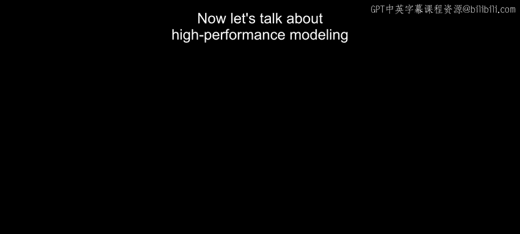
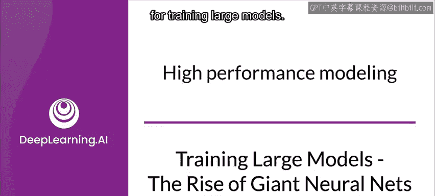
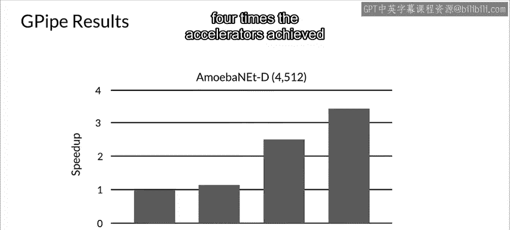

# 吴恩达《机器学习工程师的生产实践（MLOps）Machine Learning Engineering for Production》中英字幕 - P103：25_训练大型模型-巨型神经网络与并行化的兴起.zh_en - GPT中英字幕课程资源 - BV1pi4y167g5

Now let's talk about high performance modeling and some of the issues with increasingly large models。

 along with some advanced techniques for training large models。

In recent years， the size of machine learning data sets and models has been continuously increasing。

 allowing for improved results on a wide range of tasks， including speech recognition。

 visual recognition and language processing。 recent advances by Biggan Bt and G3 have shown that ever larger models lead to better task performance。

 At the same time， hardware accelerators like GPus and Tpus have also been increasing in power。

 but at a significantly slower pace。 The gap between model growth and hardware improvement has increased the importance of parallelism。

 parallelism in this context means training a single machine learning model on multiple hardware devices。

😊，Some model architectures， especially small models。

 are conducive to parallelism and can be divided quite easily between hardware devices。

In enormous models， synchronization costs lead to degraded performance。

 preventing them from being used。There's also a strong correlation between model size and classification accuracy。

 for example， the winner of the 2014 ImageNet Visual recognition challengege was GoogleNe。

 which achieved 74。8 top 1 accuracy with 4 million parameters。While just three years later。

 the winner of the 2017 imagenet challenge went to squeeze and excitation networks。

 which gained an 82。7 top 1 accuracy with a hundred and 45。8 million parameters。

 This was a 36 fold increase in the number of parameters in just three years。😊。

Massive numbers of weights and activation parameters require massive memory storage。

 So the natural question is， where to store them as the models continue to require more and more parameters。

In the last few years， memory capacity made very modest increases compared to model parameters growth。

 More concretely， TU memory has only increased by a factor of approximately three and the current state of the art image models have already reached the available memory found on cloud TpU V2s。

 So there is a strong and pressing need for an efficient scalable infrastructure that enables large scale deep learning and overcomes the memory limitations on current accelerators。

 But in some ways， this is not a new problem。 Let's look at how some older methods approach this problem of overcoming memory constraints。

 and see if we could apply them today。 And then let's look at some newer methods and some of the advances that they've been able to make。

😊，There is a need to strategize and implement solutions to overcome these important memory constraints。

 One strategy that can overcome problems with insufficient GPU memory is gradient accumulation。

Gradient accumulation is a mechanism to split full batches into several mini batches During backpro。

 the model isn't updated with each mini batch， and instead the gradients are accumulated when a full batch completes。

 the accumulated gradients of all the previous mini batches are used for backpro to update the model。

😊，This process is as effective as using a full batch for training the network since model parameters are updated the same number of times。

 the second approach is swapping here， since there isn't enough storage on the accelerator。

 you copy activations back to the CPU or memory and then back to the accelerator。

 The problem here is that it's slow and the communication between CPU or memory and the accelerator becomes the bottleneck。

😊，Returning to our discussion of parallelism， the basic idea is to split the computation between multiple workers。

 You've already seen two ways to parallelize data parallelism and model parallelism。

 Data parallelism splits the input across workers。 Model parallelism splits the model across workers in data parallelism。

 Different workers or GPus work on the same model， but deal with different data。

The model is replicated across a number of workers。

 and each worker performs the forward and backward path。 When it finishes the process。

 it synchronizes the updated model weights with the other devices and calculates the updated weights of the entire mini batch in model parallelism。

 However， workers only need to synchronize the shared parameters。

 usually once for each forward or back prop step。😊，Also。

 larger models aren't a major concern since each worker operates on a subsection of the model using the same training data。

When using a model parallelism in training， the model is divided across K workers with each worker holding a part of the model。

 a naive approach to model parallelism， its to divide an n layered neural network into K workers by simply hosting N over K layers on each worker。

More sophisticated methods make sure that each worker is similarly busy by analyzing the computational complexity of each layer。

Standard model parallelism enables training of larger neural networks。

 but suffers from a large hit in performance since workers are constantly waiting for each other and only one can perform updates at a given time。

Moving back to data parallelism， let's look at some benchmarks。

 This chart shows communication overhead as a percentage of total training time for three different hardware configurations。

Many models like AlexNe and VG G16， have a high communication overhead。

 even on the relatively slow K80 accelerator， Two factors contribute to an increase in the communication overhead across all models。

 and increase in the number of data parallel workers and an increase in GPU compute capacity。

 with data parallelism， The input data set is partitioned across multiple GPus。

 Each GPU maintains a full copy of the model and trains on its own partition of data while periodically synchronizing weights with other GPus。

 using either collective communication primitives or parameter servers。

 The frequency of parameter synchronization affects both statistical and hardware efficiency。

 synchronizing at the end of every mini batch reduces the staless of weights used to compute gradients ensuring good statistical efficiency。

 Unfortunately， this required。😊，Each GPU to wait for gradients from other GPs。

 which significantly lowers hardware efficiency。Communication stalls are inevitable in data parallel training due to the structure of neural networks。

 and the result is that communication can often dominate total execution time。

Rapid increases in accelerator speeds further shift the trading bottleneck towards communication。

 And then there's another problem。 Acccelerators， they have limited memory and limited communication bandwidth on the host machine。

 That means that model parallelism is needed for trading bigger models on accelerators by dividing the model into partitions and assigning different partitions to different accelerators。

 But due to the sequential nature of neural networks。

 its naive strategy may result in only one accelerator being active during computation Sign under utilizing accelerator compute capacity。

 On the other hand， a standard data parallelism approach allows concurrent training of the same model with different input data on multiple accelerators。

😊，But cannot increase the maximum model size an accelerator can support。

The issues with data and model parallelism have LED to the development of pipeline parallelism。

 In this diagram， a naive model parallelism strategy leads to severe under utilization due to the sequential nature of the model。

Only one accelerator is active at a time。To enable efficient training across multiple accelerators。

 you need to find a way so that you can partition a model across different accelerators and automatically split a mini batch of training examples into smaller micro batches。

By pipeing execution across micro batches， accelerators can operate in parallel。 In addition。

 gradients are consistently accumulated across micro batches so that the number of partitions does not affect model quality。

Google's G pipe is an open source library for efficiently training large scale models using pipeline parallelism。

In the diagram at the bottom， G pipe divides the input mini batch into smaller micro batches。

 enabling different accelerators to work on separate micro batchches at the same time。

GP essentially presents a new way to approach model parallelism。

 which allows training of large models on multiple hardware devices with an almost one to one improvement in performance。

It also helps models include significantly more parameters， allowing for better results in training。

There's also pipepe dreamam from Microsoft， which also supports pipeline parallelism。

 G pipe and pipe dreamam are similar in many ways。Pipeline parallelism frameworks such as G pipepe and pipepe dream integrate both data and model parallelism to achieve high efficiency and preserve model accuracy。

 They do that by dividing mini batches into smaller micro batches by allowing different workers to work on different micro batches in parallel。

As a result， they can train models with significantly more parameters。

 G pipe is an open source distributed machine learning library that uses synchronous mini batch gradient descent for training。

It partitions a model across different accelerators and automatically splits a mini batch of training examples into micro batches by pipelining the execution across micro batchches。

 accelerators can train in parallel。GP receives as input and architecture of a neural network。

On mini batch size and the number of hardware devices that will be available for the calculation。

It then automatically divides the network layers into stages and the mini batchches into micro batchches。

 spreading them across the devices to divide the model into K stages。

 G pipe estimates the cost of each layer， given its activation function and the content of the training data。

 G pipe attempts to maximize memory allocation for model parameters。

 The research team at Google ran experiments on cloud TPU V2s。

 each of which has8 accelerator cores and 64 GB of memory，8 GB per accelerator。😊，Without G pipe。

 a single accelerator can only train up to 82 million model parameters due to memory constraints。

Thanks to recomputation in back propagation and batch splitting。

 G pipe reduced intermediate activation memory from 6。2 GB to 3。4 GB。

 enabling a single accelerator to train up to 318 million parameters。

 They also saw that with pipeline parallelism， the maximum model size was proportional to the number of partitions。

 as expected。😊，With G pipe testing with an amoeba net model was able to incorporate 1。

8 billion parameters on the eight accelerators of the cloud TPU。

25 times more than is possible without G pipe to test efficiency。

 they measured the effects of G pipe on the throughput of an amoebonnet D model。

Since trading required at least two accelerators to fit the model size。

 they measured the speed up with respect to the naive case with two partitions。

 but no pipeline parallelism。They observed an almost linear speed up in training compared to the naive approach with two partitions distributing the model across four times the accelerators achieved a speed up of 3。

5 times。

