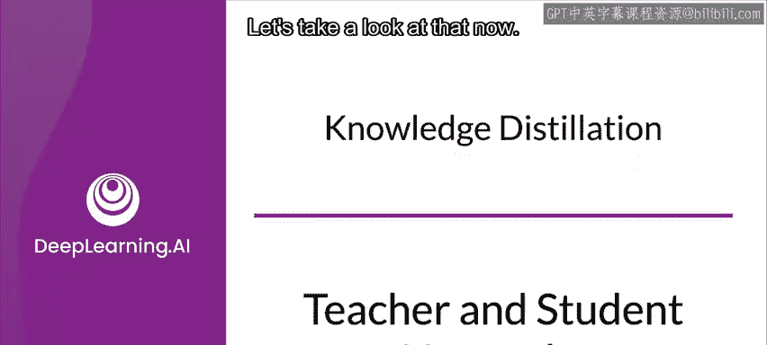
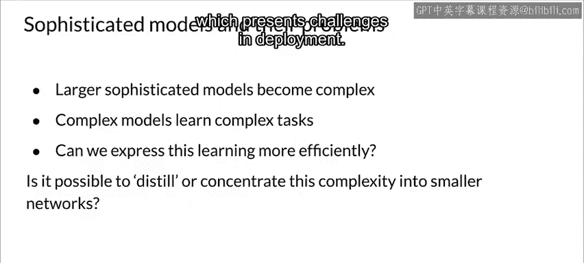
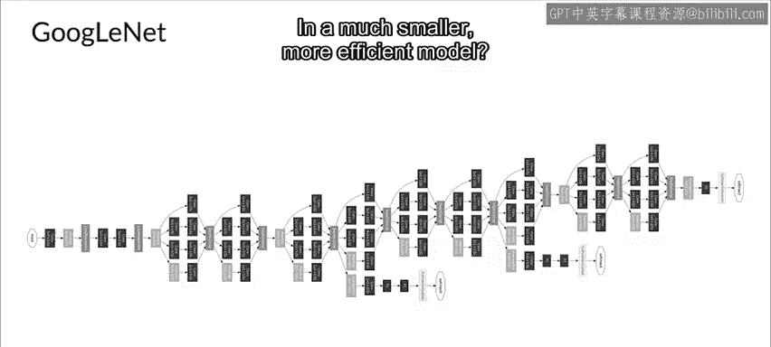
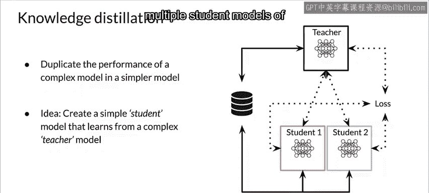

# 吴恩达《机器学习工程师的生产实践（MLOps）Machine Learning Engineering for Production》中英字幕 - P104：26_教师与学生网络.zh_en - GPT中英字幕课程资源 - BV1pi4y167g5

So far， we've discussed ways to optimizeim the implementation of models to make them more efficient。

 but you can also try to capture or distill the knowledge that has been learned by a model in a more of compact model by using a different style of training。

 This is known as knowledge distillation。 let's take a look at that。 Now， By now。

 you've seen a few different ways to optimize your models。

But what happens if you want to deploy a model that is relatively complex and significantly large in size would merely reducing the number of parameters help with deployment or would reducing the model complexity help you deploy these larger。

 more powerful models。Let's try to answer those questions For starters。

 Let's look at how larger models become complex and try to find out whether it's possible to have the same level of sophistication with smaller models。

Models tend to become larger and more complex as they try to capture more information or knowledge in order to learn complex tasks。

But if we can express or represent this learning more efficiently。

 we might be able to create smaller models that are equivalent to these larger， more complex models。

As an example， let's take a look at a complex image classification model which presents challenges in deployment。

For example， let's take a look at Googlegglenet。It's such a deep and complex network that it doesn't even fit on this slide。

The fact that it is so deep gives it the ability to express complex relationships between features。

 but because it's so large it's difficult or impossible to deploy it in many production environments。

 including mobile phones and edge devices。But can you have the best of both worlds and capture the knowledge contained in a complex model like Googleglat in a much smaller。

 more efficient model。 That's the goal of knowledge distillation。

 rather than optimizing the network implementation。

 as we saw with quantization and pruning knowledge distillation。

 seeks to create a more efficient model， which captures the same knowledge as a more complex model。

 If needed， further optimization， can then be applied to the result。😊。

Knowledge dissillation is a way to train a small model to mimic a larger model or even an ensemble of models。

It starts by first training a complex model or model ensemble to achieve a high level of accuracy。

 It then uses that model as a teacher for a simpler student model。

 which will then be the actual model that gets deployed to production。

This teacher network can be either fixed or jointly optimized and can even be used to train multiple student models of different sizes simultaneously。

