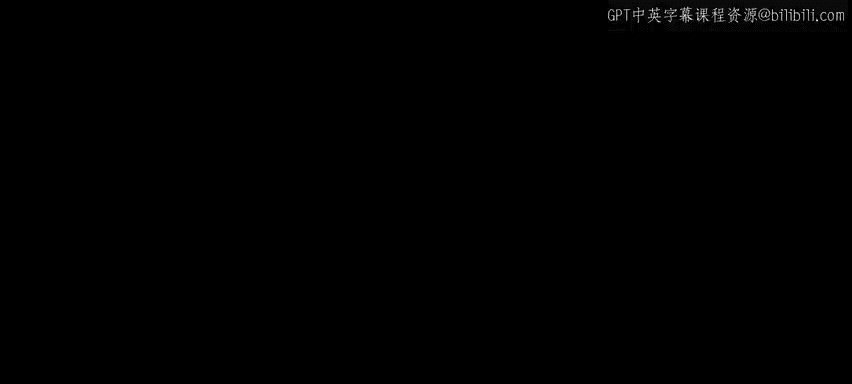
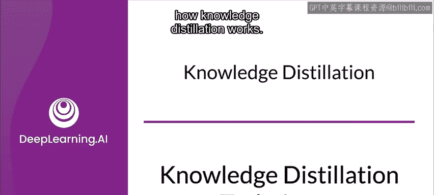
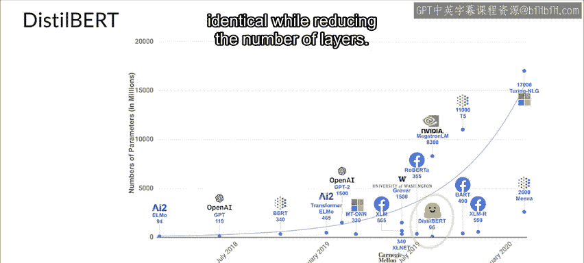

# 吴恩达《机器学习工程师的生产实践（MLOps）Machine Learning Engineering for Production》中英字幕 - P105：27_知识蒸馏技术.zh_en - GPT中英字幕课程资源 - BV1pi4y167g5

Let's take a deeper look at how knowledge distillation works。

 Knowledge disstillation introduces the idea of a teacher model and a student model。

 Let's discuss the roles of the teacher and student in knowledge distillation。

In knowledge distillation， the training objective functions for the student and the teacher are different。

The teacher will be trained first using a standard objective function that seeks to maximize the accuracy or a similar metric of the model。

 This is normal model training。The student then seeks transferable knowledge。

So it uses an objective function that seeks to match the probability distribution of the predictions of the teacher。

Notice that the student is not just learning the teacher's predictions。

 but the probabilities of the predictions， the probabilities of the predictions of the teacher form soft targets which provide more information about the knowledge learned by the teacher than the resulting predictions themselves。

Don't worry， Knowledge dissillation is not one of the dark arts， but it does involve dark knowledge。

 Let's discuss that Now， the way knowledge dissillation works is that you transfer knowledge from the teacher to the student by minimizing a loss function。

 which the target is the distribution of class probabilities predicted by the teacher model。

What happens here is that the teacher model's logicits form the input to the final softm layer。

 which is often used since they provide more information about the probabilities of all target classes for each example。

 However， in many cases， this probability distribution has the correct class at a very high probability with all the other class probabilities very close to zero。

 So realistically， it sometimes doesn't provide much information。

 beyond the ground truth labels already provided in the dataset set。😊，To tackle this issue， Hinton。

 Viigns and Dean introduced the concept of a soft max temperature。

By raising the temperature in the objective functions of the student and teacher。

 you can improve the softness of the teacher's distribution。In the formula here。

 the probability P of class I is calculated from the logicits Z as shown。

 T simply refers to the temperature parameter。 So when T is one， you get the standard softm function。

 but as T starts growing， the probability distribution generated by the softm function becomes softer。

 providing more information as to which classes the teacher found more similar to the predicted class。

The authors call this the dark knowledge embedded in the teacher model。

 and it is this dark knowledge that you are transferring to the student model in the distillation process。

Various techniques are used to train the student to match the teacher's soft targets。In one approach。

 the student is trained on both the teacher's logics and the target labels using a normal objective function。

 and the two objective functions are weighted and combined in back propagation in another similar approach。

 the distributions of the student' predictions and the teacher's predictions are compared using a metric such as KL diversions。

Let's look at the second technique now， since it's more widely used。Generally。

 knowledge dissillation is done by blending two loss functions。

 choosing a value for alpha between 0 and 1。 Here， L is the cross entropy loss from the hard labels。

 and L K L is the Kobeach lieebler divergence loss from the teacher's los。

In case of heavy augmentation， you simply cannot trust the original hard labels due to the aggressive perturbations applied to data。

The Colback Ller divergence here is a metric of the difference between two probability distributions。

You want those two probability distributions to be as close as possible。

 so the objective here is to make the distribution over the classes predicted by the student as close as possible to the teacher。

When computing the loss function versus the teacher's soft targets。

 you use the same value of T to compute the softm on the student's logics。

This loss is the distillation loss。 The authors also found another interesting behavior。

 It turns out that distilled models are able to produce the correct labels in addition to the teacher's soft targets。

 So that means that you can calculate the standard loss between the students's predicted class probabilities and the ground truth labels。

 These are known as hard labels or targets。 This loss is the student loss。

 So when you're calculating the probabilities for the student。

 you set the soft mix max temperature to one。😊，The first quantitative results of applying knowledge disillation were promising。

Hinton and his colleagues trained 10 separate models for an automatic speech recognition task using the same architecture and training procedure as the baseline automatic speech recognition tasks at the time relied on deep neural networks to map a short。

 temporal context of features derived from the waveform to a probability distribution over the discrete states of a hidden markov model。

For the models， they randomly initialized their weights with different initial parameter values。

 This was essentially done so that there was enough diversity in the trained models。

When averaging the ensemble's predictions， they would outperform the single models with ease。

 They also considered varying the sets of data that each model sees。

 but they found that it wouldn't significantly impact the results。

 So they decided to use this more straightforward strategy of comparing an ensemble of models against a single model。

For the distillation process， they tried different values for the softm temperature， like 1，2。

5 and 10。 They also used a relative weight of 0。5 on the cross entropy for the hard targets。

This table shows that distillation can indeed extract more useful information from the training set than merely using the hard labels to train a single model。

 More than 80% of the improvement in accuracy achieved by an ensemble of 10 models is transferred to the distilled model。

😊，The ensemble gives a smaller gain on the ultimate objective of word error rate on a 23 K word test set due to the mismatch in the objective function。

 Still， again， the increase in the word error rate achieved by the ensemble is transferred to the distilled model。

 with this they were able to show that the strategy of distilling models is indeed beneficial and can be used to achieve the desired effect of distilling an ensemble of models into a single model that works significantly better than a model of the same size that is learned directly from the same training data。

😊，In the real world， though。People are more interested in deploying a low resource model with close to state of the art results。

 but a lot smaller and a lot faster。 And that's why Huging face created distilled Bt a distilled version of Bert。

 which uses 40% fewer parameters runs 60% faster while preserving 97% of Bert's performance as measured on the glue language understanding benchmark。

😊，Basically， it's a smaller version of Bt， where the token type embeddings and the pooler layer typically used for the next sentence classification task are removed to create distill Bt。

 The researchers at Huging face applied knowledge distillation to Bert。

 and hence the name distill Bt。They kept the rest of the architecture identical while reducing the number of layers。

