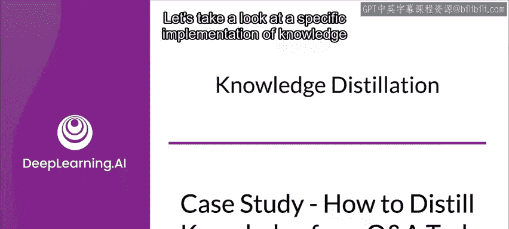
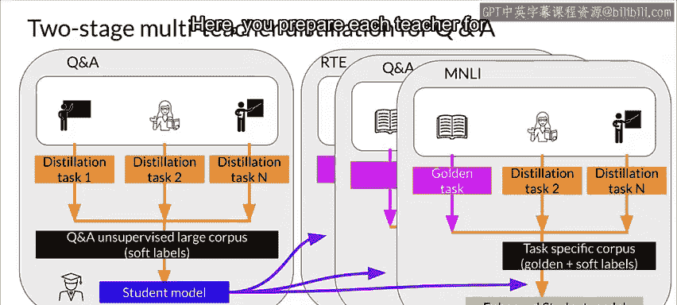
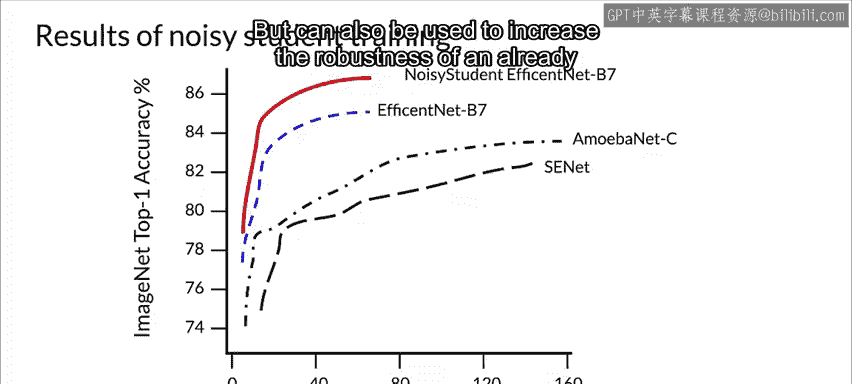

# 吴恩达《机器学习工程师的生产实践（MLOps）Machine Learning Engineering for Production》中英字幕 - P106：28_案例研究-如何为问答任务进行知识蒸馏.zh_en - GPT中英字幕课程资源 - BV1pi4y167g5

Let's take a look at a specific implementation of knowledge distillation for a Q&A task。

Let's look at how knowledge can be distilled for question answering。

 applyinglying these complex models to real business scenarios become challenging due to the vast amount of model parameters。

 Old model compression methods generally suffer from information loss during the model compression procedure leading to inferior models compared to the original one to tackle this challenge researchers at Microsoft proposed a two stage multi teacher knowledge distillation method or T M KD for short for a web question answering system。

In this approach， they first developed a general Q&A disstillation task for student model pre training and further fine tune this pretrain student model with a multi teacher knowledge distillation model。

The basic knowledge disstillation approach presented so far is known as a one on one model because one teacher transfers knowledge to one student。

 although this approach can effectively reduce the number of parameters and the time for model inference due to the information lost during knowledge dissillation。

 the performance of the student model is sometimes not on par with that of the teacher。

This was the driving force for the authors to create a different approach called Amlon M or many on many ensemble model。

 combining both ensemmbling and knowledge disillation。

This involves first training multiple teacher models。

 the models could be Bert or GPT or other similarly powerful models。

 each having different hyperparameter。Then a student model for each teacher model is then trained。

 Finally， the student models trained from different teachers are ensemled to create the final result。

Here you prepare each teacher for a particular learning objective and then train them。

 Different models have different generalization of capabilities。

 and they also overfi the training data in different ways。

 achieving performance close to the teacher model。

TMKD outperforms various state of the art baselines and it has been applied to real commercial scenarios。

Since ensemling is employed here， these compressed models benefit from large scale data and learn feature representations well。

 results from experiments show that it can considerably outperform baseline methods and even achieve comparable results to the original teacher models。

 along with a substantial speed up of model inference。

The others performed experiments on several data sets using benchmarks that are public and even large scale to verify the methods effectiveness。

To support these claims， let's look at its advantages one by one。

A unique aspect of TMKD is that it uses a multi teacher distillation task for student model pre training to boost model performance。

 to analyze the impact of pre training the author evaluated two models。

 The first one TKD is a three layer Bt based model。

 which is first trained using basic knowledge distillation pretrain on the comm QA dataset set。

 and then fine tuned on a task specific corpus by using only one teacher for each task。

The second model is a traditional knowledge distillation model， which is， again the same model。

 but without the distillation pre training stage， T K D showed significant gains by leveraging large scale unsupervised Q And A pairs for distillation pre training。

Another benefit of TMKD is its unified framework to learn from multiple teachers jointly for this。

 the authors were able to compare the impact of multi teacher versus single teacher knowledge distillation using two models。

 MKD， a three layer Bt based model trained by multi teacher distillation without a pre training stage。

And K D， a three layer Bt based model trained by single teacher distillation without a pre trading stage whose aim is to learn from the average score of the teacher models。

M KD outperforms K D on a majority of tasks， demonstrating that a multi teacher distillation approach can help the student model learn more generalized knowledge。

 fusing knowledge from different teachers。 Finally， they compared T K D。

 M KD and T M KD with each other。As you can see here。

 TMKD significantly outperforms TKD and MKD in all data sets。

Which verifies the complementary impact of the two stages， distillation。

 pre training and multi teacher fine tuning。In another example。

 researchers from Google Brain and Carnegie Mellon University trained models with a semi supervised learning method called noisy student。

In this approach the knowledge distillation process is iterative。

 it uses a variation of the classic teacher student paradigm。

 but here the student is purposely kept larger in terms of the number of parameters than the teacher。

This is done so that the model can attain robustness to noisy labels。

 as opposed to traditional knowledge distillation patterns。

This works by first training an efficient net as the teacher model using labeled images and then using the teacher to generate pseudo labels on a larger set of unlabeled images。

Next， they train another larger efficient net as a student model on the combination of labeled and pseudo labeled images。

 This algorithm was iterated a number of times by treating the student model as a teacher model to relabel the unlabeled data and train a new student model。

An important element of this approach was to ensure that noise was added to the student model using drop out。

 sarcchastic depth， data augmentation and so on via ran augment during its training。

This noing pushed it to learn harder from pseudo labels。

 addinging noise to a student ensures that the task is much harder for the student and hence the name noisy student。

 and it doesn't merely learn the teacher's knowledge。On a side note。

 the teacher model is not noise during the generation of pseudo labelbels to ensure its accuracy isn't altered in any way。

The loop closes by replacing the teacher with the optimized to network。

Comparing the results of noisy student training， the authors used efficient nets as their baseline models。

 This graph shows different sizes of efficient net models。

 along with some well known state of the art models for comparison。

 Note the results of the noisy student in red。One key factor is that the data sets were balanced across different classes which improved training especially for smaller models。

These results show that knowledge dissillation isn't just limited to smaller models like distill Bt。

 but can also be used to increase the robustness of an already great model using noisy student training。

Well we covered a lot didn't we first we started with a discussion of distributed training and then we turned to high performance modeling including high performance ingestion which turns out to be very important in high performance modeling and then we turned to one of my favorite topics knowledge distillation so I enjoyed it I hope you did and I'll see you next time。

