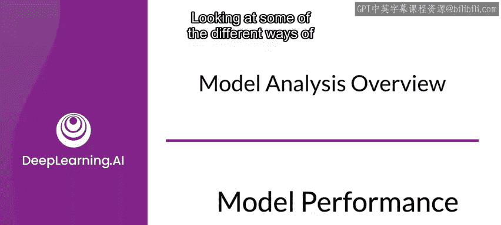
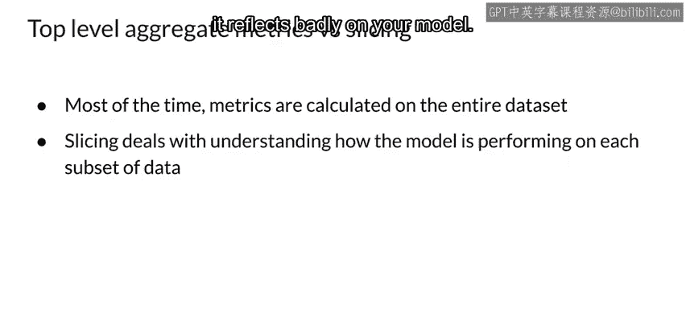

# 吴恩达《机器学习工程师的生产实践（MLOps）Machine Learning Engineering for Production》中英字幕 - P107：29_模型性能分析.zh_en - GPT中英字幕课程资源 - BV1pi4y167g5

Welcome back We've got a big week planned。 We're going to start with a deep look at model performance analysis。

 including diving into a key tool Tensorflowlow model analysis or TFM then we'll take a look at model debugging and understanding model robustness which are important especially understanding sensitivity analysis and how adversarial attacks work with robustness and sensitivity then we'll look at some ways to do model remediation as well and then we'll be talking about fairness and how important fairness is and ways to deal with it and finally we'll take a look at continuous evaluation and model and understanding when to retrain your models so it's a big week let's get started successfully training a model and getting it to converge feels good it often feels like you're done and if you're training a model。

class project or paper that you're writing， then you kind of are done， but for production ML。

 you now need to enter into a new phase of your development。

 which involves a much deeper level of analysis of your model's performance。

From in few different directions。 And that's what we'll be learning about this week。

 Let's start with a little bit of review of model analysis。

 looking at some of the different ways of analyzing models and determining performance。

 in much of this week， you'll be using the tools of Tensorflow model analysis or TFMA。

 and some related tools and technologies。 But first。

 let's review some of the basics of model analysis。 here。

 it's important to emphasize that you want to look at your model performance。

 not just on your entire data set。 but on individual slices of your data。

 After training and or deployment， you might notice a decay in performance。

 So it's natural to inquire about possible ways to improve model performance。

Additionally， you need to anticipate data changes that you might expect to see in the future。

And act on those data changes that have occurred since you originally trained your model。

 choosing the slices that are important to analyze is usually based on domain knowledge。

 This will allow you to determine if there is room for improvement in your model and perhaps address data changes that have happened since you originally trained your model。

 For example， if your model is designed to predict demand for different kinds of shoes。

 Looking at the performance of your model on individual types of shoes。

 perhaps different colors or styles， thatll be important。

 That will require slicing your data for different types of shoes。 at high level。

 there are two main ways to analyze the performance of your model。

 black box evaluation and model introspection in black box evaluation。

 you generally don't consider the internal structure of the model。

 You're just interested in quantifying the performance of the model through metrics and losses。

This is often sufficient within the normal course of development。

 But if you're interested in how the model is working internally。

 maybe looking for ways to improve it， you can apply various model introspection methods。

 Model introspection methods are very useful when you're experimenting with new architectures to understand how data is flowing internally within each layer of the model。

 This can help you adjust and iterate your model architecture to improve performance and efficiency。

Tensor board is an example of a tool for black box evaluation using Tensor board。

 we can monitor the loss and accuracy of every iteration of the model。

You can also closely monitor the training process itself。

Please check the reading list to learn more about Tensor board。In model introspection。

 the goals change completely。 You're not just interested in the model's final results。

 You're also interested in the details of each layer On the left side。

 we have the maximally activated patches of the various filters in the convolutional layers of the model。

 This is CNN N。 When we run through a series of images belonging to a particular class。

Using those patterns， you can inspect at which layer the model is learning a particular structure of your data on the right side is an example of a class activation map。

Here， you're interested in knowing which parts of the image are primarily responsible for making the desired prediction of that class。

Using this information you can try to improve the performance of your model by tuning or including more features related to those highlighted areas Next。

 let's look at the difference between performance metrics and optimization。

 first performance metrics。Based on the problem you're trying to solve。

 you need to quantify the success of your model using some measurement。 And for this。

 you use various performance metrics。 Performance metrics will be different for different types of tasks like classification and regression and so forth。

 You're familiar with these from designing and training models。

Now let's focus on the optimization part。This is your objective function or cost function or loss function。

 People use different names for it When you train your model。

 you try to minimize the value of this function in order to find an optima。

 hopefully a global optima in your loss surface。If you check out Tensor Board again。

 you'll notice options for tracking performance metrics like accuracy and optimization objectives such as loss after each E of training and validation。

Let's quickly inspect the optimization landscape。This is also referred to as a loss surface Here。

 the loss is represented as a function of two parameters。

 depicted here is a saddle point where the curvature along different dimensions has different signs。

 One dimension curves up and another down。 This is typical of many optimization problems。

The animation shows trajectories for different optimization algorithms。

 Each of these optimizers traverses the landscape differently。

 according to their update method and may take different amounts of time to converge to an optimum value。

When you're evaluating your training performance， you're usually watching the top level metrics。

 This is to decide whether your model is doing well or not。

 but it doesn't tell you about how well it does on individual parts of the data。 For example。

 different customers in different stores may experience your model very differently。

 And if their experience isn't good， it reflects badly on your model。😊。

