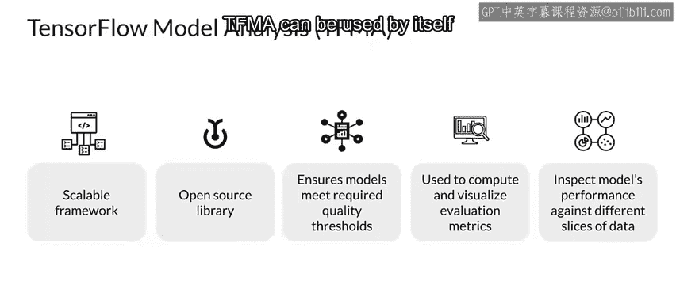
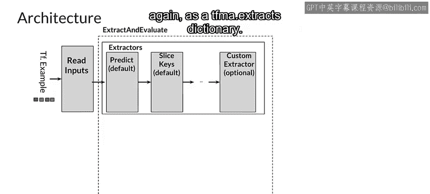
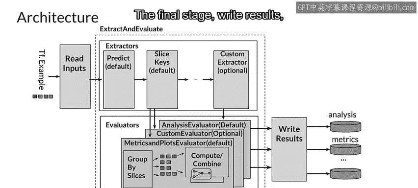
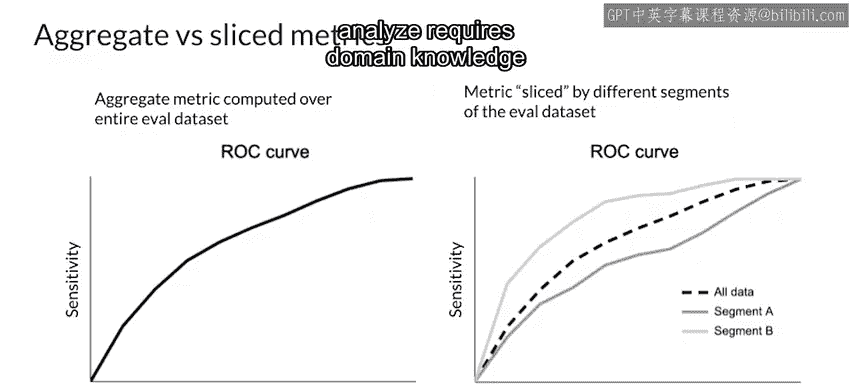
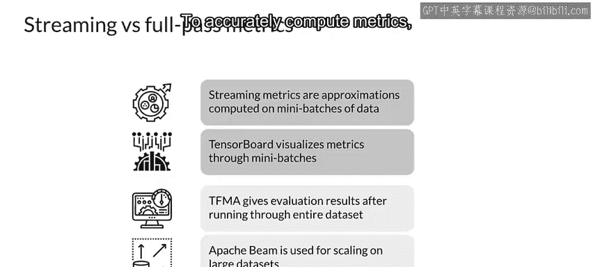

# 吴恩达《机器学习工程师的生产实践（MLOps）Machine Learning Engineering for Production》中英字幕 - P108：30_TensorFlow Model Analysis简介.zh_en - GPT中英字幕课程资源 - BV1pi4y167g5

TensorFlow model analysis or TFMA is a versatile tool for doing deep analysis of your model's performance。

 Let's discuss that Now， your top level metrics can easily hide problems with particular parts of your data。

For example， your model may not perform well for particular customers or particular products or stores or days of the week or different subsets of your data that makes sense for your domain or problem。

Thinking about customers who are requesting a prediction from your model。

 if your model produces a bad prediction， then that customer's experience of your model is bad。

 regardless of how well it may do in top level metrics。

To enable developers to look at their performance of their model at a deeper level。

 Google created Tensorflow model analysis or TFM。 TFMA is an open source。

 scalable framework for doing deep analysis of model performance。

 including analyzing performance on slices of data。😊。

TFMA is also a key part of a machine learning pipeline such as a TFX pipeline to perform deep analysis before you deploy a newly trained version of your model。

TFMA has built in capabilities to check that your models meet certain quality standards。

And to visualize evaluation metrics and inspect performance on different slices of data。

TFMA can be used by itself or as part of another framework such as TFX。

Let's take a look at the high level architecture of TFMA。

The TFMA pipeline is made up of four main components， read inputs， extracttractors， evaluators。

 and write results。The first stage read input is made up of a transform that takes raw input such as CSV or TF records and so forth。

 and converts it into a dictionary format which is understandable by the next stage extraction。

Across all the stages， the output is kept in this dictionary format， which is of the data type TFM。

 extracts。The next stage extraction performs distributed processing using Apache beam。

Input extractor and slicelic key extractor form slices of the original data set。

 which will be used by Preict extractor to run predictions on each slice。

The results are sent to the next stage again as a TFMA dot extracts dictionary。

 The next stage evaluation also performs distributed processing using Apache beam。

There are several evaluators， and you can create custom evaluators as well。 For example。

 the metrics and plots evaluator extracts the required fields from the data to evaluate the performance of the model against the received predictions from the previous stage。

The final stage， write results。

As the name suggests， writes the results to disk。Tensor Board and TFMA are used in different stages of the development process。

At a high level， Tensor board is used to analyze the training process itself。

 while TFMA is used to do deep analysis of the finished trained model。

 Tensor board is used to inspect the training process of a single model often as you are monitoring your progress during training。

It can also be used to visualize the training progress for more than one model。

 with performance for each plotted against their global training steps as they are training。

 After training is finished， TFMA allows developers to compare different versions of their trained models。

While Tensor Board visualizes streaming metrics of multiple models over global training sets。

TFMA visualizes the metrics computed for a single model over multiple versions of the exported saved model。

Most model evaluation results look at aggregate or top level metrics on the entire training data set this aggregation often hides problems with model performance。

For example， a model may have an acceptable AU over the entire Eval data set。

 but underperforms on specific slices。 In general， a model with good performance。

 on average may exhibit failure modes that are not apparent by looking at an aggregate metric。

Slicing metrics allow you to analyze the performance of a model on a more granular level。

 this functionality enables developers to identify slices where examples may be mislabeled or where the model over or underpreds。

 for example TFMA could be used to analyze whether a model that predicts the generosity of a taxi tip works equally well for riders that take the taxi during the day versus at night by slicing the data by the hour。

In general， determining which slices are important to analyze requires domain knowledge about your data and application。

Tensor board con metrics on a mini batch basis during training。

 They're called streaming metrics and are approximations based on those observed mini batches。

 T FMA uses Apache beam to do a full pass over the Eval data set。

This not only allows for accurate calculation of metrics。

 but also scales up to massive evaluation data sets since beam pipelines can be run using distributed processing back ends。

Note that TFMA computes the same TensorF metrics that are computed by the TensorFlow EVL worker just more accurately by doing a full pass over the specified data set。

TFMA can also be configured to compute additional metrics that were not identified or not defined in the model。

Furthermore， if evaluation data sets are sliced to compute metrics for specific segments。

Each of those segments may only contain a small number of examples， so to accurately compute metrics。

 a deterministic full pass over those examples is important。

