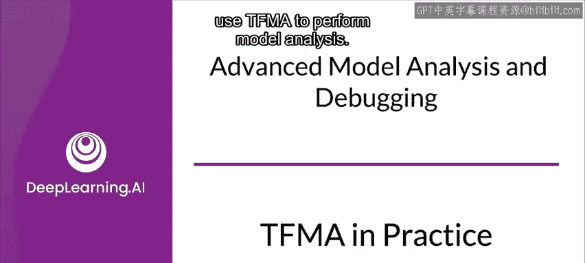
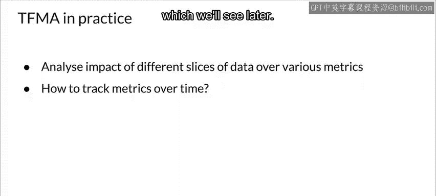
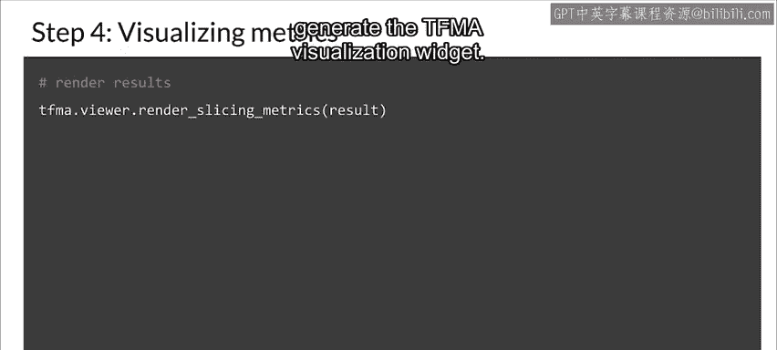
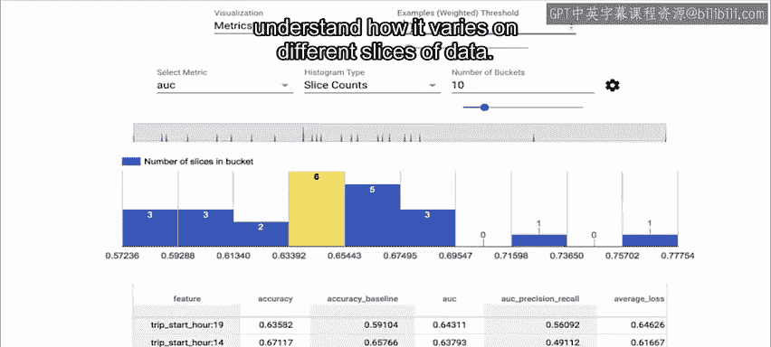

# 吴恩达《机器学习工程师的生产实践（MLOps）Machine Learning Engineering for Production》中英字幕 - P109：31_TFMA实战.zh_en - GPT中英字幕课程资源 - BV1pi4y167g5

Let's take a quick look at how to set up and use TFMA to perform model analysis over the next set of slides。

 you'll be learning how TFMA helps you evaluate your model performance in different ways。

You'll learn how Tiffama evaluates your model against different slices of data。

 and Haatiiffae keeps track of metrics over time。Before getting started。

 note that this example uses TFA by itself outside of a TFX pipeline。

When you use TFMA in a TFX pipeline， the evaluator component already includes many of the steps performed in this example。

 so you won't have to do them yourself。Instead， you would usually only provide the EL config to the evaluator component。

 which we'll see later， As usual， let's begin by importing all the necessary libraries in this case we need Tensorflow。

 Tensorflow transform and Tensorflow model analysis next to use TFMA。

 the first step is to train your model and generate a saved model object。

 which you will normally do anyway so that you can serve your model。

The raw input examples need to be pre processed in the same way during training while performing evaluation using TFMA。

For example， if a feature was normalized before training。

 it will also need to be normalized before evaluation。

 If you train your model in a TFX pipeline and include a transform component。

 then the same preprocessing and feature engineering done during training will already be included in your saved model。

 however， if you did not train in TFX， you will need to apply the same preprocessing manually。

 which is done here in the getserv Tf examples function in this case， using Tensorflow transform。

 Next， we generate a saved model In most cases， you want to use the serving default signature for your saved model。

 but you can also explicitly specify a different signature for the model in the model specification configuration The next step involves creating an eval config object that encapsulates the requirements for TFM。

More concretely， first you have to define the slices of your data set and the metrics that you want to use for analyzing your model。

Then you wrap the model， slices， metrics and other configurations in an E config object。

 This will determine what TFMA does when it's run。 This is the same EV config that you would give to the evaluator component in a TFx pipeline with the E config object set。

 you're now ready to start analyzing your model， these examples use only one machine to perform the analysis。

 and so using an orchestrator is not necessary。Here。

 the code sets the path to an evaluation graph and a directory to store the analysis。

 The next step is to call the TFMA run model analysis API。This will get your model analysis started。

 This API can accept slicing specifications directly as well。 Finally。

 let's render the results and visualize the model analysis metrics。

TFMA provides interactive widgets that can be run in notebooks。

 and this is a code that you would include in a notebook cell to generate the TFMA visualization widget。

 And here's what the visualizations look like。 This tool enables you to really dig into your model performance and understand how it varies on different slices of data。

