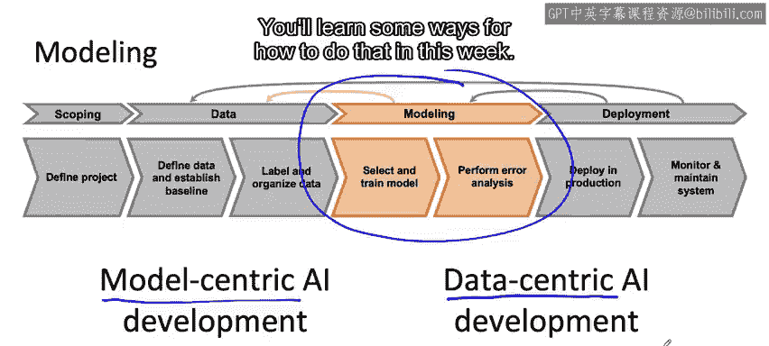

# 吴恩达《机器学习工程师的生产实践（MLOps）Machine Learning Engineering for Production》中英字幕 - P10：9_建模概述.zh_en - GPT中英字幕课程资源 - BV1pi4y167g5

Hi， welcome back。In this week， you learn about some best practices for building a machine learning model that is worthy of a production deployment。

One of my friends Adam Cos joked that the way he listened to me give advice to machine learning teams。

 he felt the way I gave advice was quite consistent from project to project so that he could almost replace me with if then elses sequence of statements and I found too when several senior machine learning engineers look at the project。

 the advice they tend to give is also remarkably consistent what you learn in this week is what are some of the key challenges of trying to build a production ready machine learning model。

 things like how do you handle few data sets or what if you do well in the testet but for some reason that still isn't good enough for your actual application and I hope that after this week's materials you'll be able to very efficiently know how to improve your machine learning model to solve the most important problem problems that then make it deployment ready let's dive in this week our focus will be on the modeling part of the full cycle。

A machine learning project and you learn some suggestions for how to select and train a model and how to perform error analysis and use that to drive model improvements one of the themes you hear me refer to multiple times is model centric AI development versus data centric AI development the way that AI has grown up there's been a lot of emphasis on how to choose the right model such as maybe how to choose the right neuralne architecture。

I found that for practical projects， it can be even more useful to take a more datacentric approach where you focus not just on improving the neuralne architectureure。

 but on making sure you are feeding your algorithm high quality data and that ultimately lets you be more efficient in getting your system to perform well。

 but the way I engage in datacentric AI development is not to just go and try to collect more and more and more data which can be very time consuming。

 but to instead use tools to help me improve the data in the most efficient possible way。

 you learn some ways for how to do that in this suite。

So I'm excited to go through this week's materials review on training models。

 but first let's look at some key challenges that many teams face when building machine learning models by understanding these key challenges you'd be better able to spot them ahead of time and adjust them more efficiently for your projects let's go to the next video。

😊。