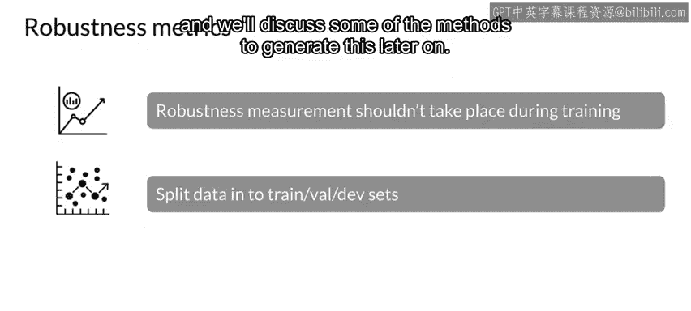
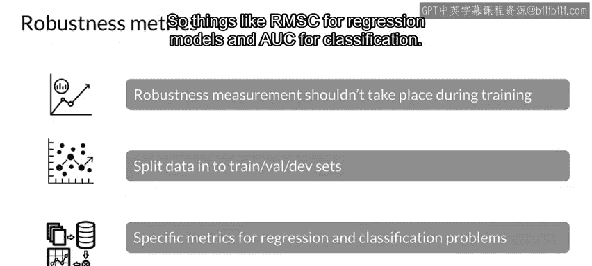
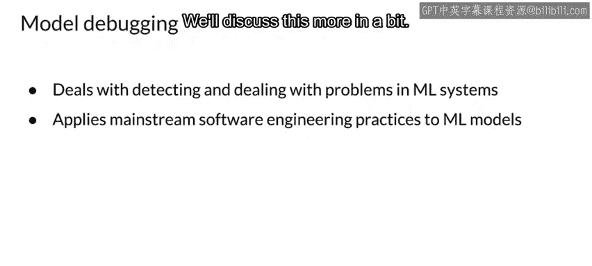
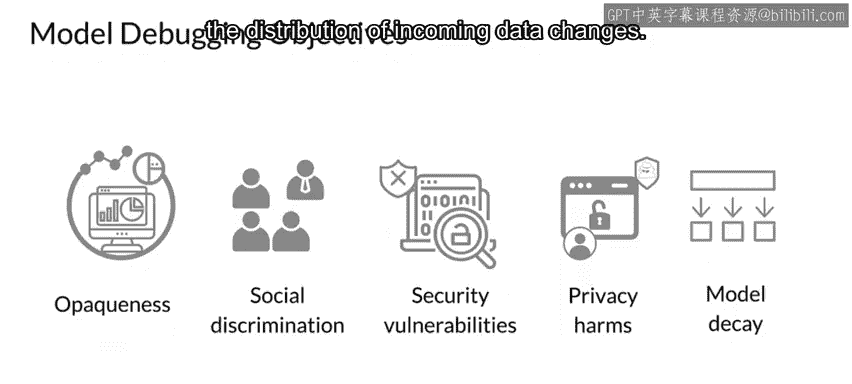
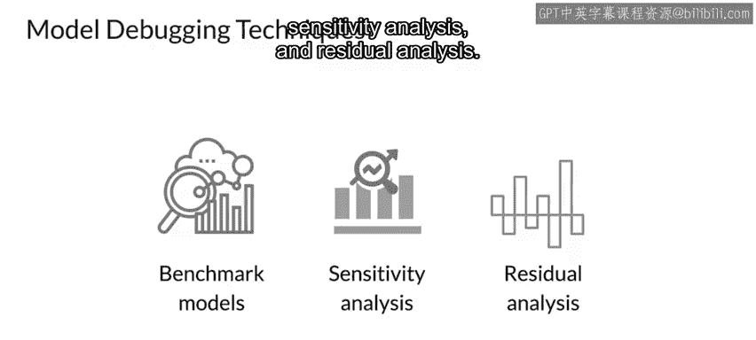

# 吴恩达《机器学习工程师的生产实践（MLOps）Machine Learning Engineering for Production》中英字幕 - P110：32_模型调试概述.zh_en - GPT中英字幕课程资源 - BV1pi4y167g5

Now let's discuss model performance beyond simple metrics and introduce some ways to analyze it and improve it To talk about model debugging。

 let me first focus on model robustness。

Checking the robustness of the model is a step beyond the simple measurement of model performance or generalization。

A model is considered to be robust if its results are consistently accurate。

 even if one or more of the features change fairly drastically。Of course。

 there are limits to robustness and all models are sensitive to changes in the data。

But there is a clear difference between a model that changes in gradual。

 predictable ways as the data changes and a model that suddenly produces wildly different results。

 So how do you measure the robustness of a model。 The first and foremost thing is you shouldn't be measuring the robustness of a model during its training。

 also， you shouldn't be using the same data set that you used during training。

 So before you start the training process， you should split the data set into train validation and test splits。

😊。

You may use the test split， which is totally unseen by the model， even during the validation stage。

 for testing the model robustness。Or otherwise， the best choice is to generate a variety of new types of data and we'll discuss some of the methods to generate this later on。

 The metrics themselves will be the same types that you use for training， depending on a model type。

 So things like RMSC for regression models and AU for classification。

Let's take a look at ways to increase model robustness。

 Model debugging is an emerging discipline focusing on finding and fixing problems in models and improving model robustness。

Md debugging borrows various practices from model risk management， traditional model diagnostics。

 and software testing。Model debugging attempts to test M， L models just like code。

 very similar to how you would test in software development。

 It probes sophisticated M L response functions and decision boundaries to detect and correct accuracy。

 fairness， security and other problems in M， L systems We'll discuss this more in a bit。

Model debugging has several objectives。 One of the big problems with MLl models is that they can become quite opaque and become black boxes。

 Modeld debugging tries to improve the transparency of models by highlighting how data is flowing inside。

 Another problem is social discrimination。 Does your model work poorly for certain groups of people。

 Model debugging also aims to reduce the vulnerability of your model to attacks。For example。

 certain requests can be made once the model is in production that may be aimed at extracting data out of your model in order to understand how your model has been built。

This is especially a problem when data has private information and it's been used for training。

 So was the data anonymized before it was used for training Lastly， with time。

 your model performance decays as the distribution of incoming data changes。

 Three of the most widely used debugging techniques are benchmarking models。

 sensitivity analysis and residual analysis。 We'll discuss each of these individually。

