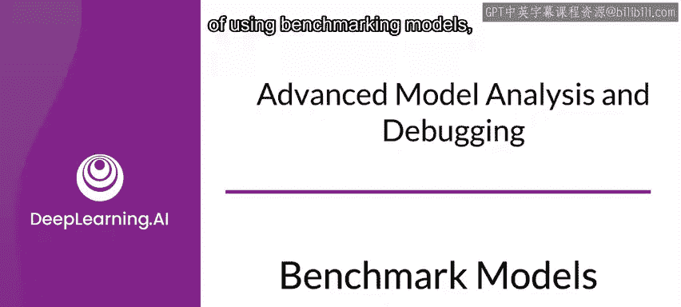
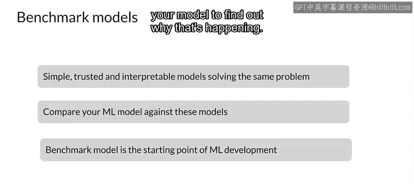

# 吴恩达《机器学习工程师的生产实践（MLOps）Machine Learning Engineering for Production》中英字幕 - P111：33_基准模型.zh_en - GPT中英字幕课程资源 - BV1pi4y167g5

We'll start with a brief discussion of using benchmarking models。

 which is always a good model debugging technique。 A good place to start is by comparing your model to benchmark models。

Which are a simple and powerful way to check your model's performance。Benchmarking models are small。

 simple models that are used before you start development for baselining your problem。

 They're generally not state of the art， but instead are linear or other simple model with very consistent performance。

 You compare your model to see if it actually is performing better than the simpler benchmarking model as a kind of sanity test。

 If it doesn't， it could be that your model has a problem。

 or that a simple model accurately models the data and is really all that you need for your application。

 Once a model passes the benchmark test the benchmark model can serve as a solid debugging tool。

Even if you're performing better than the benchmark model。

 you can still evaluate which test samples your model is failing。

 but the benchmark model predicts correctly。 Then you need to study your model to find out why that's happening。

