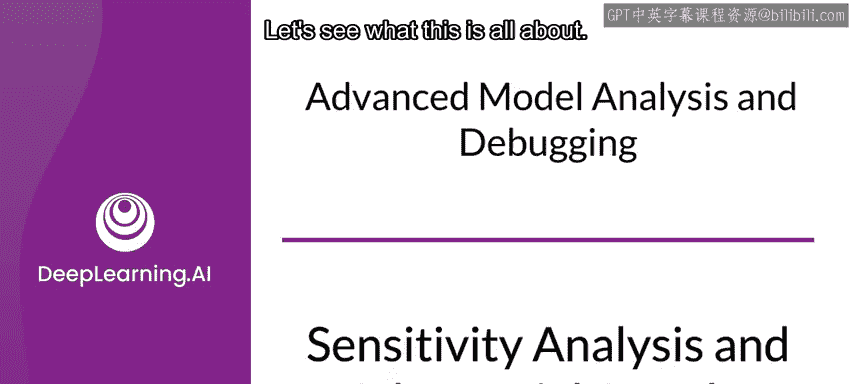
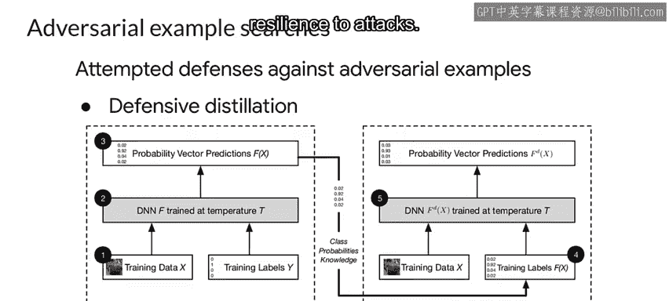

# 吴恩达《机器学习工程师的生产实践（MLOps）Machine Learning Engineering for Production》中英字幕 - P112：34_敏感度分析与对抗性攻击.zh_en - GPT中英字幕课程资源 - BV1pi4y167g5

Sensitivity analysis is an important way to evaluate your model's performance。

 including its vulnerability to adversarial attacks。 Let's see what this is all about。

 Sensitivity analysis helps you understand your model by examining the impact that each feature has on your model's prediction。

In sensitivity analysis， you experiment by changing a single features's value while holding the other features constant and observe the model results。

If changing the feature's value causes the model's result to be drastically different。

 it means that this feature has a big impact on the prediction。

 usually you're changing the values of the features synthetically according to some distribution or process and ignoring the labels for the data。

 you're really not looking to see if the prediction is correct or not。

 but instead how much it changes， different ways of doing sensitivity analysis use different techniques for changing the feature value。

 let's explore a few different approaches。One of the more powerful ways of conducting sensitivity analysis is by using the what if tool。

 which was created by the Tensorflowlow team， the what if tool allows you to visualize the results of sensitivity analysis to understand and debug your performance。

Let's discuss some of the most common approaches for doing sensitivity analysis。In random attacks。

 you generate lots of random input data and test the model's outputs。

Random attacks can reveal all kinds of unexpected software and math bugs。

If you don't know where to begin debugging an ML system。

 a random attack is a great place to get started。Another approach is to use a partial dependence plot partial dependence plots show the marginal effect of one or two features and the effect they have on the model results。

A partial dependence plot can show whether the relationship between the label and a particular feature is linear。

 monotonic， or more complex。For example， when applied to a linear regression model。

 partial dependence plots always show a linear relationship。PDP box and Pi C box。

Are open source packages， which are available for creating partial dependence plots。

 Please check the reading list for more information。

Now that we've introduced two sensitivity analysis techniques。

 it's worth asking how vulnerable your model is to attacks several machine learning problems。

 including neural networks， can be fooled into misclassifying adversarial examples which are formed by making small but carefully designed changes to the data so that the model returns an incorrect answer with high confidence。

This could have daunting implications。Imagine making a wrong decision on an important question based on only slightly corrupted data。

Depending on how catastrophic and incorrect result could be for your application。

 you may need to test your model for vulnerabilities and based on your analysis。

 harden your model to make it more resilient to attacks。So what do these attacks look like， well。

 here's a famous example with two groups of images。

Applying only a tiny distortion to the images in the left columns results in the images in the right columns。

 which a model train on imagenet classifies as an ostrich。 So how serious of a problem is it。 Well。

 it depends on your application。 But let's discuss a few examples。 First， with an autonomous vehicle。

 It's important to recognize traffic signs， other vehicles， people， et cetera。 Unfortunately。

 we've seen examples of this in real life。But as in this example。

 if a sign is altered in just the right way， it can fool the model。

 and the results can be catastrophic。Another example is just application quality。

If your business sells software to detect spam and phishing emails can get through。

 it reflects badly on your product。Finally， a somewhat scarier example。

As you rely on machine learning for more and more mission critical applications。

 you need to consider the security implications。A suitcase scanner is basically just an object classifier。

But if it's vulnerable to attack， the results can be dangerous。 The future of Pricy Forum。

 an industry group that studies privacy and security。

Sugests that security and privacy harms enabled by machine learning fall into roughly two categories。

 informational and behavioral informational harms relate to the unintended or unanticipated leakage of information。

 behavioral harms， on the other hand， Re to manipulating the behavior of the model itself。

 impacting the predictions or outcomes of the model。Let's look at informational harm。

Membership inference attacks are aimed at inferring whether or not an individual's data was used to train the model based on a sample of the model's output。

While seemingly complex， studies have shown that these attacks require much less sophistication than is frequently assumed。

 Model inversion attacks use model outputs to recreate the training data。 In one well known example。

 researchers were able to reconstruct an image of an individual's face。

Another study focused on ML systems that used genetic information to recommend dosing of specific medications。

 and it was able to directly predict individual patients genetic markers。

Model extraction attacks use model outputs to recreate the model itself。

This has been demonstrated against models as a service providers like Big M L and Amazon machine learning and can compromise privacy and security。

 as well as the intellectual property of the underlying model itself。And what about behavioral harms？

Model poisoning attacks occur when an adversary inserts malicious data into training data in order to alter the behavior of the model。

 For example， creating an artificially low insurance premium for particular individuals。

 Evasion attacks occur when data in an inference request intentionally causes the model to misclassify that data。

These attacks occur in a range of scenarios， and the changes in the data may not be noticeable by humans。

Our earlier example of an altered stop sign is one example of an evasian attack。

Before hardening your models， you need to have some way of measuring the vulnerability to attack。

 Clever Hand is an open source Python library that you can use to benchmark your models to measure their vulnerability to adversarial examples。

 to harden your model to adversarial attacks。 One approach is to include sets of adversarial images in your training data so that the classifier is able to understand the various distributions of noise and your model learns to recognize the correct class。

 This is known as adversarial training。 examples created by tools such as clever hands can be added to your data set。

 but doing so limits your ability to use them to measure your model's vulnerability。

 Since you are now almost testing with your training data。

Fool box is another open source Python library that lets you easily run adversarial attacks against machine learning models like deep neural networks。

 It built on top of eager pie and works natively with models in Pytorch， Tensorflow and jacks。

 Unfortunately， detecting vulnerability is easier than fixing it。 This is an emerging field。

 and like many things in security。 There is an arms race between attackers and defenders。😊。

One fairly advanced approach is defensive distillation。

 since it does not use specific adversarial examples。

 it may provide more general hardening to new attacks。As the name suggests。

 this is very similar to knowledge distillation training。

 the goal is to increase model robustness and decrease sensitivity in order to decrease vulnerability to attacks。

Defensive distillation reduced the effectiveness of a sample creation from 95% to less than 0。

5% in one study， the main difference between defensive distillation and the original distillation proposed by Hinton and others that we discussed earlier in our model optimization section。

 is that we keep the same network architecture to train both the original network。

 as well as the distilled network。 In other words， instead of transferring knowledge between different architectures。

 the authors proposed using knowledge distillation to improve a model's own resilience to attacks。

