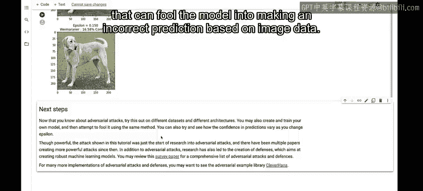

# 吴恩达《机器学习工程师的生产实践（MLOps）Machine Learning Engineering for Production》中英字幕 - P113：35_对抗攻击演示.zh_en - GPT中英字幕课程资源 - BV1pi4y167g5

Let's take a look at an attack on a model using an adversarial example which uses the fast gradient signine method。

Which was described by Good fellow and others， you know， kind of a landmark paper。

 So what is an adversarial example， adversarial examples are specialized inputs created with the purpose of confusing a neural network。

 resulting in the misclassification of a given input。

These notorious inputs are indistinguishable to the human eye。

 but cause the model to fail to identify the contents of the image。

 There are several types of such attacks。 However， here。

 the focus is on the fast gradient sign method attack， which is a white box attack。

 whose goal is to ensure misclassification。A white box attack is where the attacker has complete access to the model being attacked。

 One of the most famous examples of an adversarial image is shown here。

 and it's taken from that paper。 We have a panda on the left that the model predicts with fairly high confidence。

 Some noise is added， which is fairly， you know， opaque to a human。

And the result is that the model now thinks that that panda is a gibbon with a very high confidence。

 So I'm not going to go into the details of the attack method Theyre here。

 And this example is available in the references。 You can go through it yourself。

But what we will do is just walk through this example and show really how easy this kind of attack is。

So we're running in a coabab here。We'll start by doing some imports of Tensorflowlow and matpl Live。

 and then we'll load a pretrain mobilenet V2。And the image net class names。

So this will take a second， there we go。And then we have this helper function here to do preprocess。

And then we'll take a look at the original image， which in this case is a Labrador retriever。

 so we're going to download that data。And now let's look at the image， we'll do a plot here。

And there it is a Labrador retriever， okay。So we'll create an adversarial image using the fast gradient sign method。

And there actually is the code that we'll use， you can see it's very simple。

And we can visualize the perturbations that that method makes。To give you an idea。

 So looking at that， you know， most people wouldn't expect it to have。

Really any change in the model based on applying that， but as we'll see it does。So。

One of the things we do is we're going to。Try different values for epsilon。

 which is one of the parameters of the method。And we'll see how different values of Epsilon have different predictions that the model makes。

So we have a。helper method there to display the image。

And then here's some different values of epsilon and the resulting model predictions， so。

Here's our original laboratorybraor retriever confidences。You know， this is actually， yeah。

 with the the input and then with Epsilon 0。01 and now thinks it's say salucki。Which is a thin dog。

And then a little higher value of epsilon， it thinks it's a vier honor。And again。

 a little bit higher than that， it still thinks it's a vior honor with a little more confidence。

All right。So that's one very simple method of doing an adversarial attack that can fool the model into making an incorrect prediction based on image data。

