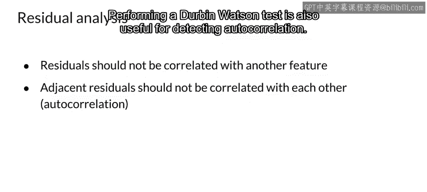

# 吴恩达《机器学习工程师的生产实践（MLOps）Machine Learning Engineering for Production》中英字幕 - P114：36_残差分析.zh_en - GPT中英字幕课程资源 - BV1pi4y167g5

Now， let's discuss residual analysis， which is the last model debugging technique that we'll cover in this course。

 Another debugging technique is residual analysis。 In most cases。

 this can be used for regression models， since it requires measuring the distance between predictions and the ground truth。

However， it requires having ground truth values for a comparison。

 which can be difficult in many on or real time scenarios。 In general。

 you want the residuals to follow a random distribution。 If you find correlation between residuals。

 it's usually a sign that your model can be improved。If you've trained your regression model。

 then you're probably familiar with metrics like root mean square error or RMSC and similar metrics。

 residual analysis uses those kinds of metrics， but it primarily looks at the distribution of the errors。

 often using residual plots to visually inspect the distribution of residuals。

 If your model is well trained and has captured the predictive information in the data。

 then the residuals should be randomly distributed。 However。

 if you see systematic or correlated residuals， then it tells you that there is predictive information that the model has not captured。

 you can then look for ways to improve your model。 So what should you aim for when performing residual analysis。

The residuals should not be correlated with another feature that was available。

 but was left out of the feature vector。 If you can predict the residuals with another feature。

 that feature should be included in the feature vector。

 This requires checking the unused features for correlation with the residuals。 Also。

 adjacent residuals should not be correlated with each other。 In other words。

 they should not be auto correlated。If you can use one residual to predict the next residual。

 then there's some predictive information that is not being captured by the model。 Often。

 but not always， you can see this visually in a residuals plot。

Ordering can be important for understanding this。For example。

 if a residual is more likely to be followed by another residual that has the same sign。

 adjacent residuals are positively correlated。Performing a Durban Watson test is also useful for detecting autocorlation。

