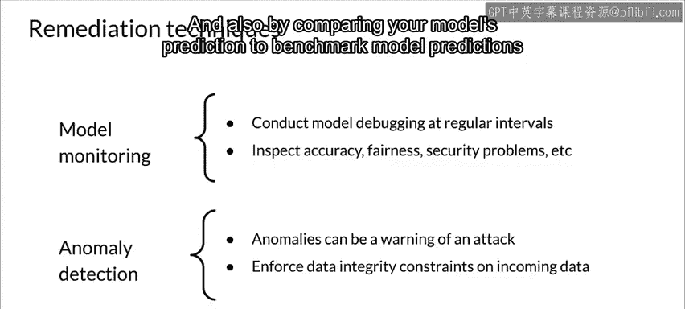

# 吴恩达《机器学习工程师的生产实践（MLOps）Machine Learning Engineering for Production》中英字幕 - P115：37_模型修复.zh_en - GPT中英字幕课程资源 - BV1pi4y167g5

So far， we've discussed ways to analyze robustness。But we haven't talked about ways to improve it。

 Let's do that now with a discussion of model remediation。

So what can you do to improve robustness， You should make sure that your training data accurately mirrors the request that you'll receive from your trained model。

 but data augmentation can also help your model generalize， which typically reduces sensitivity。

You can generate data in many ways， including generative techniques， interpretative techniques。

 or simply adding noise to your data。Data augmentation is also a great way to help correct for unbalanced data。

 Understanding the inner workings of your model can also be important。 Often。

 more complex models can be black boxes， and we sometimes don't make much effort to understand what is happening internally。

However， there are tools and techniques， which can help with model interpretability。

 and this can also help with improving model robustness。

 There are also model architectures which are more easily interpreted， including tree based models。

 as well as neural network models， which are specifically designed for interpretability。

Another remediation technique is model editing。 Some models such as decision trees。

 are so directly interpretable that the learned parameters can be understood easily。

 If you find that something is going wrong， you can tweak the model to improve its performance and robustness。

😊，Another technique is model assertions。Model assertions apply business rules or simple sanity checking to your model's results and either alter or bypass the results before delivering them。

For example， if predicting someone's age， number should never be negative。

Or if predicting a credit limit， then it should never be more than a maximum amount。Next。

 let's look at how model bias can be reduced or eliminated。 This is discrimination remediation。

The best solution for this is to have a diverse data set。

 which is representative of the people who will be using your model。

 It also helps to have people on the development team from diverse backgrounds with expertise in ethics。

 privacy， social sciences and other related disciplines， careful feature selection。

 including sampling and reweighting rows to minimize discrimination and training data can also be helpful。

 when training， you should consider fairness metrics when selecting hyperpara and decision cut off thresholds。

This requires using a tool like fairness indicators to measure fairness。

 This may also involve training fair models directly by learning fair representations or LFR and adversarial debiasing using tools such as AIF 360。

 or using dual objective functions that consider both accuracy and fairness metrics。

For prediction post processing， changing model predictions after training。

 reject option classification tools such as AIF 360 or theMA ML can also help to reduce unwanted bias tools like Google Model remediation library can help with improving model fairness as well。

Check the references at the end of the lesson for links to libraries and resources。

Model debugging is not something that you only do during development。

 This requires constant monitoring of your model。 The accuracy。

 fairness or security characteristics of M models will change during lifetime of a model as the data and the world changes and as new attacks emerge You should build monitoring into your process so that your models are checked for accuracy。

 fairness and security problems on a regular basis。 Strange。

 anomalous input and prediction values are always worrisome in M L。

 and can be indicative of an attack。Luckily， anomalous inputs and predictions can be caught and corrected in real time using a variety of tools and techniques。

 including data integrity constraints on input streams。

 statistical process control methodologies on inputs and predictions。

 anomaly detection through autoencors and isolation fors。

 and also by comparing your model's prediction to benchmark modeled predictions。

