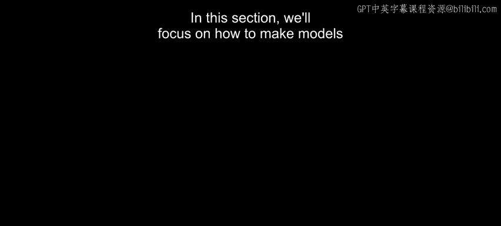
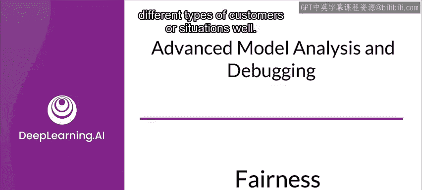
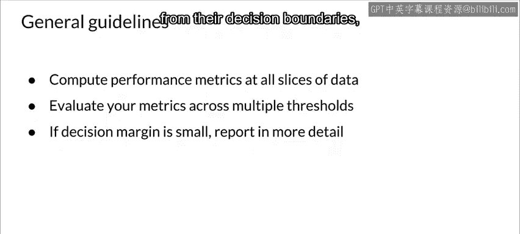

# 吴恩达《机器学习工程师的生产实践（MLOps）Machine Learning Engineering for Production》中英字幕 - P116：38_公平性.zh_en - GPT中英字幕课程资源 - BV1pi4y167g5

In this section， we'll focus on how to make models fair and look at using fairness syndicators library to assess fairness。

 Remember that in addition to serving your community well。

 focusing on fairness helps you serve different types of customers or situations well。

 in addition to analyzing and improving your model performance。

 You want to introduce checks and controls to ensure that your model behaves fairly in different scenarios。

 Ac for fairness and reducing bias towards any group of people is an important part of that。

You need to make sure that your model is not causing harm to the people who use it。

Fairness indicatordics is an open source library built by the Tensorflow team to easily compute commonly identified fairness metrics for binary and multi class classifiers。

 Fairairness indicators scales well and has been built on top of the Tensorflow model analysis framework。

What are the main features of the Fairness Indicators library Well。

 Fairness indicatordators is a library that enables easy measurement of commonly identified fairness metrics for binary and multiclass classifiers。

With the fairness indicatordators tool suite， you can also compare model performance across subgroups to a baseline or to other models。

This includes using confidence intervals to surface statistically significant disparities and performing evaluation over multiple thresholds。

Fairness indicators is primarily a tool for measuring fairness。

 not for doing remediation to improve fairness。Looking at slices of data is actually quite informative when you're trying to mitigate bias and check for fairness。

When measuring fairness， it's important to identify slices of data which are sensitive to fairness and measure your model's performance on those slices。

 If you only measure fairness using the entire data set。

 it can easily hide fairness problems with particular groups of people。

It's also important to consider and select the right metrics to measure for your data set and users。

 because otherwise， you may measure the wrong thing and be unaware of problems。

 This is often based on domain knowledge。Keep in mind that measuring fairness is only one part of evaluating a broader user experience。

Start by thinking about the different contexts through which a user may experience your application。

Who are the different types of users for your application。

 Who else may be affected by the experience。It's important to remember that human societies are extremely complex。

Understanding people and their social identities， social structures and cultural systems are each huge fields of open research。

 When possible， we recommend talking to appropriate domain experts。

 which may include social scientists， sociinguists or and cultural anthropologists。

 as well as members of the communities that will be using your application。

A good rule of thumb is to slice for as many groups of data as possible。

 Pay special attention to slices of data that deal with sensitive characteristics， such as race。

 ethnicity， Gen， nationality， income， sexual orientation and disability status。 Ily。

 you should be working with labeled data， But if not。

 then you can apply statistics to look at the distributions of the outcomes。

 with some assumptions around any expected differences。

Let's look at some important guidelines to avoid common pitfalls when working with fairness indicators。

 when you're just getting started with fairness indicators。

 you should conduct various fairness tests on all the available slices of data。Next。

 you should evaluate the fairness metrics across multiple thresholds to understand how the threshold can affect the performance of different groups。

Finally， for predictions which don't have a good margin of separation from their decision boundaries。

 you should consider reporting the rate at which the label is predicted。

