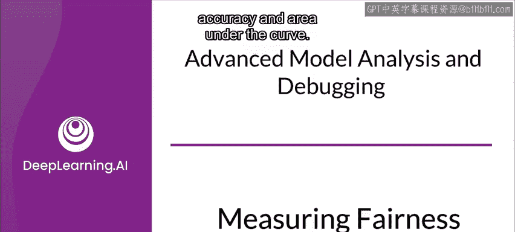
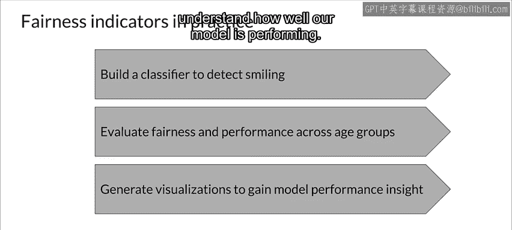

# 吴恩达《机器学习工程师的生产实践（MLOps）Machine Learning Engineering for Production》中英字幕 - P117：39_衡量公平性.zh_en - GPT中英字幕课程资源 - BV1pi4y167g5

Now let's look at the various fairness metrics which are available in fairness indicators。

This includes the positive negative rate， the ratios of true and false positives。

Accuracy and area under the curve。 We'll start with a quick overview of these metrics。

Let's first consider the basic， positive and negative rates。

The basic positive and negative rates show the percentage of data points that are classified as positive or negative。

These are independent of ground truth labels。These metrics help with understanding demographic parity。

 the equality of outcomes， which should be equal across subgroups。

This applies to use cases where having equal percentages of outcomes for different groups is important。

Let's talk about the true positive rate， also known as TPR and the false negative rate also referred to as FNR。

The true positive rate measures the percentage of positive data points。

 as labeled in the ground truth that are correctly predicted positive。Similarly。

 the false negative rate measures the percentage of positive data points that are incorrectly predicted negative。

This metric relates to the equality of opportunity for the positive class when it should be equal across subgroup。

 This often applies to use cases where it's important that the same percentage of qualified candidates are rated positively in each group。

 such as for loan applications or school admissions。Now let's talk about the true negative rate。

 also known as T& R and the false positive rate also referred to as FPR。

The true negative rate measures the percentage of negative data points。

 as labeled in the ground truth that are correctly predicted negative。Similarly。

 the false positive rate is the percentage of negative data points that are incorrectly predicted positive。

This metric relates to quality of opportunity when the negative class should be equal across subgroups。

This applies to use cases where misclassifying something is positive is more concerning than classifying the positives。

This is most common in abuse cases where positives often lead to negative actions。

 These are also important for facial analysis techniques such as face detection or face attributes。

The last set of fairreness metrics will go through our accuracy and area under the curve。

 also known as AUC。Accuracy is the percentage of data points that are correctly labeled。

 and AU is the percentage of data points that are correctly labeled when each class is given equal weight independent of the number of samples。

Both of these metrics relate to predictive pary when equal across subgroup。

 This applies to use cases where the precision of the task is critical。

 but not necessarily in a given direction， such as face identification or face clustering。

Here are some thoughts to consider a significant difference in a metric between two groups can be a sign that your model may have fairness issues。

You should interpret your results according to your use case。Next。

 achieving equality across groups with fairness indicators doesn't guarantee that your model is fair。

Systems are highly complex。And achieving equality on one or even all of the provided metrics can't guarantee fairness。

 Fairness Eval should be run throughout the development process and post launch as well。

Just like improving your product is an ongoing process and subject to adjustment based on user and market feedback。

 making your product fair and equitable requires ongoing attention。

As different aspects of the model change， such as training data。

 inputs from other models or the design itself。Fairness metrics are likely to change。 Lastly。

 adversarial testing should be performed for rare and malicious examples。

Fairness evaluations aren't meant to replace adversarial testing。

 but to provide an additional defense against rare targeted examples， this is crucial。

 as these examples probably will not be included in training or evaluation data。Now。

 let's look at a concrete example of using fairness indicators。 Let's consider the celeb a data set。

 which contains 200，000 images of celebrities。In addition to an image of a celebrity。

 each example has 40 attribute annotations。 Some of these attributes are hair type， facial features。

 fashion accessories， et cetera。Every image also has five facial landmark locations which mark the positions of the eyes。

 nose and mouth。It's customary to assume that during the labeling of this dataset set。

 the smiling attribute was determined through a pleasing。

 kind or amusing type of expression on the subject's face。😊。

So you'll practice using fairness indicators to explore the smile attribute in this data set。First。

 you'll start by building a classification model to identify whether the person in the image is smiling or not。

Once the models ready， you'll evaluate model performance across various age groups using fairness indicators。

Finally， you'll plot a few of the metrics to understand how well our model is performing。

