# 吴恩达《机器学习工程师的生产实践（MLOps）Machine Learning Engineering for Production》中英字幕 - P118：40_持续评估与监控.zh_en - GPT中英字幕课程资源 - BV1pi4y167g5

We've mentioned a few times that keeping a healthy model running and operational requires continuous evaluation and monitoring。

 Let's take a quick look at these important topics。

 Let's look at some of the ways of monitoring your model once it has been deployed to production。

 When you train your model， you use the training data that' available at that time。

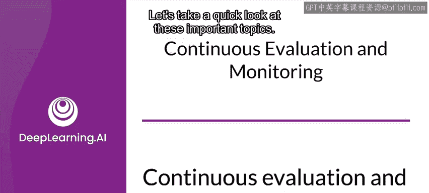

The trading data represents a snapshot of the world at the time that it was collected and labeled but the world changes。

 and for many domains， the data changes too。Sometime later。

 when your model's being used to generate predictions。

 it may or may not know enough about the current state of the world to make accurate predictions。

For example， if your model to predict movie sales was trained on data collected in the 90s。

 it might predict that customers would buy VHS tapes。Is that still a good prediction today， Well。

 my guess is no， when the model goes bad， your application and your customers will suffer。

Before it becomes of fire drill to collect new training data and fix the model。

 you want an early warning that your model performance is changing。

Continuously monitoring and evaluating your data and your model performance help give you that early warning。

 Let's take a look at data drift and shift。

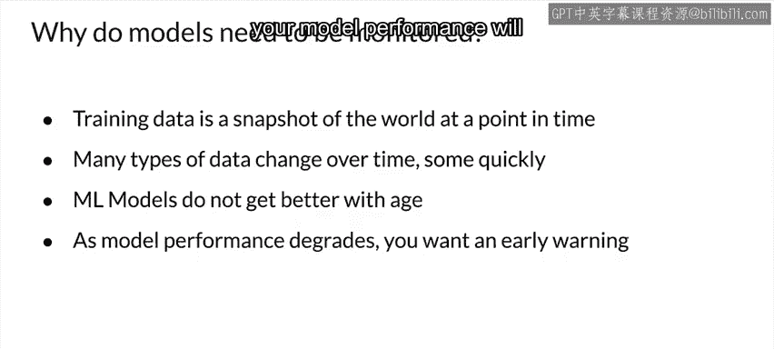

The most extreme form of this is concept drift， which is a change in the relationship between your input data and your labels。

Conscept drift can happen even when the rest of your data doesn't change。 For example。

 the exact same customer who bought red boots6 months ago may instead want white sneakers to day if the fashions have changed。

The input to your model might be exactly the same， depending on which features you capture。

 but the correct prediction has changed。 There's also the idea of an emerging concept。

 An emerging concept refers to new patterns in the data distribution that weren't previously present in your data set。

This can happen in several ways。 Labels may have become obsolete。

 and new labels may need to be added， as in our VHs example earlier。

Based on the type of distribution change， the data set shift can be classified into two types。

The first is covariate shift。In Covariate shift， the distribution of your input data changes。

 but the conditional probability of your output over the input remains the same。

 The distribution of your labels doesn't change。Prior probability shift is basically the opposite of covariate shift。

The distribution of your labels changes， but your input data stays the same concept drift can be thought of as a type of prior probability shift。

Now， let's think about how to monitor your data and model performance。 First。

 think of your trained model in a production setting。

 Let's start with the raw data that you'll use to make a prediction before making a prediction。

 you probably need to do some preproces of the raw data。

 and then you use your model to generate a prediction， given the input data。 Now。

 let's add monitoring and evaluation。 First， let's monitor the raw data being received in production and compare it to the data that you train your model with。

 This lets you look for changes in the input data over time or covariate shift。 Next。

 let's add monitoring for the predictions which you generate。

 This enables you to detect prior probability shift。Finally， let's add a labeling process。

 which enables the detection of concept drift。😊，Note that in many cases。

 there will be a significant delay in generating labels for a sample of the new input data。

So now that you've added monitoring， how do you look for drift and shift？

There are both supervised and unsupervised methods based on whether or not you have labels for the incoming stream of data and the kind of drift or shift that you're looking for。

 Let's discuss each of these， next。

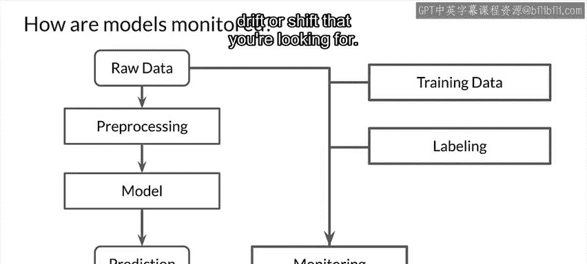

Our first supervised technique is statistical process control。

 Statistical process control has been primarily used in manufacturing for quality control since the 1920s。

It uses statistical methods to monitor and control a process。

 which in the case of your deployed model is the incoming stream of raw data for prediction requests。

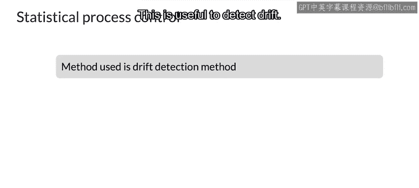

This is useful to detect drift。 It assumes that the stream of data will be stationary。

 which it may or may not be， depending on your application。

And that the errors follow a binomial distribution。

 it analyzes the rate of errors and since it's a supervised method。

 it requires us to have labels for our incoming stream of data。Essentially。

 this method triggers a drift alert if the parameters of the distribution go beyond a certain threshold rule。

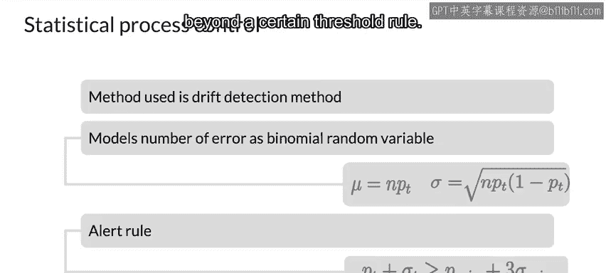

The second supervised technique is sequential analysis。In sequential analysis。

 we use a method called linear4 rates。 The basic idea is that if data is stationary。

 the contingency table should remain constant。

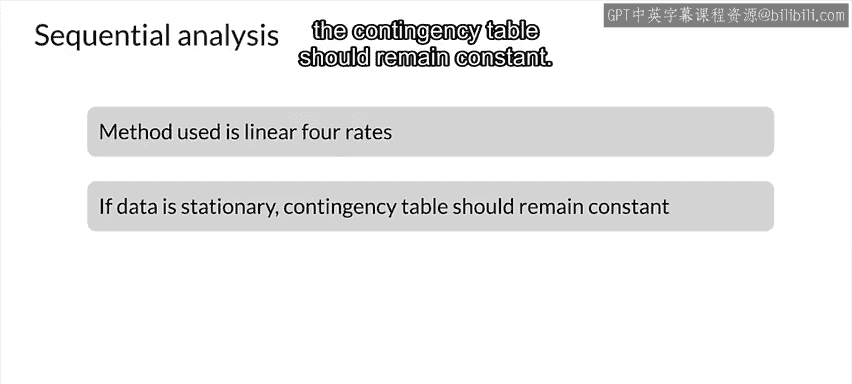

The contingency table， in this case corresponds to the truth table for a classifier that you're probably familiar with。

 True positive， false positive， false negative and true negative。

You use those to calculate the four rates， net predictive value， precision， recall and specificity。

If the model is predicting correctly， these four values should continue to remain constant。

 the last supervised technique to review is air distribution monitoring。

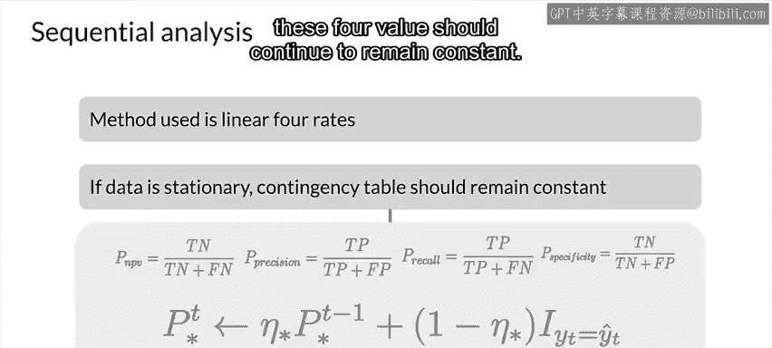

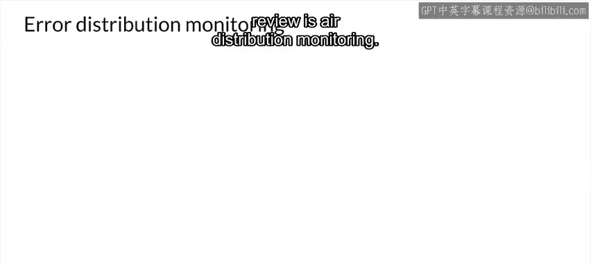

The method of choice here is known as adaptive windowing。 In this method。

 you divide the incoming data into windows， the size of which adapts to the data。

 Then you calculate the mean error rate at every window of data。

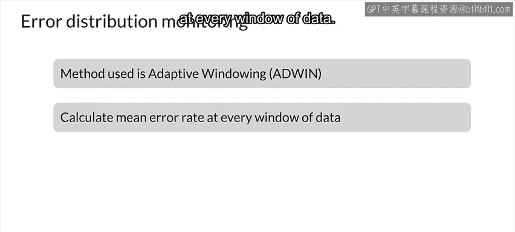

Finally， let's calculate the absolute difference of mean of the mean error rate at every successive window and compare it with a threshold based on the hofting bound。

 The hofting bound is used for testing the difference between the means of two populations。 Now。

 let's move on to unsupervised techniques。

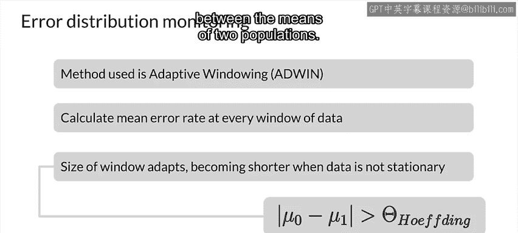

The main problem with supervised techniques is that you need to have labels and generating labels can be expensive and slow。

In unsupervised techniques， you don't need labels and note that you can also use unsupervised techniques in addition to supervised techniques when you do have labels。

Let's start with clustering or novelty detection。 In this method。

 you cluster the incoming data into one of the known classes。

If you see that the features of the new data are far away from the features of known classes。

 then you know that you're seeing an emerging concept。Based on the type of clustering you choose。

 there are multiple algorithms available。 We've listed a few， including Olinda， Minas。

 E S Minor and G C 3。 But for this course， we won't be discussing the details of these algorithms。

While the visualization and ease of working with clustering work well with low dimensional data。

 the curse of dimensionality kicks in once the number of dimensions grows significantly。 Eventually。

 these methods start get inefficient， but you can use dimensionality reduction techniques like PCA to help make it manageable。

However， this is the only method that helps you in detecting emerging concepts。

The downside of this method is that it detects only cluster based drift。

 not population based changes。

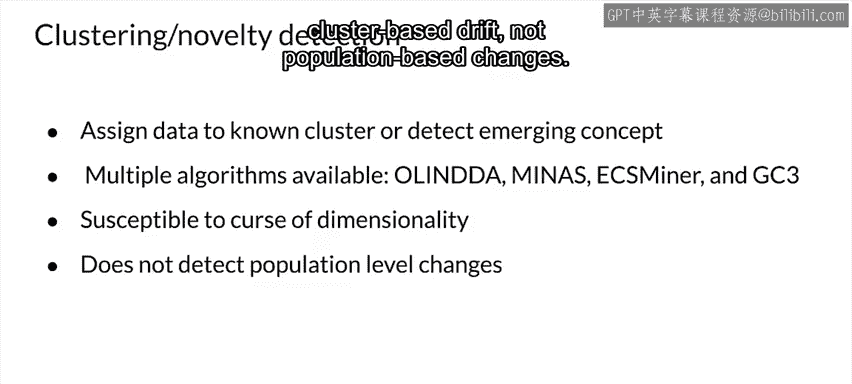

The next unsupervised technique is feature distribution monitoring。

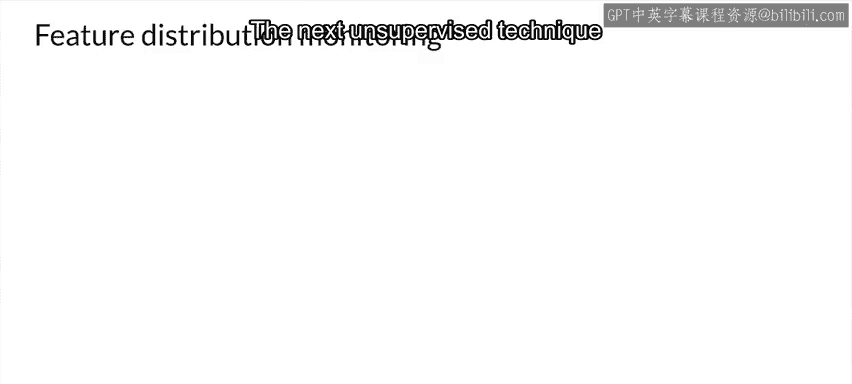

In feature distribution monitoring， we monitor each feature of the data set separately。

 you split the incoming data into uniformly sized windows and then compare the individual features against each window of data。

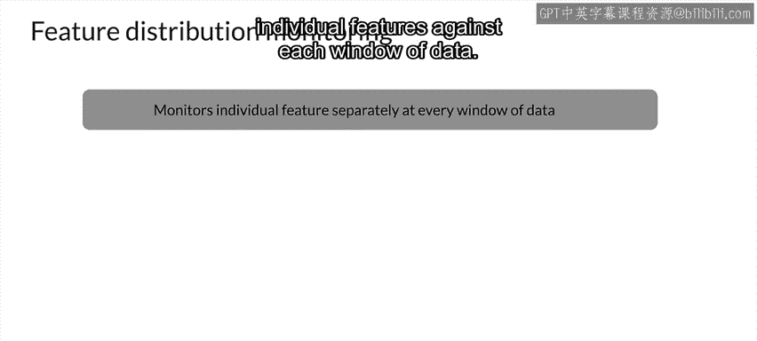

There are multiple algorithms available to do the comparison。

 and here are two of the most popular ones。 The first is Pearson correlation。

 which is used in the change of concept technique。There's also the Helener distance。

 which is used in the Helener distancetance drift detection method or HDDM。

The Helinger distance is used to quantify the similarity between two probability distributions。

 See the reference list at the end of the week for more information。

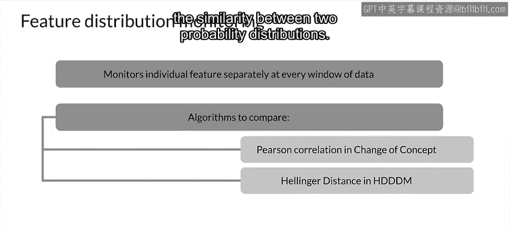

Similar to the case of novelty detection， if the cursive dimensionality kicks in。

 you can make use of dimensionality reduction techniques like PCA to reduce the number of features。

 The downside of this method is that is not able to detect population drift since it only looks at individual features。

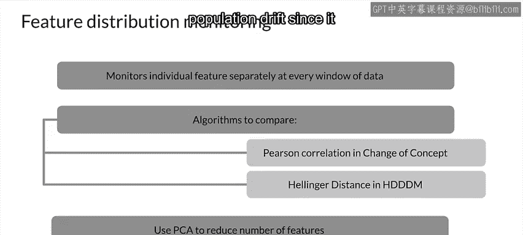

The last unsupervised technique to cover is model dependent mono。

This method monitors the space near the decision boundaries or margins in the latent feature space of your model。

One of the algorithms used is margin density drift detection or MD3。

Space near the margins where the model has low confidence matters more than in other places。

 And this method looks for incoming data that falls into the margins。

A change in the number of samples in the margin， the margin density indicates drift。

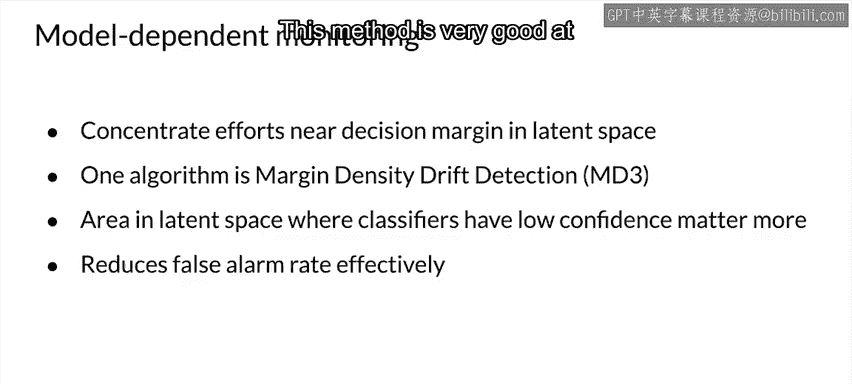

This method is very good at reducing the false alarm rate。

There are many ways to evaluate different aspects of model performance。

 looking at both the incoming stream of requests and the predictions generated by the model。

Cloud hosting providers， including Google， offer services。

 which can be used for continuous evaluation of your data and or model。

 One such service is Microsoft Azure Ma learning datasets， which focuses on data drift。

 Another is Amazon Sagemakerr model monitor， which focuses on concept drift。😊，Here。

 let's take a look at Google Cloud AI continuous evaluation。

 which also focuses primarily on concept drift as an example of the kinds of services which are available。

Google Cloud AI continuous evaluation regularly samples prediction input and output from train models that you've deployed to AI platform prediction AI platform data labeling service。

 then assign human reviewers to provide ground truth labels for a sample of the prediction request that you receive。

 or alternatively， you can provide your own ground truth labels using a different technique。

We discussed several labeling techniques previously。

The data labeling service then compares your model's predictions with the ground truth labels to provide continual feedback on how your model is performing over time。

 You start by deploying a trained model to AI platform prediction as a model version。

 Then you can create an evaluation job for the model version。As your model serves online predictions。

 the input and output for some of these predictions is saved in a Big query table。

 You can customize how much data gets sampled。Intermittently， the evaluation job runs。

 generating evaluation metrics， which you can view in the Google Cloud console。

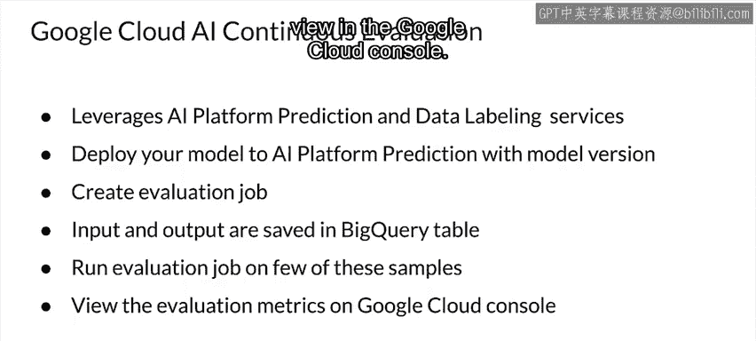

So how often should you retrain your model？There's no fixed answer to this question。

 and it largely depends on the data and the world。The rate of change of the data and the rate of change of the world that you're modeling will determine how often you need to retrain your model to adapt to change。

Of course， you can retrain your model whenever you wish。

 including when you've made improvements to your model's design， Retraining too often is okay。

But it can result in higher costs for compute resources。

Not retraining often enough can lead to degraded model performance。Ideally。

 you should monitor your data and model well enough to be able to use your evaluation results to trigger retraining automatically。

 If you can't do that or haven't reached the level of maturity in your deployment。

 then you can also just retrain on a schedule。 For example。

 imagine that you're selling sporting goods and using your model to predict sales so that you can order inventory。

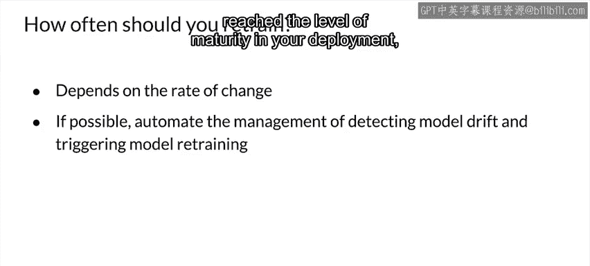

In the winter， your models performing well， and your inventory ordering is nearly perfect。

Your customers are buying widter clothes and winterter sports equipment like skis。However。

 as spring approaches， you start to see changes in customer behavior。

 the same customers that were buying skis before start to buy tennis rackets。

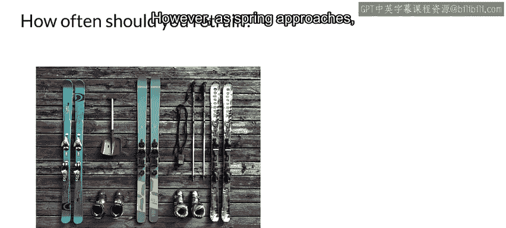

But your model is still predicting skis and you're in danger of ordering too many。

Because you had continuous monitoring in place， you catch the problem early and retrain your model with new data from recent customer interactions and sales。

 Now， your inventory is back to nearly perfect again。😊。

Well it was quite a week we started with model performance analysis at a fairly deep level。

 including a deep dive into Tensorflowlow model analysis or our TFMA。

 which is a great tool for understanding your model performance。

 then we took a look at model debugging and robustness including sensitivity analysis and understanding adversarial attacks as well。

 then we looked at model remediation which is of course very important and fairness as well。

 which we looked at ways to measure fairness and ways to try to deal with it as well。

So finally we finished up with continuous evaluation and monitoring which are of course very important for understanding when you need to retrain your model and how to measure your model performance throughout its life so it was a lot to go over I hope you enjoyed it I did and we'll see you next time。

