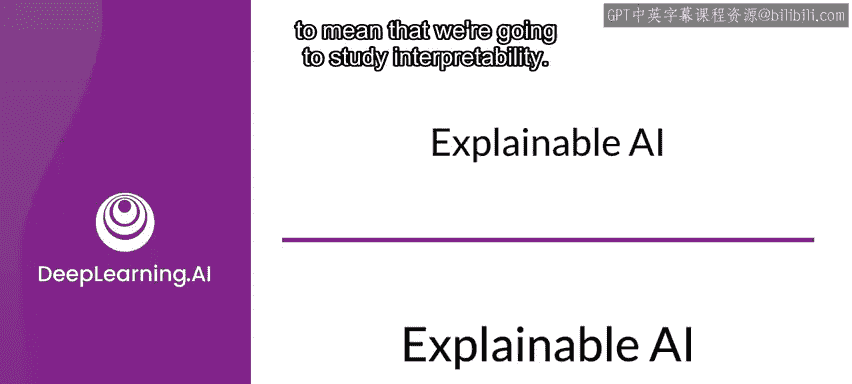
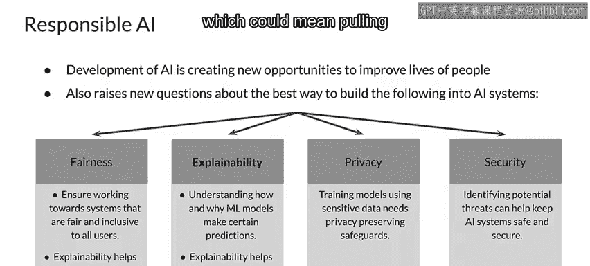
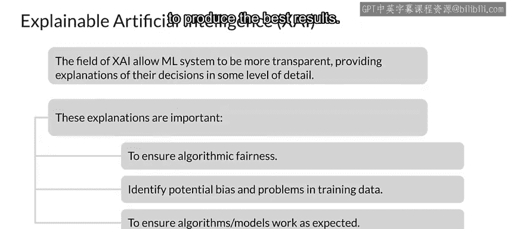
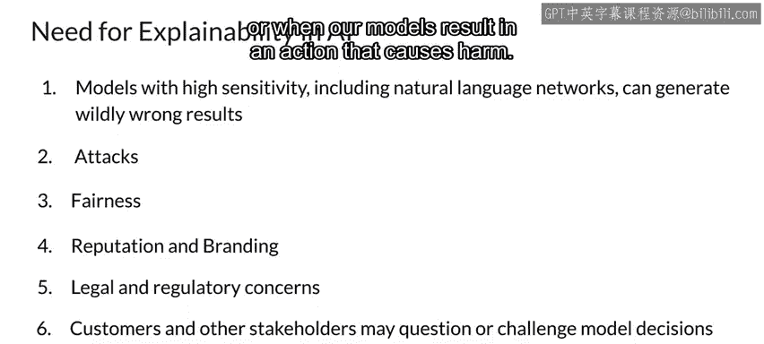

# 吴恩达《机器学习工程师的生产实践（MLOps）Machine Learning Engineering for Production》中英字幕 - P119：41_可解释的AI.zh_en - GPT中英字幕课程资源 - BV1pi4y167g5

Welcome back。This week is all about interpretability。

 explaining to yourself and probably to other people why your model did what it did。

It's important increasingly in a lot of production ML for a number of different reasons。

 including fairness， regulatory requirements and legal requirements。

 as well as just being able to understand your model better so that you can either fix problems with it or improve it。

So interpretability， let's get started。We'll start by discussing explainable AI。

Interpretability is becoming increasingly important at the same time that it's becoming increasingly difficult with more and more complex models。

But the good news is that the techniques for achieving interpretability are improving as well。

Concretely， you could interpret that to mean that we're going to study interpretability。

Interpretability and explainability are parts of a larger field known as responsible AI。

 The development of AI and the successful application of AI to more and more problems has resulted in the rapid growth of the ability to perform tasks which were previously not possible。

This has created many great new opportunities， but at the same time。

 it also puts a lot of power into the results of models。

There are sometimes questions about models and how responsibly they handle a number of factors which influence people and can cause harm。

 So issues of fairness， which we've talked about previously， are central to responsible AI。

 explainability in a smaller sense， interpretability are key to being able to do responsible AI。

 because we need to understand how models generated their results。

Privacy is also part of responsible AI， since models often operate with personally identifiable information or P I。

 and they are often trained with P I。And， of course。

 security is also an issue and related to privacy， since one of the attacks that we've talked about is to pull the training data out of a model which could mean pulling private information from a model。

The results generated by a model can be explained in different ways。

 One of the most advanced techniques is to create a model architecture that is inherently explainable。

A simple example of this is a decision tree based model， which， by its nature， is explainable。

 but there are increasingly more advanced and complex model architectures that are also designed to be inherently explainable。

 This is the field of explainable artificial intelligence or X AI。

Explainability is important in many ways。 these include ensuring fairness。

Looking for issues with bias in the training data， regulatory， legal and branding concerns。

And simply studying the internals of a model to optimize it to produce the best results。

So why is explainability in AI so important？Well， fundamentally。

 it's because we need to explain the results and the decisions that are made by our models。

 This is especially true for models with high sensitivity， including natural language models， which。

 when confronted with certain examples， can generate wildly wrong results。

It also includes vulnerability to attacks， which we need to evaluate on an ongoing basis and not just after an attack has already happened。

And of course， fairness is a key issue， since we want to make sure that we are treating every user of our model fairly。

This also impacts our reputation and branding， especially in cases where customers or other stakeholders may question or challenge our model's decision。

 but really in any case where we generate a prediction。And， of course。

 there are legal and regulatory concerns， especially when someone is so unhappy that they challenge us and our model in court。

 or when our models result in action that causes harm。

Deep neural networks can be fooled into misclassifying inputs to produce results with no resemblance to the true category。

 This is easiest to see in examples of image classification， but fundamentally。

 it can occur with any model architecture。The example on this slide demonstrates a black box attack in which the attack is constructed without access to the model。

The example is based on a phone app for image classification using physical adversarial examples。

What you see is a clean image of a washer from the data set， the image A on the left。

 and that's used to generate adversarial images with various degrees of perturbation。

 The next was printing out the clean and adversarial images and then using the Tensorflow camera demo app to classify them。

The clean image B is recognized correctly as a washer when perceived through the camera。

 while increasing the adversarial perturbation in images C and D results in greater misclassification。

 of their key result that is in image D where the model thinks that the washer is either a safe or a loudspeak。

 but definitely not a washer。😊，Looking at the image， would you agree with the model， maybe not？

Can you see the adversarial perturbation that was applied， it's not that easy to see。

This is perhaps the most famous example of this kind of model attack by adding an imperceptibly small amount of well crafted noise。

 an image of a panda can be misclassified as a gibbon。 with 99。3 per cent confidence。

 That's much higher than the original confidence that the model had that it was a panda。😊。

