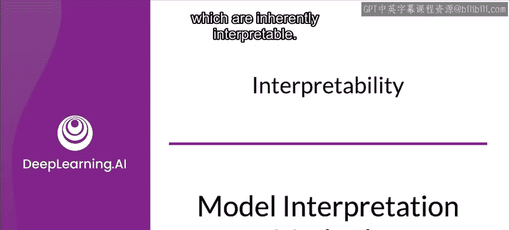
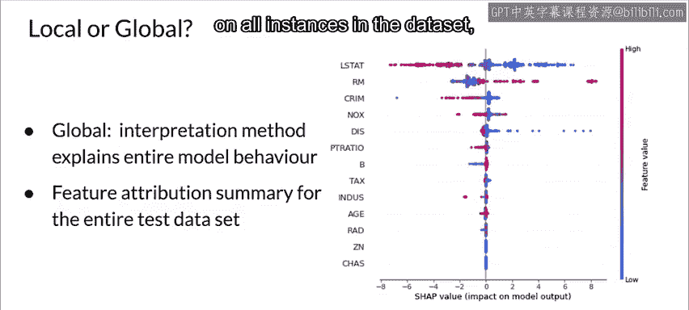

# 吴恩达《机器学习工程师的生产实践（MLOps）Machine Learning Engineering for Production》中英字幕 - P120：42_模型解释方法.zh_en - GPT中英字幕课程资源 - BV1pi4y167g5

Let's look now at some of the basic ways of interpreting models。

 There are two broad overlapping categories， techniques which can be applied to models in general and model architectures。

 which are inherently interpretable。

Interpretability itself does not have a mathematical definition。

 Beron and Cotton provided one good definition of interpretability。 They wrote that in systems。

 or in this case， models， they are interpretable if their operations can be understood by a human。

 either through introspection or through a produced explanation。 In other words。

 if there is some way for a human to figure out why a model produced a certain result。

 then the model is interpretable。Practically speaking， however。

 the level of effort required needs to be feasible as well。

 And one measure of interpretability of models is the amount of effort or analysis required to understand a given result。

Ideally， you should be able to query the model to understand the what。

 why and how of its algorithmic decisions。 Why did the model behave in a certain way。

You should be able to identify and validate the relevant variables driving the model's outputs。

 Doing so will help you develop trust in the reliability of the predictive system。

 even in unforeseen circumstances。 This diagnosis will help ensure accountability and confidence in the safety of the model。

😊，How can we trust the predictions made by the model， Well。

 you should be able to validate any given data point to demonstrate to business stakeholders and peers that the model works as expected。

 This will help ensure the transparency of the model。

What information can the model provide to avoid prediction errors。

 You should be able to query and understand latent variable interactions in order to evaluate and understand in a timely manner。

 What features are driving predictions。 This will help you to ensure the fairness of the model。

 There are some criteria that can be used for categorizing model interpretation methods。 For example。

 interpretability methods can be grouped based on whether they are intrinsic or post ho。

They could also be model specific or model agnostic。

And they can also be grouped according to whether they are local or global。

 Let's discuss each of these criteria。One way of grouping model interpretability methods is by whether the model itself is intrinsically interpretable。

 Model architectures that are intrinsically interpretable have been around for a long time。

And the classic examples of this are linear models and tree based models。 More recently， however。

 more advanced model architectures， such as lattice models have been developed to enable both interpretability and a high degree of accuracy on complex modelling problems。

😊，Latuce models， for example， can match， or in some cases， exceed the accuracy of neural networks。

Let's consider post hoc methods。Post ho methods treat models as black boxes and often don't distinguish between different model architectures。

 They tend to treat all models the same and are applied after training to try to examine particular results to understand what caused the model to generate them。

 there are some methods， however， especially for convolutional networks。

 that do inspect the layers within the network to try to understand how results were generated。

 There is， however， always some level of uncertainty about whether the interpretation of the reasons for certain results is correct or not。

 Since post ho methods don't evaluate the actual sequence of operations that LED to the generation of the results。

 In general， an intrinsically interpretable model provides a higher degree of certainty as to why it generated a particular result。

 Examples of these analyseses include feature importance and partial dependency plots。

The various interpretation methods can also be roughly classified。

 according to the type of results they produce。 Some methods create a summary of feature statistics。

 Some methods return a single value for a feature。 For example。

 feature importance returns a single number per feature。 A more complex example。

 would be pairwise feature interaction strength， which associates a number with each pair of features。

Some methods rely on visualization to summarize features， for example， partial dependence plots。

Partial dependence plots are curves that show a feature and its average predicted output。

 In this case， drawing the curve is more meaningful and intuitive than simply representing the values in a table。

Some model specific methods look at model internals。

 The interpretation of intrinsically interpretable models falls into this category。 For example。

 in case of less complex models such as linear models。

 you can look at the learned weights to produce an interpretation。Similarly。

 the learned tree structure in a tree based model serves as an interpretation。In lattice models。

 the parameters of each layer are the output of that layer。

 which makes it relatively easy to analyze， understand and debug each part of the model。

Some methods examine particular data points。 One such method is counterfactual explanations。

 counterfactual explanations are used to explain the prediction of a data point。 in order to do so。

 it finds another data point by changing some features so that the predicted output changes in a relevant way。

 The change should be significant。 For example， the new data point should be predicting a different class。

Model specific methods are limited to specific model types。 For example。

 the interpretation of regression weights and linear models is model specific。By definition。

 the techniques for interpreting intrinsically interpretable models are model specific。

But model specific methods are not limited to intrinsically interpretable models。

 There are also tools that specifically focus on neural network interpretation。

Model agnostic methods are not specific to any particular model。

 They can be applied to any model after it's trained。Essentially， they are post hoc methods。

 These methods do not have access to the internals of the model， such as weights and parameters。

 et cetera。 They usually work by analyzing feature input and output pairs and trying to infer relationships。

In addition to grouping interpretation methods as model agnostic or model specific。

 they can also be grouped by whether they generate interpretations which are local or global。

Interpretability methods can be local or global based on whether the method explains an individual prediction or it explains the entire model behavior。

 Sometimes the scope can be in between local and global。

 A local interpretability method explains an individual prediction。 For example。

 feature attribution in the prediction of a single example in the data set。

 Fe attributions measure how much each feature contributed to the predictions for a given result。

Here's a feature attribution using a library called Shap for the prediction of a single example by a gradient boosted ensemble tree trained on the Boston House price data set。

This example is used to demonstrate what a local explanation looks like。

The diagram shows the contribution of features in pushing model output from the base value towards the actual model output。

Features in red push the model towards higher value。

 and features in blue try to push the model output towards a lower value。

Interpretability methods could also be global。Global methods explain the entire model behavior。

 For example， if the method creates a summary of feature attributions for predictions on the entire test set。

Then it can be considered global Here's an example of a global explanation created by the Shap library。

😊，It shows feature attributions the Sha value of every feature for every sample for predictions in the Boston House pricess data set。

The color represents the feature value。 Red is high and blue is low。 You can see how， as Ltt。

 the percent of lower status of the population increases。

 It tends to lead to a decrease in the predicted house price。

 Since this explanation shows an overview of attributions of all features on all instances in the data set。

 it would be considered global。

