# 吴恩达《机器学习工程师的生产实践（MLOps）Machine Learning Engineering for Production》中英字幕 - P121：43_内生可解释模型.zh_en - GPT中英字幕课程资源 - BV1pi4y167g5

Since the early days of statistical analysis and machine learning。

 there have been model architectures which are intrinsically interpretable。Let's look at those now。

 along with some more recented advances and learn about how they can improve interpretability。

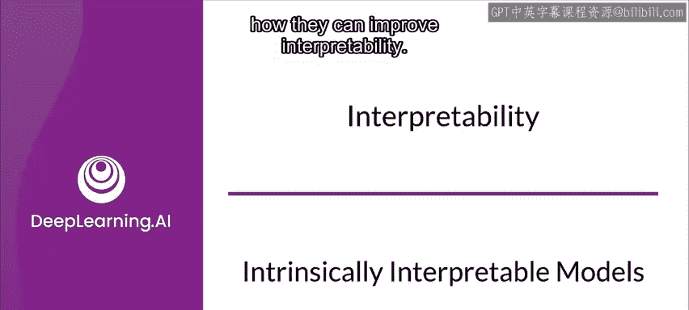

So what exactly do we mean by an intrinsically interpretable model， well。

 one definition is that the workings of the model are transparent enough and intuitive enough。

That they make it relatively easy to understand how the model produced a particular result by examining the model itself。

Many classic models are highly interpretable， such as tree based models and linear models。

But although we've seen neural networks that are able to produce really amazing results。

 one of the issues with them is that they tend to be very opaque。

 especially the larger and more complex architectures。

 which makes them black boxes when we're trying to interpret them。😊。

That limits our ability to interpret their results and requires us to use post hoc analysis tools to try to understand how they reached a particular result。

However， newer architectures have been created， which are designed specifically for interpretability and yet retain the power of deep neural networks。

 This continues to be an active field of research。

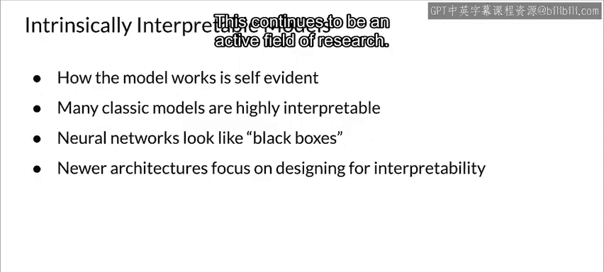

One key characteristic， which helps improve interpretability， is when features are monotonic。

Monoonic means that the contribution of the feature towards the model result either consistently increases or decreases or stays even as the feature value changes。

The key factor here is the consistency。 This matches the domain knowledge for many features in many kinds of problems。

So when you're trying to understand a model result， if the features are monoonic。

 it matches your intuition about the reality of the world that you're trying to model。So。

 for example， if you're trying to create a model to predict the value of a used car。

 when all other features are held constant， the more miles on the car， the less the value should be。

 you don't expect a car with more miles to be worth more than it was with less miles。

 All other things being equal。This matches your knowledge of the world。

 and so your model should match it too， and the mileage feature should be monotonic。In this graph。

 the blue and green curves are monotonic， while the red curve is not because it does not consistently increase or decrease or remain the same。

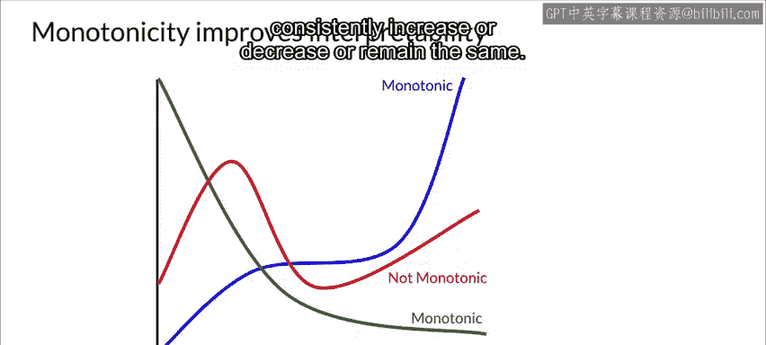

Let's look at a few architectures， which are considered interpretable。 First。

 linear models are very interpretable because linear relationships are easy to understand and interpret。

 and the features of linear models are always monotonic。

Some other model architectures have linear aspects to them。 For example， when used for regression。

 rule fit models are linear， and in all cases， T F lattice models use linear interpolation between lattice points。

 which we'll learn about soon。Some models can automatically include feature interactions or include constraints on feature interactions。

In theory， you can include feature interaction in all models through feature engineering。

Interactions which match our domain knowledge tend to make models more interpretable。

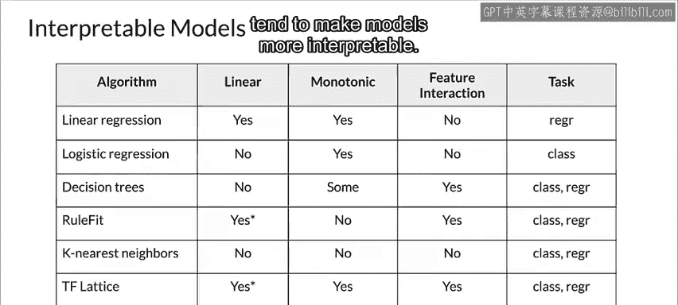

Depending on the characteristics of the loss surface that you're trying to model。

 the more complex model architectures can achieve high accuracy。

This often comes at a price in terms of interpretability。 For many of the reasons discussed earlier。

 interpretability can be a strict requirement of models。

 And so you need to find a balance between models that you can interpret and models that generate the accuracy that you need。

 Again， some newer architectures have been created， which deliver far greater accuracy。

 but also deliver good interpretability。 Tensorflow lattice is one example of these kinds of architectures。

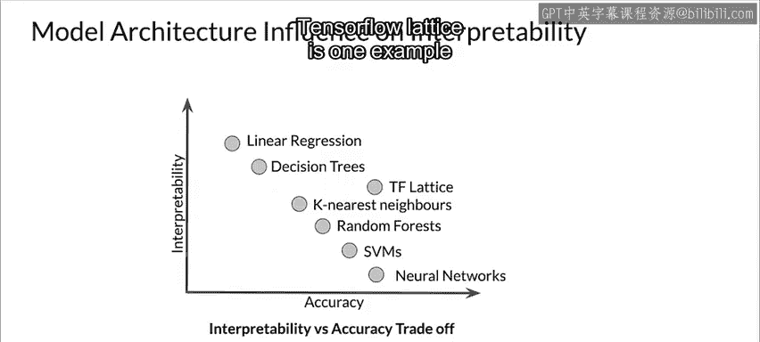

Probably the ultimate in interpretterpretability is our old friend linear regression。

I don't know about you， but for me， this was the first type of model that I learned about。

 It's very easy to understand the relationship between feature contributions。

 even for multivariate linear regression。As feature values increase or decrease。

 their contribution to the model results also increases or decreases。

This example here shown here models the number of chirps per minute that a cricket will make based on the temperature of the air。

This is a very simple linear relationship。 And so linear regression models it well。 By the way。

 this also means that when you're out at night， if you listen carefully to the crickets and count how many chirps they make。

 you can measure the temperature of the air。

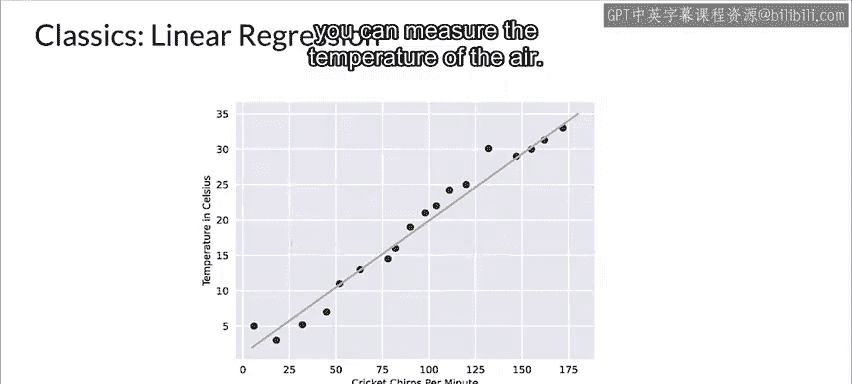

Check out Dober's law to learn more。Of course， the actual contribution of a feature to the results of the model will depend on its weight。

This is especially easy to see for linear models。For numerical features。

 an increase or decrease of one unit in a feature increases or decreases the prediction based on the value of the corresponding weight。

For binary features， the prediction is increased or decreased by the value of the weight based on whether the feature's value is1 or zero。

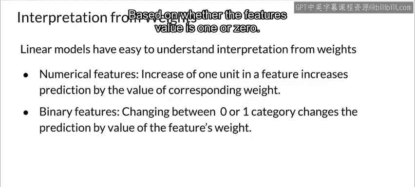

Categorical features are actually divided up into several individual features for one hot encoding。

 each of which has a weight with one hot encoding。 only one of the categories will be set。

 So only one of the weights will be included in the model result。

How can we determine the relevance of a given feature for making predictions？

Feature importance tells us how important a feature is for generating a model result。

The more important the feature is， the more we want to include it in our feature vector。

But feature importance for different models is calculated differently because different models calculate results differently。

For linear regression models， the absolute value of a feature's T statistic is a good measure of that feature's importance。

The T statistic is the learned or estimated weight of the feature， scaled by its standard error。

So the importance of a feature increases as its weight increases。

 but the more variance the weight has， In other words。

 the less certain we are about the correct value of the weight。The less important the feature is。

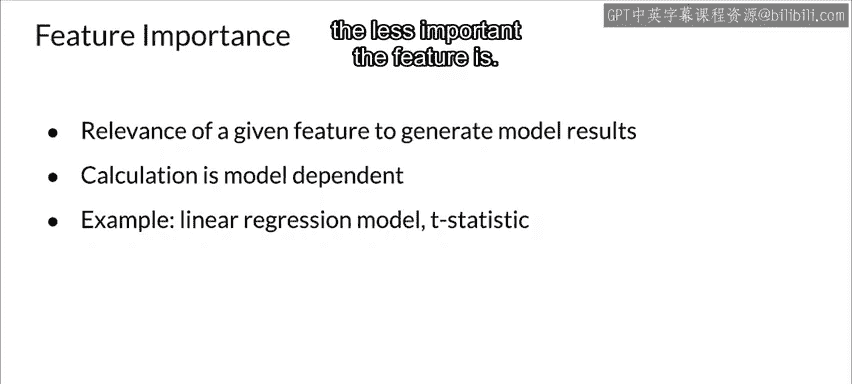

You may not be familiar with lattice models， so let's take a look at how they work。

Latuce models overlay a grid onto a feature space and set the values of the function that it's trying to learn at each of the vertices of the grid。

As prediction requests come in， if they don't fall directly on a vertex。

 then the result is interpolated using linear interpolation from the nearest vertices of the grid。

 One of the benefits is to regularize the model and greatly reduce sensitivity。

 even to examples that are outside the coverage of the training data by imposing a regular grid onto the feature space。

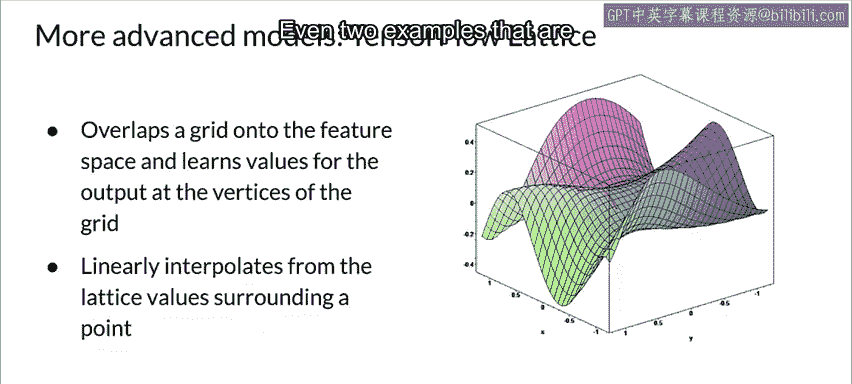

However， Tensorflow lattice models go beyond simple lattice models。

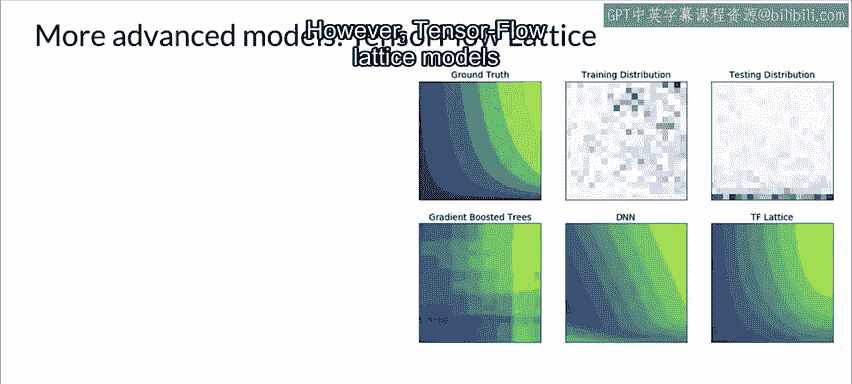

Tensorful lattice further allows you to add constraints and inject domain knowledge into the model。

 These graphs show the benefit of regularization and domain knowledge。

Compare the one on the top left to the one on the bottom right。

 and notice how close the model is to the ground truth compared to other kinds of models。

When you know that certain features in your domain are monoonic or convex。

 or that one or more features interact， you can inject that knowledge into the model as it learns。

For interpretability， this means that feature values and results are likely to match your domain knowledge for what you expect your results to look like。

You can also express relationships or interactions between features to suggest that one feature reflects trust in another feature。

For example， a higher number of reviews makes you more confident in the average star rating of a restaurant。

You might have considered that yourself when shopping on。All of these constraints。

 based on your domain knowledge or what you know about the world that you're trying to model。

 help the model produce results that makes sense， which helps make them interpretable。Also。

 since the model uses linear interpolation between vertices。

 it also has many of the benefits of linear models in terms of interpretability。

But along with all the benefits of added constraints based on domain knowledge。

 Tensorflow lattice models also have a level of accuracy on complex problems that is similar to deep neural networks。

And， of course， Tensorflow lattice models are also easier to interpret than neural networks。

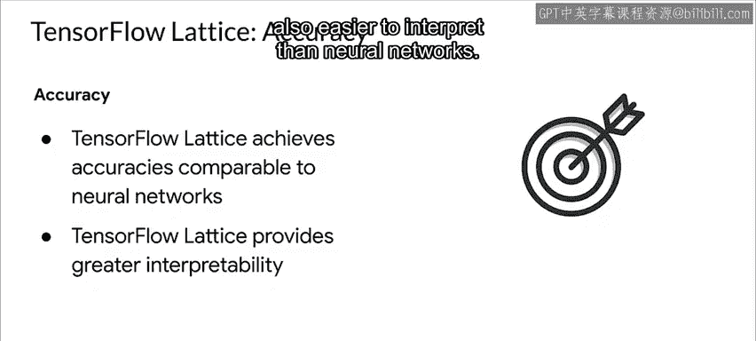

However， lattice models do have a weakness。Dimensionalality is their kryptonite。

The number of parameters of a lattice increases exponentially with the number of input features。

 which creates problems with scaling for data sets with a large number of features as a rough rule of thumb。

 you're probably okay with 20 or less features， but this will also depend on the number of vertices that you specify。

There is another way to deal with this dimensionality cryryptonite， however。

 and that's by using ensembling。 But that is beyond the scope of this presentation。

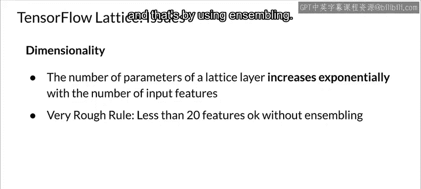

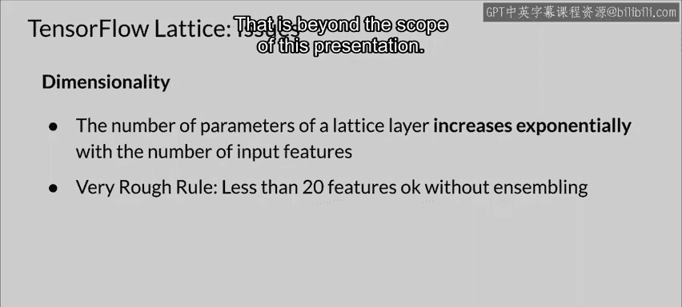