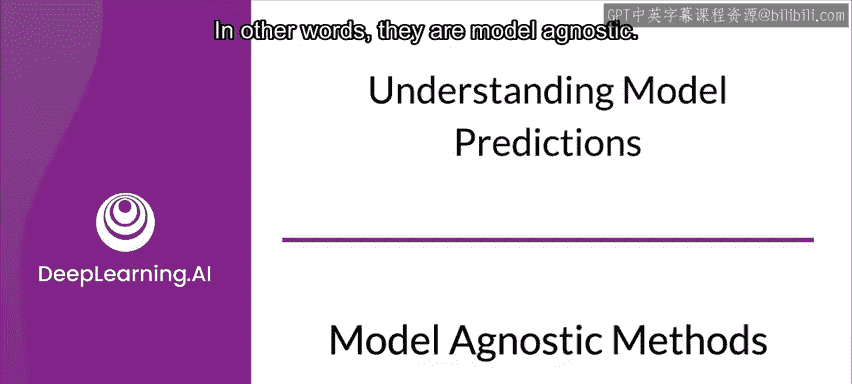
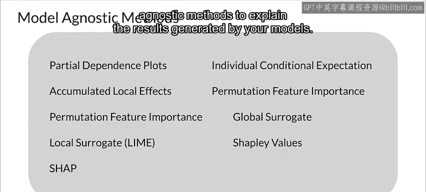

# 吴恩达《机器学习工程师的生产实践（MLOps）Machine Learning Engineering for Production》中英字幕 - P122：44_模型无关方法.zh_en - GPT中英字幕课程资源 - BV1pi4y167g5

Unfortunately， you can't always work with models that are intrinsically interpretable for a variety of reasons。

 you may be asked to try to interpret the results of models that are not inherently easy to interpret。

Fortunately， there are several methods available that are not specific to particular types of models。

 In other words， they are model agnostic。 Let's look at some of those now。

Model agnostic methods separate the explanations from the model。

 These methods can be applied to any model， after it's been trained。For example。

 they can be applied to linear regression or decision trees or even black box models like neural networks。

The desirable characteristics of a model agnostic method include model flexibility and explanation flexibility。

The explanation shouldn't be limited to a certain type。

 The method should be able to provide an explanation as a formula， or in some explanations。

 it can be graphical， like perhaps for feature importance。

These methods also need to have representation flexibility。

 The feature representations used should make sense in the context of the model being explained。

 Let's take the example of a text classifier that uses word embeddings。

 It would make sense for the presence of individual words to be used in the explanation in this case。

There are many model agnostic methods that are currently being used。

 too many to go into all of them in detail here。I'll just discuss a few to give you a flavor for the kinds of things that you can do with model agnostic methods to explain the results generated by your models。

