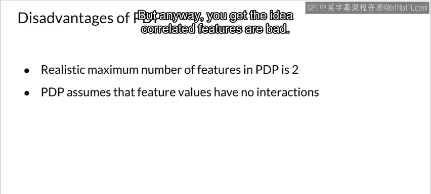

# 吴恩达《机器学习工程师的生产实践（MLOps）Machine Learning Engineering for Production》中英字幕 - P123：45_部分依赖图.zh_en - GPT中英字幕课程资源 - BV1pi4y167g5

One widely used method is partial dependence plots or PDP。 Let's start with PDP。

Partel dependence plots help you to understand the effects that particular features have on the model results that you're seeing and the type of relationship between those features and the targets or labels in your training data。

 It typically concentrates on the marginal impact caused by one or two features on the model results。

Those relationships could be linear and or monotonic， or they could be of some more complex type。

 For example， for a linear regression model， a partial dependence plot will always show a linear monotonic relationship。

PDP is a global method since it considers all instances and evaluates the global relationship between the features and the results。

The partial function F sub Sx is estimated by calculating averages in the training data。

 also known as the Monte Carlo method。This equation shows the estimation of the partial function where n is the number of examples in the training data set。

 S is the features that we're interested in， and C is all of the other features。

The partial function tells us what the average marginal effect on the result is for given values of the features in S。

In this formula， X sub CI are feature values for the features that we're not interested in。

PD P makes the assumption that the features in C are not correlated with the features in S。

 If this assumption is violated， the averages calculated will include data points that are very unlikely or even impossible。

Here's an example of a random forest model trained on a bike Reolds data set to predict the number of bikes rented per day。

 given a set of features， which include temperature， humidity and wind speed。

These are the partial dependence plots for temperature， humidity and wind speed。

Notice that as the temperature increases up to about 15 degrees centigrade or 59 degrees Fahrenheit。

 more people are likely to rent a bike。This makes sense because people like to ride bikes when the weather is nice and at that temperature。

 I'd say it's just starting to get nice。But notice that this trend levels off and then starts to fall off between above about 25 degrees centigrade or 77 degrees F。

 You can also see that humidity is a factor， and above about 60% cent humidity。

 people start to get less interested in riding bikes。How about you。

 Do these plots Me your bike riding preferences。To calculate a PDP for categorical features。

 we force all instances to have the same category value。

Here's the plot for the categorical feature season in the bikeike Reynolds data set。

 It has four possible values， spring， summer， fall and winter。

In order to calculate the PDP for summer， we force all instances in the data set to have value equals summer for the feature season。

This plot shows different values for season。 Notice that there is not much difference of an effect of the change in seasons on bike rentals。

 except for in spring， where the number of rentals is somewhat lower。Frankly。

 I wouldn't expect that to be the case， but that's what the data is telling us。

There are some clear advantages to using PDP。First， the results tend to be intuitive。

 especially when the features are not correlated。 when they' are not correlated。

 a PD DP plot shows the average prediction changes when a feature is changed。

The interpretation of a PDP is also usually causal in the sense that if we change a feature and measure the changes in the results。

 we expect the results to be consistent。Finally， PDP is fairly easy to implement with some packages listed in the reference section at the end of this lesson。

Like most things， however， there are some disadvantages to PDP。Realistically。

 you can only really work with two features at a time because humans have a hard time visualizing more than three dimensions。

 but I'm really not sure that I would blame PDP for that。

More serious limitation is the assumption of independence。

PDP assumes that the features that you're analyzing aren't correlated with other features。

 As we learned in our discussion of feature selection。

 it's a good idea to eliminate correlated features anyway。But if you still have correlated features。

 PDP doesn't work quite right。For example， suppose you want to predict how fast a person walks given the person's height and weight。

PDP will assume that height and weight aren't correlated， which is obviously a false assumption。

As a result， we might include people with a height of two meters and a weight of 50 kilograms。

 which is a bit unrealistic even for fashion models。Although when I Googled this。

 I was shocked to learn that some are actually pretty close。But anyway。

 you get the idea correlated features are bad。

