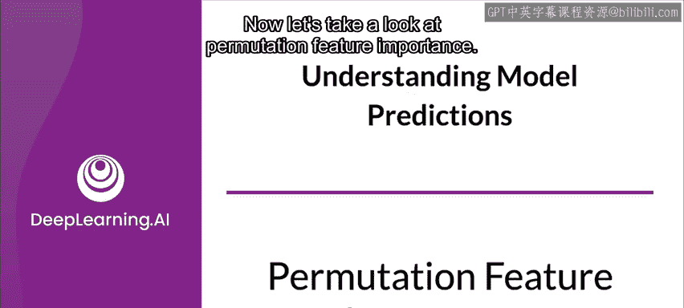
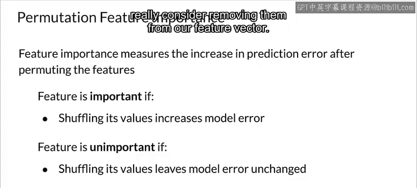
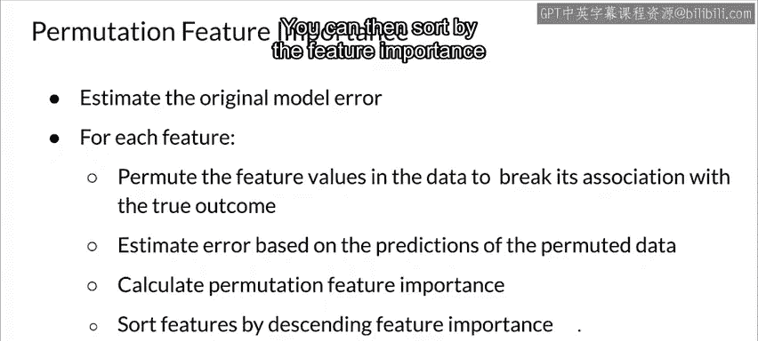
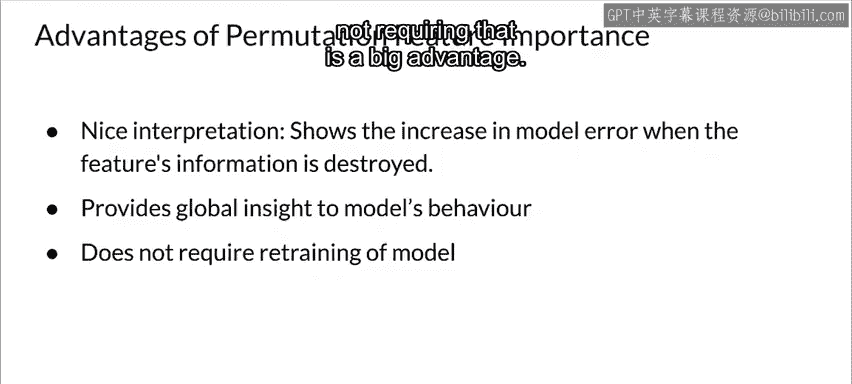
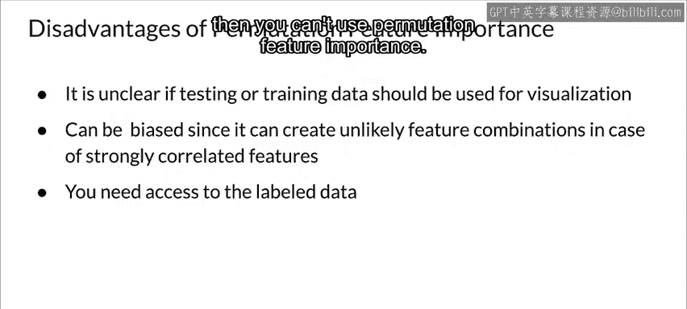

# 吴恩达《机器学习工程师的生产实践（MLOps）Machine Learning Engineering for Production》中英字幕 - P124：46_排列特征重要性.zh_en - GPT中英字幕课程资源 - BV1pi4y167g5

Now let's take a look at permutation feature importance Permutation feature importance is just one way of measuring the importance of a feature。

 Permuting a feature is just one way of breaking the relationship between a feature and the model result。

 essentially by assigning a nearly random value to the feature。For permutation feature importance。

 we measure the importance of a feature by measuring the increase in the prediction error after permuting that feature。

A feature is important if shuffling its values increases the model error， because in this case。

 the model relied on the feature for the prediction。

A feature is unimportant If shuffling its values leaves the model error unchanged。

 because in this case， the model ignored the feature。Again。

 if we find that we have unimportant features， then we should really consider removing them from our feature vector。

This is the basic algorithm。 The inputs are the model of features， the labels are targets。

 and are error metric。You start by measuring the model error with all of the true values of the features。

Next， you start an iterative process for each feature where you first permute the values of the feature that you're examining and measure the change in the model error。

You can either express the feature importance as a ratio of the permuted error to the original error。

Or as the difference between the two。You can then sort by the feature importance to determine the least important features。

Let's consider the advantages of permutation feature importance。

Permutation feature importance has a nice interpretation because feature importance is the increase in the model error when the feature's information is destroyed。

It's a highly compressed global insight into the model's behavior。 Since by permuting the feature。

 you also destroy the interaction effects with other features。

 It also shows the interactions between features。 This means that it accounts for both the main feature effects and the interaction effects on model performance。

😊，And a big advantage is that it doesn't require retraining the model。

Some other methods suggest deleting a feature， retraining the model。

 and then comparing the model error。 Since retraining a model can take a long time。

 Not requiring that is a big advantage。

Let's look at some of the disadvantages inherent to permutation feature importance。

One kind of odd disadvantage is that it's unclear whether you should use your training data or your test data to measure permutation feature importance。

 There are pluses and minuses to both。And like PDP， correlated features are once again a problem。

You also need to have access to the original labeled training data set。

 so if you're getting the model from someone else and they don't give you that。

 then you can't use permutation feature importance。

