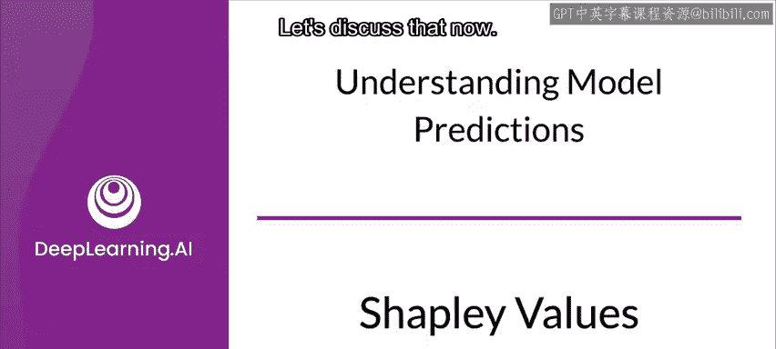
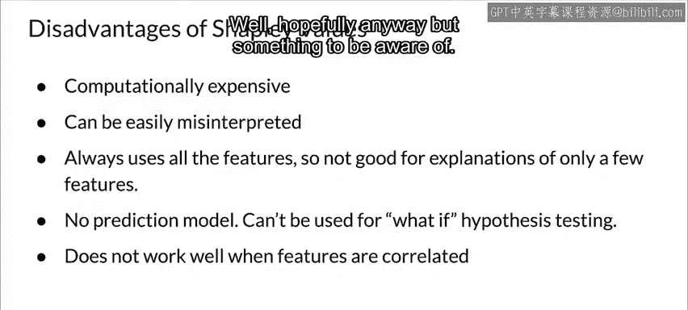

# 吴恩达《机器学习工程师的生产实践（MLOps）Machine Learning Engineering for Production》中英字幕 - P125：47_Shapley值.zh_en - GPT中英字幕课程资源 - BV1pi4y167g5

A key concept in measuring feature importance and the contribution of each feature to the model's results is the Shaplely value。

 Let's discuss that， now。

The Shapley value is a concept from cooperative game theory。 It was named in honor of Lloyd Shapley。

 who introduced it in 1951 and won the Nobel Prize in economics for it in 2012 to each cooperative game。

 it assigns a unique distribution among the players。

Of the total surplus value generated by the coalition of all players。

 Here's how it works in game theory。Imagine that a group of players cooperates。

 and that results in an overall gain because of their cooperation。

Since some players may contribute more than others or may possess different bargaining power。

 How should we distribute the gains among the players or phrase differently。

 How important is each player to the overall cooperation and what payoff can he or she reasonably expect。

The Shaplely value provides one possible answer to this question。

So how do you apply this to ideas in ML？For machine learning and interpretability。

 the players are the features of the data set， and we're using the Shaplely value to determine how much each feature contributes to the results。

As you might expect， the prediction is the payout。Knowing how the features contribute will help you understand what the important factors were in generating the model's results。

 because it's not specific to any particular type of model。

 It can be used regardless of the model architecture。

 That was a quick overview of the ideas behind Shaplely value。 Let's now focus on a concrete example。

 Suppose you trained an M L model to predict apartment prices。

You need to explain why the model predicts a 300，000 price for a certain apartment。

What data do you have to work with， Well， in this example， the apartment is 50 square meters。

 It's located on the second floor。 It has a park near by， and cats are banned。You're not a cat。

 So you're okay。 The average prediction for all apartments is 310000 euros。

Shaplely values come from game theory。 So let's clarify how to apply them to machine learning interpretability。

 The game is the prediction task for a single instance of the data set。

 The game is the actual prediction for this instance minus the average prediction for all instances。

 The players are the feature values of the instance that collaborate to produce the game。

 In the apartment example。 The feature values park equals nearby by cat equals band area equals 50 square meters and floor equals second。

 work together to achieve the prediction of 300000s。

 Our goal is to explain the difference between the actual prediction 300000s and the average prediction of 310000s。

 which is the loss of 10000s。😊，One possible explanation could be the park nearby contributed 30000 euros。

Size of 50 square meters contributed 10，000 euros。Floor equals second， contributed zero。

 cat equals band， contributed negative 50，000 euros。The contributions add up to negative 10000。

 The final prediction minus the average predicted apartment price。

 You could think of that as the absolute value 10000。

 or you could also think about it as the percentage of the average， which is about 3。3 per cent。

 This is 1 possible explanation。 But how did we get these numbers。

Unlike perhaps any other method of interpreting model results。

 Shaplely values are based on a solid theoretical foundation。 Other methods make intuitive sense。

 which is an important factor for interpretability。

 but don't have the same rigorous theoretical foundation。

This is one of the reasons that Shapleley was awarded the Nobel Prize for his work。

The theory defines four properties which must be satisfied， efficiency， symmetry， dummy and addivity。

One key advantage of Shaplely values that they're fairly distributed among the future values of an instance。

 Some have argued that Shapley might be the only method to deliver a full explanation in situations where the law requires explainability。

 like the E U's right to explanations。 for example。

 Some feel that Shapley value might be the only legally compliant method。

 because it based on a solid theory and distributes the effects fairly。

The Shapley value also allows contrastive explanations。

 instead of comparing a prediction to the average prediction of the entire data set。

 you could compare it to a subset or even to a single data point。

This ability to contrast is something that local models like Lyme don't have。Like any method。

 Chapley has some disadvantages。Probably the most important is that it's computationally expensive。

 which in a large percentage of real world cases means that it's only feasible to calculate an approximate solution。

It can also be easily misinterpreted。The Shapley value is not the difference of the predicted value After removing the feature from the model training。

 It's the contribution of a feature value to the difference between the actual prediction and the mean prediction。

If you want to only explain a few of your features。

 Shapley is probably the wrong method to use Shaplely always uses all the features。

Humans prefer selective explanations such as those produced by lime and other similar methods。

 So those might be the better choice for explanations that lay persons have to deal with。

 or another possible solution is to use Shap， which is based on the Shapley value。

 but can provide explanations with only a few features。 We'll discuss Shap next。

Unlike some other methods， Shapley does not create a model。

This means you can't use it to test changes in the input。

 such as if I change to 100 square meter apartment， how does it change the prediction？And finally。

 like many other methods， it does not work well when the features are correlated。

But you already know that you should have removed correlated features from your feature vector when you are doing feature selection。

 So that's not a problem for you， right。Well， hopefully anyway， but something to be aware of。

