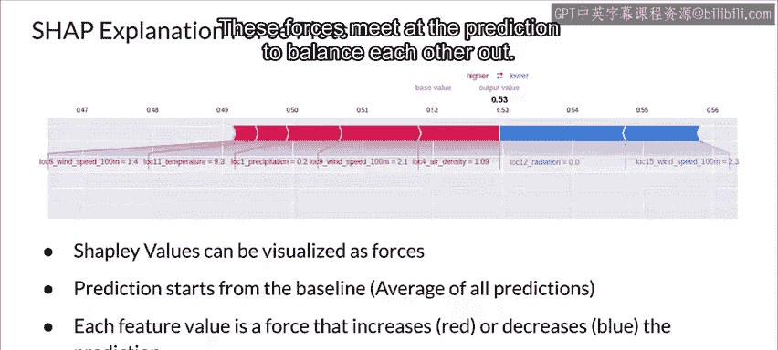
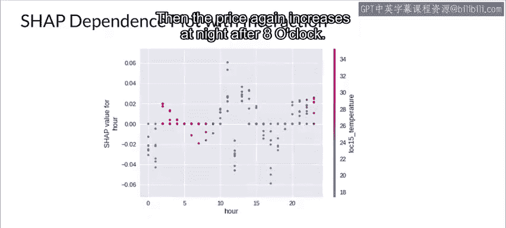

# 吴恩达《机器学习工程师的生产实践（MLOps）Machine Learning Engineering for Production》中英字幕 - P126：48_Shapley可加性解释.zh_en - GPT中英字幕课程资源 - BV1pi4y167g5

Now， let's take a look at the open source Shap library。

 which is a powerful tool for working with Shaplely values and other similar measures。 Shap。

 which is short for Shapley additive explanations is a game theoretic approach to explain the output of any machine learning model。

 which makes it model agnostic， It connects optimal credit allocation with local explanations using the classic Shaplely values from game theory and their related extensions。

 which have been the subject of several recent papers。

 Remember that Shapley created his initial theory in 1951。

 and more recent researchers have been extending his work。😊。

It assigns each feature an importance value for a particular prediction and includes some very useful extensions。

 many of which are based on this recent theoretical work。 These include tree explainer。

 a high speed exact algorithm for tree ensembles。

Deep explainer， a high speed approximation algorithm for Sha values in deep learning models。

 gradient explainer， which combines ideas from integrated gradients。

 Shap and smooth grad into a single expected value equation and kernel explainer。

 which uses a specially weighted local linear regression to estimate Sha values for any model。

 It also includes several plots to visualize the results， which helps you to interpret the model。😊。

You can visualize Shaplely values as forces。 Each feature value is a force that either increases or decreases the prediction。

The prediction starts from the baseline， which for Shapley values。

 is the average of all the prediction。In a force plot。

 each Shaplely value is displayed as an arrow that pushes the prediction to increase po values shown here in red。

 or decrease negative values shown here in blue。These forces meet at the prediction to balance each other out。

A summary plot combines feature importance with feature effects。

Each point on the summary plot is a shaplely value for a feature and an instance。

The color represents the value of the feature from low， blue to high red。

Overlping points are jittered in the Y axis direction。

 so we get a sense of the distribution of Shay values per feature and features are ordered according to their importance。

 So in this example， we can quickly see that the two most important features are day and hour。

In a Sha dependence plot， a feature value is plotted on the x axis and the Sha value plotted on the Y axis。

From the plot in this example， you can see that the correlation between hour and the loke 15 temperature feature is low。

In this example， in the early hours of the morning， right after midnight， the energy price drops。

During the afternoon hours， between 10 and 12， the price increases and then drops back down after three。

 Then the price again increases at night after 8 o'clock。

