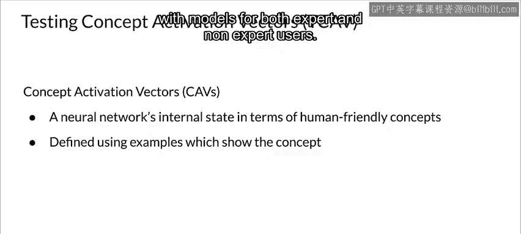

# 吴恩达《机器学习工程师的生产实践（MLOps）Machine Learning Engineering for Production》中英字幕 - P127：49_测试概念激活向量.zh_en - GPT中英字幕课程资源 - BV1pi4y167g5

Let's get started with an advanced approach known as testing concept activation vectors。

 The interpretation of deep learning models is a challenge due to their size。

 complexity and often opaque internal state。 In addition。

 many systems such as image classifiers operate on low level features。

 rather than high level concepts。

To address these challenges， the team at Google introduced concept activation vectors or calves。

 which provide an interpretation of a neural network's internal state in terms of human friendly concepts。

 High level human friendly concepts are defined using sets of example input data for the model under inspection。

For instance， to define the concept curly， a set of images of hairstyles and texture images can be used for an image model。

 note that these examples are not constrained to training data。

 they can be defined using new user provided data。Examples have been shown to be effective means of interfacing with models for both expert and non expert users。

You can use concept activation vectors to sort examples， or in this case。

 images with respect to their relationship to a concept。

This is useful for qualitative confirmation that the concept activation vectors correctly reflect the concept of interest。

As a concept activation vector ands the direction of a concept in the vector space of a bottleneck。

 we can compute cosine similarity between a set of pictures of interest to the cosine activation vector in order to sort the pictures Note that the pictures being sorted are not used to train the concept activation vector shown here are two concepts of interest。

 C O and model women and images that have been sorted by similarity to the concept。

On the left are sorted images of stripes with respect to a concept activation vector learned from a more abstract concept CEO collected from imagenet。

The top three images are the most similar to the CEO concept and look like pin stripes。

 which may relate to the ties or suits that a CEO may wear。

 which provides confirmation of the idea that CEOs are more likely to wear pin stripes than horizontal stripes。

 I'm told that horizontal stripes can look unprofessional， but I'm hardly a fact expert。

 which you can tell， by the way， I dress。On the right are sortdid images of neckects with respect to a model women concept activation vector。

 Again， the top three images are the most similar to the concept， which。

 in this case is model women and show women inects。

 but all of the bottom three images show men in neckects。

 This also suggests that concept activation vectors can be a standalone similarity sort to sort images to reveal any biases in the example。

 images from which the concept activation vector is learned。

