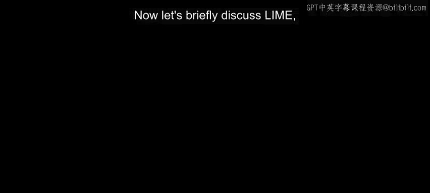
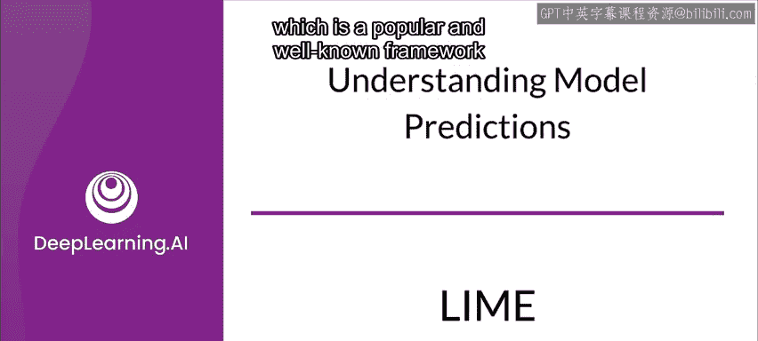
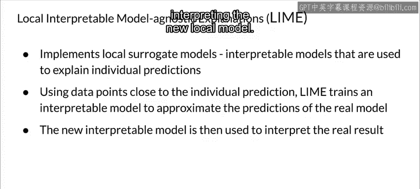

# 吴恩达《机器学习工程师的生产实践（MLOps）Machine Learning Engineering for Production》中英字幕 - P128：50_LIME.zh_en - GPT中英字幕课程资源 - BV1pi4y167g5

Now let's briefly discuss Lyme， which is a popular and well known framework for producing local explanations。

Lme is a popular and well known framework for creating local interpretations of model results。

The idea is quite intuitive。 First， forget about the training data and imagine that you only have a black box model where you can input data points and get the predictions of the model。

You can probe the box as often as you want。 Your goal is to understand why the model made a certain prediction。

Lme tests what happens to the predictions when you give variations of your data to the model。

Lme generates a new data set consisting of permuted samples and the corresponding predictions of the model。

With this new data set line then trains an interpretable model。

 which is weighted by the distance from the sampled instances to the results that we're interpreting。

 The interpretable model can be anything that is easily interpretable。

 like a linear model or a decision tree。The new model should be a reasonably good approximation of the model results locally。

 but it does not have to be a good global approximation。

This kind of accuracy is called local fidelity。You then explain the prediction by interpreting the new local model。

