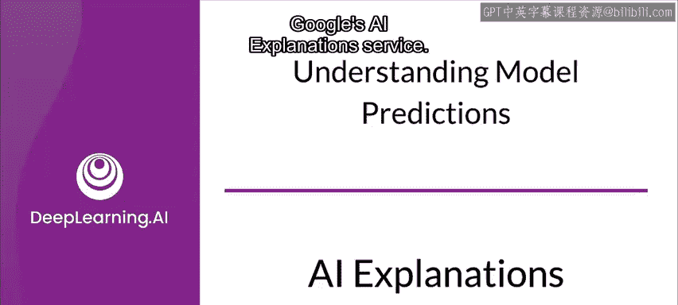
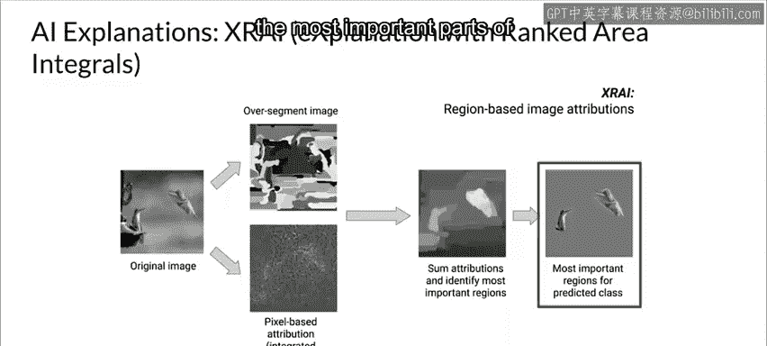

# 吴恩达《机器学习工程师的生产实践（MLOps）Machine Learning Engineering for Production》中英字幕 - P129：51_AI解释.zh_en - GPT中英字幕课程资源 - BV1pi4y167g5

。

There are also cloud based tools and services which can be very valuable for interpreting your model results。

Let's look at one of these Now， Google's AI explanation service。

Another option for interpretability is to leverage managed services from cloud providers such as Google's AI explanations for AI platform。

AI explanations integrates feature attributions into Google's AI platform prediction service。

AI explanations helps you understand your model's output for classification and regression tasks whenever you request a prediction on AI platform。

 AI explanations tells you how much each feature in the data contributed to the predicted results。

 You can then use this information to verify that the model is behaving as expected and identify any bias in your models and get ideas for ways to improve your model and your training data。

Feature attributions indicate how much each feature contributed to the given prediction。

 AI explanations works with Google's AI platform prediction managed service。

 When you request predictions from your model normally using AI platform predictions。

 you only get the predictions。 However， when you request explanations。

 you get both the predictions and the feature attribution information for those predictions。

There are also visualizations provided to help you understand the feature attributions。

 This chart shows an example of feature attributions for a tabular data set。

These are examples of the visualizations for image data。 They include an overlay for each image。

 highlighting which pixels in the image contributed most strongly to the resulting prediction。

AI explanations currently offers three methods of feature attribution。

 These include sampled Shaplely integrated gradients and X R AI。 But ultimately。

 all of these methods are based on Shaplely values。

 We've discussed Shaplely enough that we don't need to go over that again。

 But let's look at the other two methods， integrated gradients and X R AI。

Integrated gradients is of different way to generate feature attributions with the same axiomatic properties as Shaplely values based on using gradients and its orders of magnitude more efficient than the original Shaplely scubic method when applied to deep networks In the integrated gradients method。

 The gradient of the prediction output is calculated with respect to the features of the input。

 A long and integral path。The gradients are calculated at different intervals based on a scaling parameter that you can specify for image data。

 imagine the scaling parameter as a slider that is scaling all the pixels of the image to black。

By saying that the gradients are integrated， it means that they are first averaged together。

 and then the element wise product of the average gradients and the original input is calculated。

XRAI or explanation with ranked area integrals。Is specifically focused towards image classification。

 The X R AI method extends the integrated gradients method with additional steps to determine which regions of the image contribute most to a given prediction。

XRI performs pixel level attribution for the input image using the integrated gradients method independently of pixel level attribution。

 X RI also over segmentsments the image to create a patchwork of small regions。

 X RI then aggregates the pixel level attribution within each segment to determine the attribution density of that segment。

It then ranks each segment and orders them from the most to the least positive。

 This determines which areas of the image are the most salient or contribute the most strongly to a given prediction。

Here's an example of an image of hummingbirds starting at the left。

The original image is both segmented into different regions。

 and the pixel level attributions are calculated using integrated gradients。

The attributions within each region are then summed。

And the regions are ranked to determine the results， which are the most important。

 As you can see in the image on the right， the most important parts of this image are the humming birdsrds themselves。

Well， that was quite a week。 We got fairly deep into interpretability and explainability and looked at it from a couple of different angles。

 We looked at some intrinsically interpretable models。

 We looked at the ideas of local versus global interpretation。

 We looked at a few different post ho methods， including Shaplely values。

 which are very important for interpretability and the Shap library， which helps us work with them。😊。

And we took a look at some of the newer methods too， including TCAav and lattice models。

 so I thought it was a great week， I hope you did and we'll see you next time。

