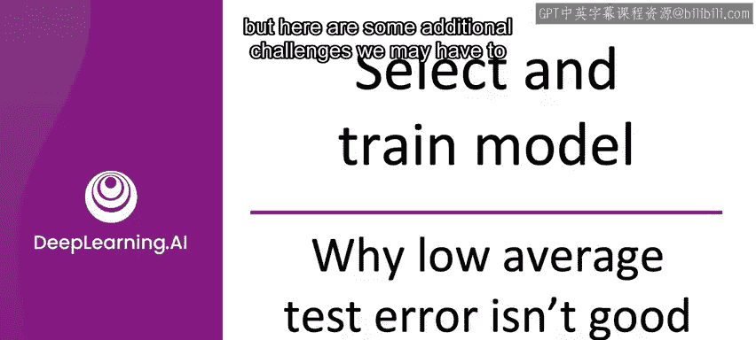
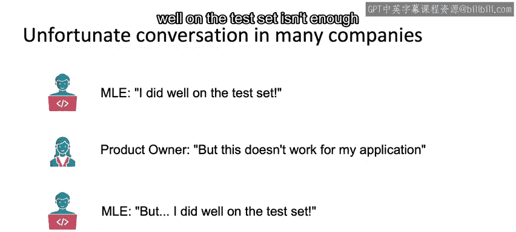

# 吴恩达《机器学习工程师的生产实践（MLOps）Machine Learning Engineering for Production》中英字幕 - P12：11_为什么低平均错误率还不够好.zh_en - GPT中英字幕课程资源 - BV1pi4y167g5

The job of a machine learning engineer would be much simpler if the only thing we ever had to do was do well on the holdout test set as hard as it is to do well in a holdout test set unfortunately。

 sometimes that isn't enough let's take a look at some of the other things we sometimes need to accomplish in order to make a project successful。

 We've already talked about concept drift and datatod last week。

 but here are some additional challenges we may have to address for a production machine learning project First。

 a machine learning system may have low average test set error。

 but if its performance on a set of disproportionately important examples isn't good enough then the machine learning system will still not be acceptable for production deployment Let me use an example from web search There are a lot of web search queries like these Apple Pi recipe laser movies wireless data plan I want to learn about the。

W the festival， these types of queries are sometimes called informational or transactional queries where I want to learn about Apple pies or maybe I want to buy a new wireless data plan and you might be willing to forgive a web search engine that doesn't give you the best Apple pie recipe because they' are a lot of good Apple pie recipes on the internet so for informational and transactional queries a web search engine wants to return the most relevant results but users are willing to forgive maybe ranking the best result number two or number three does a different type of web search query such as Stanford or Reddit or YouTube these are called navigational queries where the user has a very clear intent very clear desire to go to Stanford。

edduu or Redit。com or YouTube。 co when a user has a very clear navigational intent they will tend to be very unforgiving if a web search engine does anything other than。

Returns staford。ed asD number one ranked results， and a search engine that doesn't give the right results will quickly lose the trust of its users。

So navigational queries in this context are a disproportionately important set of examples。

 and if you have a learning algorithm that improves your average test and accuracy for web search。

 but messes up just a small handful of navigational queries that may not be acceptable for deployment。

And the challenge， of course， is that average test set accuracy tends to weight all examples equally。

 whereas in web search， some queries are disproportionately important。

Now one thing you could do is try to give these examples a higher weight that could work for some applications。

 but in my experience just changing the weight of different examples doesn't always solve the entire problem closely related to this is the question of performance on key slices of the data For example。

 let's say you've built a machine learning algorithm for loan approval to decide who is likely to repay a loan and does to recommend approving certain loans for approval for such a system you will probably want to make sure that your system does not unfairly discriminate against loan applicants according to the ethnicity。

 gender， maybe the location， the language or other protected attributes many countries also have laws or regulations。

That mandates that financial systems and loan approval processes not discriminate。

On the basis of a certain set of attributes， sometimes called protected attributes。

So even if a learning algorithm for loan approval achieves high average tested accuracy。

 it would not be acceptable for production deployments if it exhibits an unacceptable level of bias or discrimination。

Whereas the AI community has had a lot of discussion about fairness to individuals and rightly so because this is an important topic we have to address and do well on。

The issue of quoteFairness or performance of key slices also occurs in other settings Let's say you run an online shopping website so an ecommerce-commerce website where you aggregate and sell products from many different manufacturers and many different brands of retailers you might want to make sure that your system treats fairly all major user retailer and product categories for example。

 even if a machine learning system has high average tested accuracy maybe it recommends better products on average。

 if it gets really irrelevant recommendations to all users of one ethnicity that may be unacceptable。

Or if it always pushes products from large retailers and ignores the smaller brands。

 that could also be harmful to the business because you may then lose all the small retailers。

 and it would also feel unfair to build a recommend system that only ever recommends products from the large brands that ignores the smaller businesses。

 or it had a product recommender that gave highly relevant recommendations。

 but for some reason would never recommend electronics products。

 then maybe the retailers that sell electronics would be quite reasonably upset and this may not be the right thing。

For the retailers on your platform or for the longter health of your business。

 even if the average tested accuracy shows that by not recommending electronics products。

 you are showing slightly more relevant results to your users for some reason one thing you learn later this week is how to carry out analysis on key slices of the data to make sure that you spot and edgegs potential problems like these Next is the issue of rare classes and specifically of skewed data distributions in medical diagnosis is not uncommon common for many patients not to have a certain disease。

And so if you have a data set， which is 99% negative examples。

Because 99% of the population doesn't have a certain disease。But1% positive。

Then you can achieve very good test accuracy by writing a program that just says print zero。

 don't need a learning algorithm， just write this one line of code and you have 99% accuracy on your dataset set。

 but clearly print zero is not a very useful algorithm for disease diagnosis。By the way。

 this actually did happen to me once where my team had trained a huge neural network。

 found we had 99% average accuracy and we found it achieved it by printing zero all the time so we basically trained a giant neural network that did exactly the same thing as print zero and of course when we discovered this we then went back to fix the problem but so hopefully this won't happen to you。

😊，Closely related to the issue of skewed data distributions。

 which is often a discussion of positive and negatives。

Is accuracy on rare clauses I was working with my friend Praav Rajperer and others on diagnosis from chests Xrays and we were diagnosing clause and were working on deep learning to spot different conditions there were some relatively common conditions these are technical medical terminology but for medical condition called effusion we had about 10。

000 images and so we were able to achieve a high level of performance whereas for much rarer condition hernia we had about 100 images and so performance was much worse and it turns out that from a medical standpoint is not acceptable for diagnosis system to ignore obvious cases of hernia if a patient showed。

UAnd an X ray clearly shows they have hern near a learning algorithm that misses that diagnosis。

Would be problematic， but because this was a relatively rare class。

 the overall average test set accuracy of the algorithm was not that bad。

 and in fact the algorithm could have completely ignored all cases of heria and it would have had only a modest impact on its average test set accuracy because cases of hernia were rare and the algorithm could pretty much ignore it without hurting this average test accuracy that much if average test accuracy gives equal weight to every single example in the test set。

I have heard pretty much this exact same conversation too many times in too many companies。

 and conversation goes like this。A machine learning engineer says， I did well under test set。

This works。Let's use it and a product owner or business owner says。

 but this doesn't work for my application。And the machine learning engineer replies。

 but I did well on the test set。My advice to you， if you ever find yourself in this conversation is don't get defensive。

We as a community have built lots of tools for doing well on the test set and that's to be celebrated。

 I think it's great， but we often need to go beyond that because just doing well on the test set isn't enough for many production applications。

When I'm building a machine learning system， I view it as my job。

 not just to do well on the test set， but to produce a machine learning system that solves the actual business or application need。

 and I hope you take a similar view as well。Later this week， we'll go through some techniques。

 usually involving error analysis， maybe error analysis on slices of the data that will allow you to spot some of these issues that require going beyond average testet accuracy and help you with tools to tackle these broader challenges as well。

