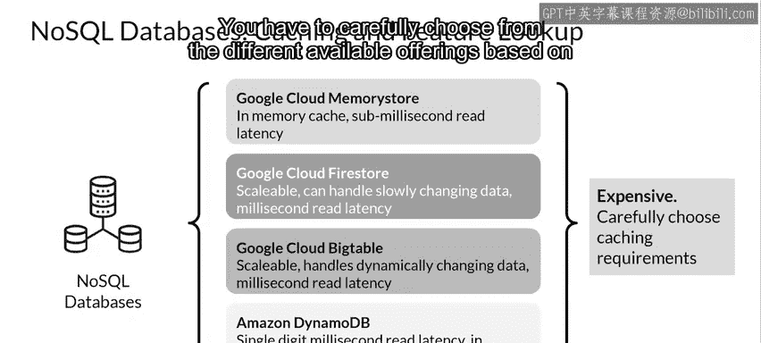

# 吴恩达《机器学习工程师的生产实践（MLOps）Machine Learning Engineering for Production》中英字幕 - P131：2_模型服务基础设施简介.zh_en - GPT中英字幕课程资源 - BV1pi4y167g5

We saw in the previous lesson that when deploying a model to a production environment。

 we might have some decisions to make in order to maximize throughput while minimizing latencies and cost。

Let's now look at some of the issues with resource costs and some constraints that we might encounter。

There are good reasons why models often become complex。

 in an effort to find ways to increase accuracy or model more complex relationships。

 there is a natural impulse to imply more complex model architectures。

 including more and more features。😊，And this often results in longer prediction latencies but hopefully a boost in prediction accuracy。

😊，However， as models become more complex and more and more features are included。

 the resource requirements increase for every part of the training and serving infrastructure。😊。

Increased resource requirements means increased cost and increased hardware requirements。

 management of larger model registries， and this results in a higher support and maintenance burden。

😊，As in many things in life， the key is to find the right balance。

 finding that right balance between cost and complexity is a skill that season and practitioners will build up over time。

😊，So there's a trade off between the model's predictive effectiveness and the speed of its prediction latency。

 depending on the use case you need to decide on two metrics。😊，There's the model's optimizing metric。

 which reflects the model's predictive effectiveness， and this includes things like accuracy。

 precision， recall and so on。 Good values in these metrics is a strong signal about the quality of your model。

😊，And then there's the model's gating metric， and this reflects an operational constraint that the model has to satisfy。

 such as prediction latency。😊，So for example， you might set a latency threshold to a particular value。

 such as 200 milliseconds， and any model that doesn't meet this threshold is not going to be accepted。

😊，Another example of a gating metric is the size of the model if you plan on deploying your model to lowpe hardware like mobile and embedded devices。

 this is of course very important。😊，One approach you can take is to specify the serving infrastructure。

 CPU， GPU and all of that， and then start increasing your model complexity to improve your model's predictive power until you hit one or more of your gating metrics on that infrastructure。

Then you can assess the results and either accept the model as it is。

 or work to improve accuracy and or reduce complexity or make the decision to increase the specifications of the serving infrastructure。

😊，One of the factors to consider when designing your server and training infrastructure is the use of accelerators such as GPUs and TAs now each of these have different advantages。

 but they also have costs and potentially limitations。😊。

GPUs tend to be optimized for parallel throughput， and they're often used in training infrastructure。

 while GPUs， as well as being useful in training， have advantages for large complex models and large batch sizes。

 especially during inference。These decisions can have a significant effect on your project's budget。

So there's also a trade off between applying a large number of less powerful accelerators and using a smaller number of more powerful accelerators。

😊，Often when working with a team or department， these choices will need to be made for a broad range of models and not just for the new model that you're working on at this moment because there are always going to be shared resources。

The prediction request to your ML model might not provide all of the features required for prediction。

Some of the features may also need to be precomputd or aggregated and then read in real time from a data store。

😊，Take for example， a food delivery app that needs to predict the estimated time for an order delivery while this is based on a number of features like current traffic conditions。

 there are also some that can be read from a data store， like the list of incoming orders。

 the number of outstanding orders per minute in the last hour and stuff like that。😊。

You'll need powerful caches to retrieve this data with low latency since the delivery time has to be updated in real time。

You cannot wait many seconds for retrieving data from the database。And of course。

 this has cost implications。No SQL or no SQL databases are a good solution to implement Caching and feature lookup。

 and there are various options available。If you need submisecond read latency on a limited amount of quickly changing data retrieved by a few thousand clients。

 one good choice is Google Cloud Me store。 It's a fully managed version of Redis and Mamcash。

 and of course， there are also very good open source options。😊。

If you need millisecond read latency on slowly changing data where the storage scales automatically。

 one good choice is Google Cloud Firestore。😊，If you need millisecond read latency on dynamically changing data。

 using a store that can scale linearly with heavy reads and writes。

 one good choice of course is Google Cloud Big table。😊。

Amazon's Dynamo DB is also a good choice for scalable low read latency database with an in memoryory cache。

😊，Adding caches speeds up feature lookup while reducing prediction Rerieval latency。

You have to carefully choose from the different available offerings based on your requirements and then balance that with your budget constraints。

😊。

