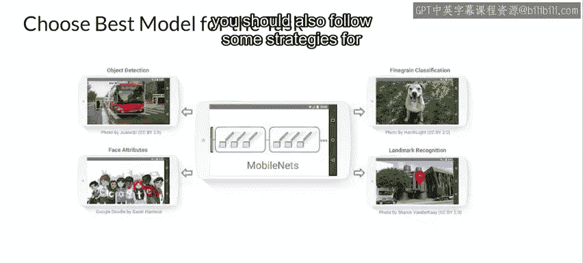

# 吴恩达《机器学习工程师的生产实践（MLOps）Machine Learning Engineering for Production》中英字幕 - P132：3_部署选项.zh_en - GPT中英字幕课程资源 - BV1pi4y167g5

Returning to the question of where should I deploy my model， there are primarily two choices。

You can have a centralized model in a data center that's accessed via a remote call。

 or you can distribute instances of your model to your users so they can use it locally。

 such as in a mobile or embedded system。😊，In our data centers。

 cost and efficiency are important at any scale， even when you have large resources in a huge data center。

😊，So for example， large companies like Google constantly look for ways to improve resource utilization and reduce costs in applications and data centers。

 using many of the same techniques and technologies that we're discussing in this course。

 but there are also constrained distributed environments like mobile phones， Android and iOS。

 so let's take a look at running a model on a mobile phone and then take a look at the hardware constraints that these devices can impose。

😊，In a mobile phone， the average GPU memory size， if you even have a GPU。

 is much smaller than the one that you'll find in a data center and often less than about 4 gigytes。

😊，You'll mostly have only one GPU， which is shared by a number of applications and not just yours。

In most cases， you'll be able to use the GPU for accelerated processing。

 but that comes at a price you have limited GPU available and using it can lead to your battery draining quickly。

Your app will not be received well and could be reviewed poorly if it drains the battery quickly or makes the phone too hot to touch because of complex operations in your ML model。

There's also storage limitations since users don't appreciate large apps using up the storage on their phones。

You can rarely deploy a very large complex model to a device like a mobile phone if it's too large。

 users just might choose not to even install it because of the memory constraints。

So since there are these constraints on memory processing power， battery usage and all that。

There are many classes of models that we simply cannot deploy to mobile phones or embedded systems。😊。

So instead， we may choose to deploy our model to a server and then expose it through a rest API so that we can use it for inference in our app。

But of course this might also not be suitable， it might not be feasible to deploy a model to a server in environments where prediction latency is super important。

 or when a network connection may not always be available。

One example for this could be an object detection model deployed to an autonomous vehicle。

It's critical in those applications that the system is able to take actions based on predictions made in near real time and account wait for a server round trip。

As a general rule， you should always opt for minimize latency of inference wherever possible。

This enhances the user experience by reducing the response time of your app。

But there are also exceptions latency might not be as important where it's critical that the model is as accurate as possible。

 for example， a disease diagnosis。😊，So you do want to make a trade off between model complexity。

 size， accuracy， and prediction latency， and understand the cost and constraints of each for the application that you're working on。

 and that's not an easy task。😊，All of these factors influence your choice of the best model for your task。

Based on your limitations and constraints。One example is mobile Nes。

 and these are models that are specifically designed for computer vision on mobile devices。😊。

Now they may not have the highest number of predictive classes。

 and they may not be state of the art in recognition。

 but all of the work in performing trade offs for the best mobile model have been done for you already。

 and you can build on this。So if you're deploying to mobilele。

 you should also follow some strategies for optimizing your model for the constrained mobile environment。

😊。

