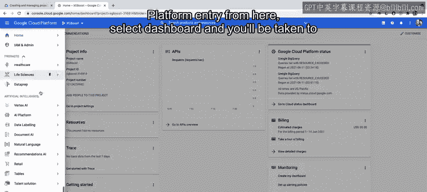
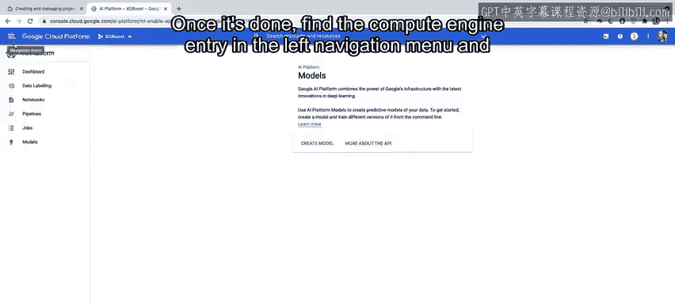
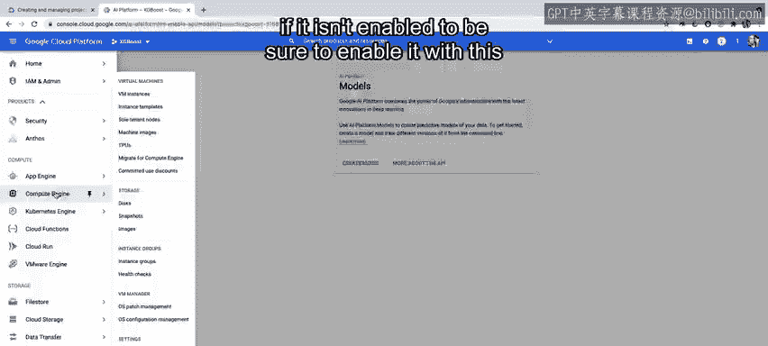
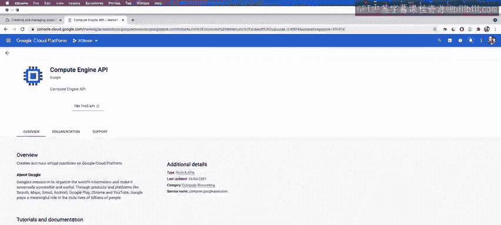
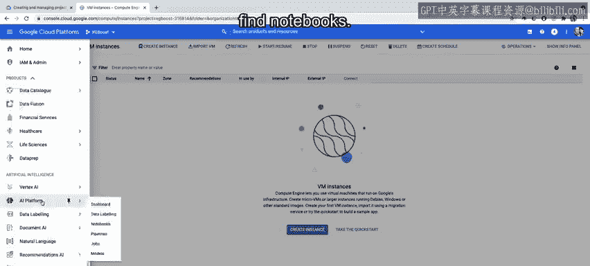
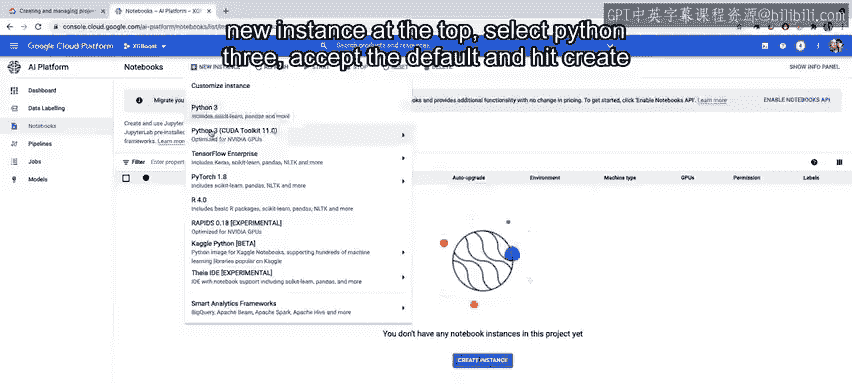
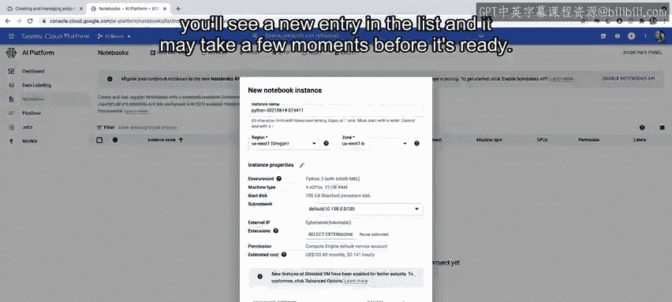
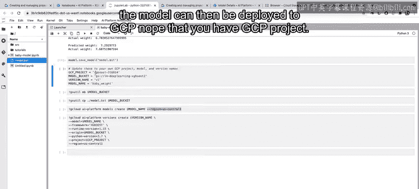
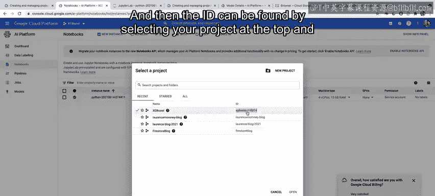
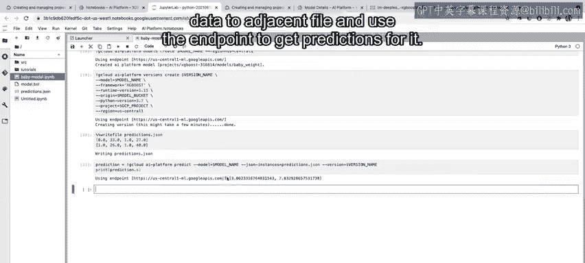

# 吴恩达《机器学习工程师的生产实践（MLOps）Machine Learning Engineering for Production》中英字幕 - P134：5_将模型部署到AI预测平台.zh_en - GPT中英字幕课程资源 - BV1pi4y167g5

You'll next go through a CodeLb for building and deploying an XG boost model on the Cloud AI platform。

 let's do a walk through first。On the Google Cloud Plaform console。

 scroll down until you see the AI platform entry。From here。

 select dashashboard and you'll be taken to the AI Platform dashboard。

Select models from the list on the left， you may see that you need to enable the API to create a model。

 select that and wait for the progress to complete。Once it's done。

 find the compute engine entry in the left navigation menu。

And if it isn't enabled， be sure to enable it with this button。

 it may take a while and I've sped it up here。

Once it's done， return to the AI platform entry in the navigation and find notebooks。

Once it opens， you'll see a list of notebooks and it's probably empty。

 so go to new instance at the top。Select Python 3。

Acept the default and hit createate， you'll see a new entry in the list and it may take a few moments before it's ready。

 I sped up the video here。😊。

When it's done， you'll see a link to Open Jupiter Lab。

Select it and the Jupyter environment will open up with a number of options。

Select the terminal option。Within the terminal， you can then pP3 install XG Bos like this。

When it's done， you can now open a new Python 3 notebook。The code La will give you all this code。

 so don't worry if you don't see it right now。As you create the code and again， it's in the code Lab。

 which you'll see next， you can run it cell by cell。😊。

The first couple of cells allow you to inspect the data。And as you run through。

 you'll see how you can create an XGB regressor for this data。

 which will give you predicted weights versus actual weights for babies。

You can then save this model as a Tensorflowlow saved model。

The model can then be deployed to GCP。Note that you have GCP project and then the ID can be found by selecting your project at the top and finding it in the list of projects that you own。

The model bucket is a storage bucket that you can name with the model bucket variable。

 and after you make it， you can see that you can copy the saved model to it。

You can explore your cloud storage to find the bucket， and then within that you'll see the Sa model。

😊，Running the GCud AI platform Model create will create the AI platform model for you。

 and GCud AI platform versions create will deploy a version for you。When it's done。

 you can then look at your models list and refresh it。

 and you should see that the baby model is there。😊，We have one version called V1。

And now we can write some simulated data to a file and use the endpoint to get predictions for it。

So now it's your turn， try out the code Lab to see if you can repeat what I've done。

