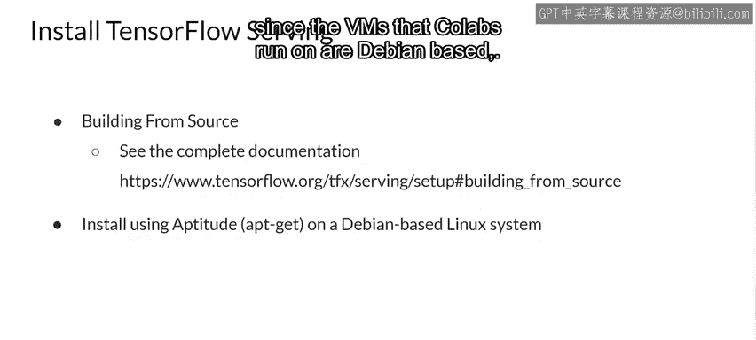
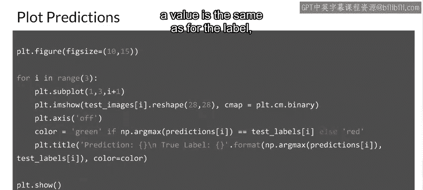
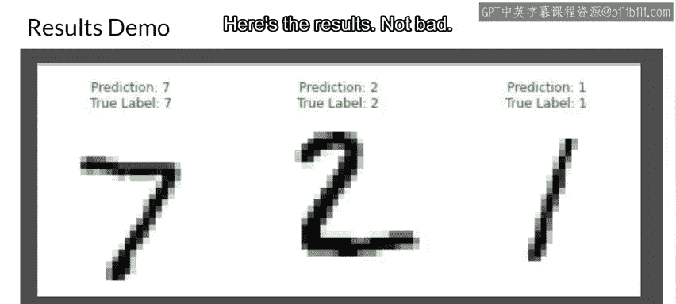

# 吴恩达《机器学习工程师的生产实践（MLOps）Machine Learning Engineering for Production》中英字幕 - P135：6_安装TensorFlow Serving.zh_en - GPT中英字幕课程资源 - BV1pi4y167g5

Okay now that you've seen deploying to the Cloud AI platform。

 you might also want to explore what it would take to deploy to your own infrastructure and the open source TensorF serving is an ideal solution to that。

So in the next few minutes， we're going to explore how to train a simple model and then deploy and serve it so that you can do remote inferences。

 You'll use the Google Collab environment that runs on Linux so pretty much everything that you see here you could do on your own server。

😊，There are several ways to install Tensflow serving depending on your needs and your environment。

 the easiest and most straightforward way of using Tensflowlow serving is with Docker images。😊。

And I highly recommend this route unless you have specific needs that are not addressed by running in a container。

😊，And here's a tip， this is also the easiest way to get TensorFflow serving。

 working with GPU support。😊，You can also use Tensorflow serving using one of the two available binaries。

 the first is simply called Tensorflowlow model server。

 and this is a fully optimized server that uses some platform specific compiler optimizations like SSE4 and AVX instructions。

 and this should be the preferred options for most users but it may not work on some older machines。

For those， you can use the package called Tensorflowlow dash model， dash serverver dash Universal。😊。

And this has been compiled with basic optimizations。

 but it doesn't include platform specific instruction sets， so it should work on most。

 if not all machines out there。😊，And you can use this one if TensorFflow model server does not work for you。

Note that the binary name is the same for both packages。

 so if you've already installed Tensorflowlow model Server。

 you should first uninstall it using the Appget Removeve TensorFlow model Ser command。😊。

You can also build TensorF serving from source if you want to fully customize it for your needs。

 please refer to the documentation for instructions on this。😊，On Debian based Linux。

 you can install using aptitude with the AppGt command。

 and that's what you'll be doing in this example。😊，In the collab environment provided。

 you'll use aptitude since the VMs that collabs run on are deian based。

Let's get ready to install TensorF serving using aptitude since this collab runs in A Deian environment。

 you'll add the TensorFlow model Ser package to the list of packages that aptitude knows about。

 Note that in CoLab you're going to be running as route。And to install Tensflow Ser。

 you use Appget installs to install the TenorFflowlow Model Ser package。

 and that's all you need just that one command line。😊。

Now let's take a look at training a simple computer vision model using the MNIS data set。

 we'll then serve that for inference using Tensflow serving。😊，The endless data set contains 70。

000 grayscale images of the digits 0 through9。 These images show individual digits at a low resolution 28 by 28 pixels。

😊，And even though these are really images， we're going to load them as nupy arrays and not as binary image objects。

 so we're not dealing with JPEGs or bitmaps or PNGs or anything like that。😊，For model training。

 it's important to rescale the pixel intensities into the range of 0 through1。

 and we call this process normalization。😊，So next we'll reshape the training set to be an array of 60。

000 by 28 by 28 by1。Similarly， we'll reshape the test set to be an array of size 10。

000 by 28 by 28 by1 The one here is just the size of the color depth of the pixel because they're just grayscale。

 we don't need three channels red， green and blue。And we can print it out now just to check that it's all good。

Before moving forward， it's always important to inspect your data。

 so here we'll visualize one example from the data set and feel free to change the value of IDX to visualize other examples。

😊，Now let's build a Tf。caras。 sequentialial model that can be used to classify the images of the MS data set We're going to use a very simple CNN。

😊，Make sure that your model has the correct input shape and the correct number of output units。

We'll also use softmax for activation in the output layer。

Here you set your model up for training using the atom Opr。

 sparse categorical cross entropy as the loss and accuracy formetrics you'll then train the model for the given number of epochs by fitting the training images to the training labels。

😊，The history object will contain the epoC by epoC matrix for the training。

Now we can look at the loss and accuracy on the test set after training and it's not bad。

 especially for such a simple model。😊，For Tensorflow serving to be able to access the model。

 you need to save it and to do this you'll use the saved model format。

 so this code will save it for you in the directory stored in the model DIR variable。😊。

To let another process such as TensorFlow serving know where the model is saved。

 you can use an environment variable， so here you can create one for the model there that you just wrote。

With TensorF serving installed， you launch it with a batchsh script。

Then you use the following parameters to configure the model server。

The rest API port is the port that your requests will be handled on， and in this case it's 8501。

The model name is the name that your model is going to use within the URL and we're using diggiits model here。

The model base path should use the environment variable model de as the base path to the saved model。

To send requests for a prediction using our Save model， you can use JSON。

 and here you see we create a JSON object using the first few images of the test set。

We'll then send a predict request as a post to the server's rest endpoint。

And you'll pass this adjacentO object containing our request data。By default。

 the server will use the latest version of your model。

 but you could specify a particular version if you needed to here， perhaps for testing。

 or if you want an AB test across multiple users。😊，Note the digits model in the URL。

 and that's the name that we used in the previous step。If you want to plot the results。

 you can do so with code like this Note that if the prediction for a value is the same as for the label we plotted in green。

 otherwise we'll do it in red。😊。

And here's the results。 Not bad。

