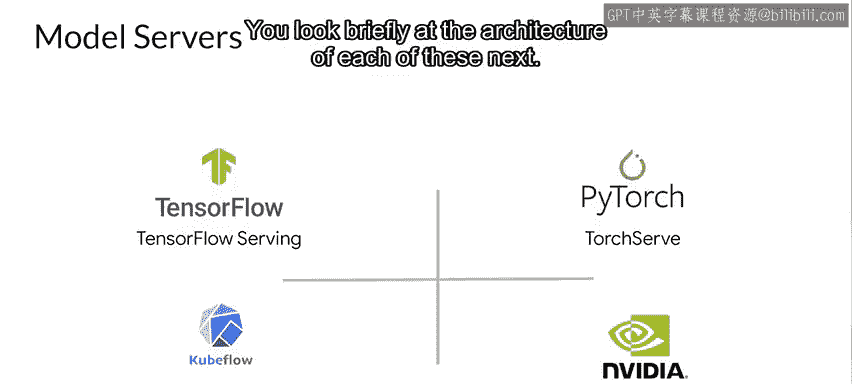

# 吴恩达《机器学习工程师的生产实践（MLOps）Machine Learning Engineering for Production》中英字幕 - P136：7_模型服务架构.zh_en - GPT中英字幕课程资源 - BV1pi4y167g5

Welcome to week two of this course and this week we're going to look at model serving。

 including patterns in infrastructure， as well as a little bit of scaling。😊。

Let's start with a very high level look at the two main places that you can run your infrastructure on which a machine learning models are going to be built and used。

Let's start with a very high level look at the two main places that you can run your infrastructure on which your machine learning models will be built and used。

And this in general boils down to those two main places you can either have all of the hardware and software required on your own premises。

Or you can outsource them to a cloud provider wholl provide all the hardware management for you。

 as well as software services such as pipeline management as part of their offering。

When you run on your own premises， you have complete control over your hardware infrastructure。

Obviously， this can be very flexible and you can be nimble to adapt to changes in your requirements quickly。

 but it does come at a cost。You have to procure， install， configure。

 and maintain your hardware infrastructure， which can be complicated and expensive。

Larger companies tend to take this approach because they can leverage economies of scale。

 such as having extensive in house experience。The other option。

 and one often used by smaller companies is to outsource their infrastructure needs to experts in building。

 managing， scaling and monitoring hardware software and applications。😊。

Great examples of this are the services from the likes of Amazon， Google Cloud Platform。

 and Microsoft Azure。Going beyond choosing the infrastructure。

 you also have to consider how model serving will work depending on the choice you made。

So when using onpres hardware， you have the flexibility to choose which model server you like and you're responsible for installing。

 configuring and maintaining it。So options like Tensorflowlow Ser。

 Ceflowlow and VI Server and more are going to be made available to you。

 and we'll explore what some of these look like in just a moment。😊。

If you do the model serving on the cloud， then you can create virtual machines on their infrastructure that give you the same flexibility as onPm so you can install and configure the same types of prebi server。

 such as TensorF Ser and KubeFlow and all of those。😊。

Or you can use a provided suite of tools and services that are available from that cloud vendor。😊。

So for example， if you had chosen the Google Cloud platform。

 you could use things like AutoML or any of the Google Cloud AI services。

 or if you' had chosen Amazon Web services， then SageMaker Autopilot would be available to you。

Now that you've explored the higher level options around how you can do model serving。

 be it on premise or using a cloud provider， let's now look into model servers and explore some of the popular options that are available to you。

😊，These include TensorFlow， CeFlow， Piytorrch， and NVIDdia servers， but before looking at them。

 let's have a quick recap at what a model server actually does。😊。

The high level architecture of a model server can be summarized in a diagram like this one。

Your model is typically saved to the file system。😊。

You could also have multiple versions of the same model so you can try out different ones。

 but ultimately it's available to be read by the model server。

 whose job it is to instantiate the model and expose the methods on the model that you want to make available to your clients。

😊，So， for example， if the model is an image classifier。

 the model itself will take in tensors of a particular size and shape。😊，For mobileNe。

 these would be 224 by 224 by3。The model server receives this data。

 format it into the required shape， passes it to the model file， and gets the inference back。

It can also manage multiple model versions， should you want to do things like AB testing or have different users with different versions of the model。

And the model server then exposes that API to the client as we previously mentioned， so in this case。

 for example， it has a RE or RPPC interface that allows an image to be passed to the model。😊。

The model server will handle that and get the inference back from the model。

 which in this case is an image classification， and it will return that to the caller。😊。

Some of the most popular model servers are listed in this slide， Tensorflow Ser， Torch Serve。

 Ceflowlow Ser and the NviIDdia Triton inference server youll look briefly at the architectures of each of these next。

😊。

