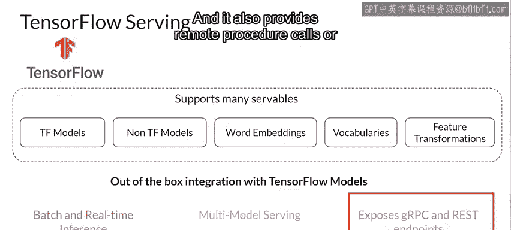
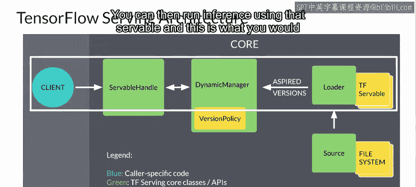
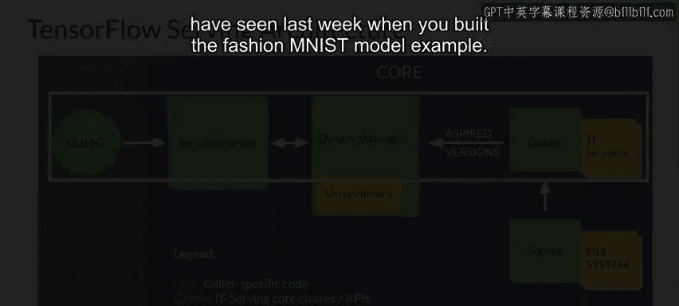

# 吴恩达《机器学习工程师的生产实践（MLOps）Machine Learning Engineering for Production》中英字幕 - P137：8_模型服务器-TensorFlow Serving.zh_en - GPT中英字幕课程资源 - BV1pi4y167g5

So now that you've seen model serving from a high level。

 let's dig into some of the architectures that little more deeply， starting with Tensorflow serving。

😊，In week one， you had a chance to experiment with the basics of TF serving。

 which is a flexible high performance serving system for machine Learn models。😊。

It provides out of the box integration with TensorF models。

 and it can also be extended to serve other types of model。

So let's take a look at the architecture of this serving system and some important features that I'd like to call out are that it provides both batch and realtime inference。

 so you can either get a bunch of inferences at the same time。

 which is useful if you're building something like a recommendation engine that requires a lot of predictions。

😊，Or real time inference， if you want an answer to a single task back quickly。

 and this is useful for， for example， an image classification。😊。

Multimodel serving is also available and this allows you to have multiple models for the same task and the server chooses between them this could be useful for example for AB testing。

 audience segmentation and more。😊，And it also provides remote procedure calls or traditional rest endpoints on which you can call your server。

😊。

The high level architecture for Tenflow serving looks like this。

It's built around the core idea of aservable， which is the central abstraction in TF serving。

These are the underlying objects that clients use to perform computation， for example。

 inference or lookups， they give me any kind of type or interface and this makes them very flexible。

😊，A typicalservable is a tensflow saved model， but it could also be something like a lookup table for an embedding。

The loader manages a Cable's lifecycle， the loader API enables common infrastructure independent from specific learning algorithms。

 data or whatever product use cases were involved。Specifically。

 loaders standardize the APIs for loading and unloading isservable。Together。

 these produce aspired versions， and these represent the set ofservable versions that should be loaded and ready。

😊，Sources communicate this set ofservable versions for a singleservable stream at a time。

When a source gives a new list of aspired versions to the manager。

 it supersedes the previous list for thatservable stream。😊。

The manager unloads any previously loaded versions that no longer appear in the list。😊。

The manager then handles the full life cycle of the serables， including loading the serables。

 serving the serables， and of course unloading theservables。😊。

The managers will listen to the sources and will track all of the versions according to a version policy。

And the cervicable handle provides the exterior interface to the client。😊。

There's a lot of pieces here， so let's look at an example of how this would work。😊。

So let's take this as an example， say a source represents a tensorflow graph with frequently updated model weights。

 the weights are stored in a file on disk。😊，The source detects a new version of the model weights。

 it creates a loader that contains a pointer to the model data on disk。

The source notifies the dynamic manager of the Aspired version。

The dynamic manager applies the version policy and decides to load the new version。😊。

The dynamic manager tells the loader that there' enough memory。

 the loader instantiates the Tensorflow graph as aservable with these new weights。😊。

A client requests a handle to the latest version of the model。

 and the dynamic manager returns a handle to the new version of theservable。😊。

You can then run inference using thatservable and this is what you would have seen last week when you built the fashion Endist model example。

😊。

