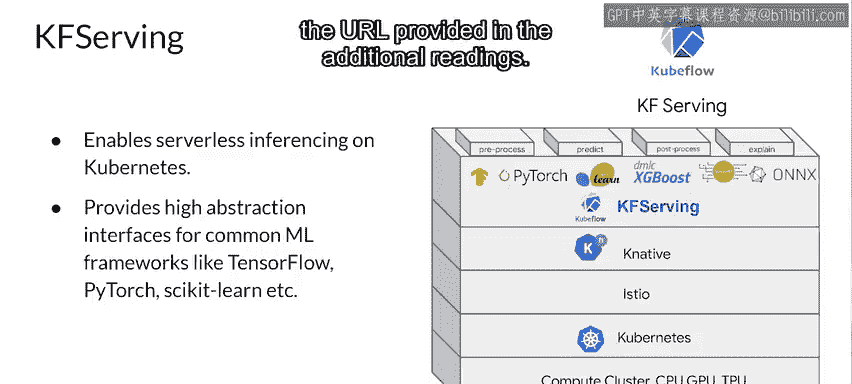

# 吴恩达《机器学习工程师的生产实践（MLOps）Machine Learning Engineering for Production》中英字幕 - P138：9_模型服务器-其他供应商.zh_en - GPT中英字幕课程资源 - BV1pi4y167g5

The Triton inference server， an offering from NviIDdia。

 simplifies deployment of AI models at scale in production。

 it's an open source inference serving software that lets teams deploy trained AI models from any framework。

 Tensorflow， TensorT， Pytororch， Onyx runtime， or even a custom framework。

You can deploy from local storage or from a cloud platform like the Google Cloud Plat or AWS on any GPU or CPU based infrastructure。

 so it can be the cloud， the data center， or even the edge。

The Triton inference server runs multiple models from the same or different frameworks concurrently on a single GPU using KudA streams。

😊，In a multi GPU server， it automatically creates an instance of each model on each GPU。😊。

All these increase your GPU utilization without any extra coding from the user。😊。

The inference server supports low latency real time inferencing with batch inferencing to maximize GP and CPU utilization。

😊，It also has built in support for streaming inputs if you want to do streaming inference。

Users can use shared memory support for higher performance， inputs and outputs need to be passed。

 to and from Triton's inference server can be stored in the systems or to CA shared memory。

And this can reduce the HTTPC or GRPC overhead and increase overall performance。

It also supports model ensemble。Tritton for Ser integrates with Kubernetes for orchestration。

 metrics and auto scaling Triton also integrates with Ceflow and Cubeflow pipelines for an end to end AI workflow。

😊，The Triton inference server exports Prometheus metrics for monitoring GPU utilization， latency。

 memory usage， and inference throughput。It supports the standard HTTP GRPC interface to connect with other applications like load balancers。

 and it can easily scale to any number of servers to handle increasing inference loads for any model。

😊，The Triton inference server can serve tens or hundreds of models through the model control API。

Models can be explicitly loaded and unloaded into and out of the inference server based on changes made in the model control configuration to fit in the GP or CPU memory。

😊，And it can be used to serve models and CPUs too。It supports heterogeneous cluster with both GPUs and CPUs and does help standardize inferences across these platforms。

 so during peak loads it can dynamically scale out to any CPU GPU。

As well as Tensorflow Ser and the Triton inference server。

 another popular serving environment is Torch Serve， designed around Pytorrch。😊。

Torchserverve is an initiative by AWS and Facebook to build a modelserv framework for Pytorch models Before the release of Torchservve。

 if you wanted to serve Pytororch models， you had to develop your own model serving solutions like custom handlers via model。

 you had to develop a model server， maybe build your own Docker container。

 you had to figure out a way to make the model accessible via the network and integrate it with your cluster orchestration system and all of that good stuff。

With TorchSve， you can deploy Pytorrch models in either eager or graphph mode。

 you can serve multiple models simultaneously， you can have version production models for AB testing。

 you can load and unload models dynamically， and you can monitor detailed blogs and customizable metrics。

😊，And best of all， Torch Serve is open source， so hence it's extensible to fit your deployment needs。

The server architecture looks like this。The front end is responsible for handling your requests and your responses。

 and it handles both requests and responses coming in from clients and the model lifecycl。

The backend uses model workers that are running instances of the model loaded from a model store。

 they're responsible for performing the actual inference。

You can see that multiple workers can be run simultaneously on Torchserver。

There can be different instances of the same model or they could be instances of different models。

 instantiating more instances of a model enables handling more requests at the same time and can increase the througher。

😊，A model is loaded from cloud storage or from local hosts。

 Torchservve supports serving of ego mode models and Git saved models from PyTtororch。

And the server supports APIs for management and inference as well as plugins for common things like server logs。

 snapshots and reporting。😊，As well as TF serving， Inviience's In Ser and Torch Ser。

 you may also want to look at Cuubbeflowlow serving， there's a bit too much to go into detail here。

 but let's look at it briefly。😊，Cubeflowlow also offers serving capabilities with Kubeflowlow serving。

 and this allows you to use a compute cluster with Kubernetes to have serverless influence through abstraction。

😊，It works for TensorFlow， PyTtorch and others， and won't go into the detail on it here。

 but you can learn more about it at the URL provided in the additional readings。😊。

Now that you've seen how serving of machine learning models can be achieved。

 let's take a step back and explore scaling applications like these。

 and you can understand the fundamentals of horizontal and vertical scaling。😊，From there。

 you'll see how you can use virtualization， containers and container orchestration to manage the serving of your apps at an appropriate scale using open source services。

😊。