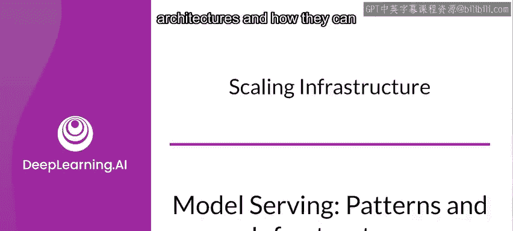
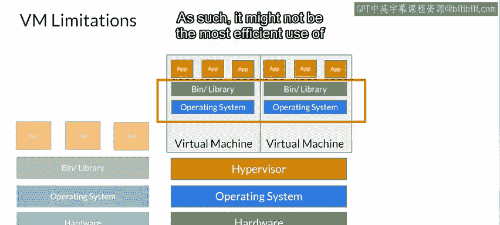
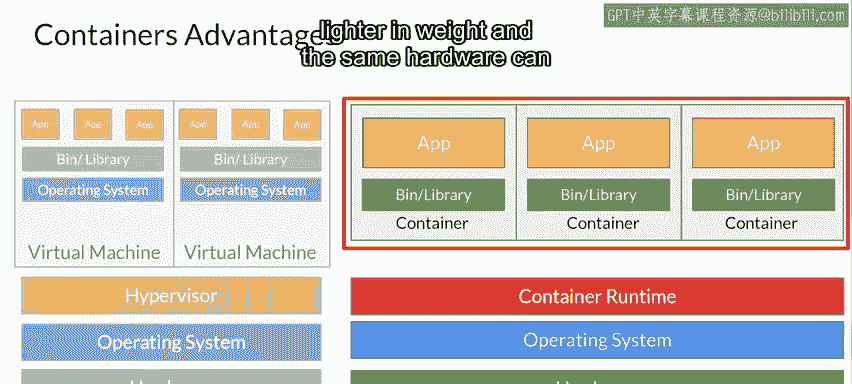
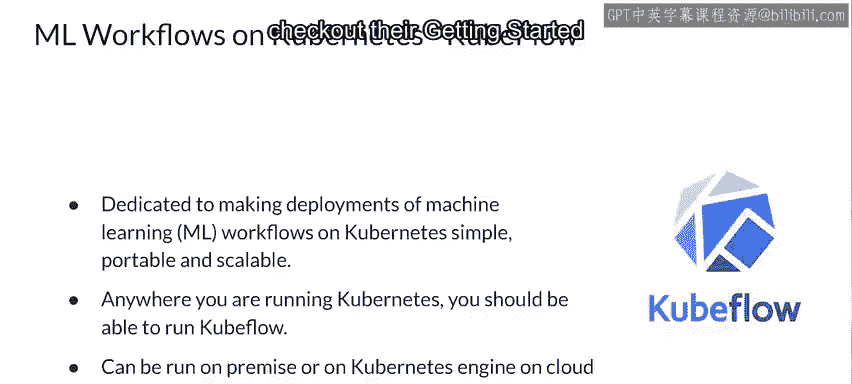

# 吴恩达《机器学习工程师的生产实践（MLOps）Machine Learning Engineering for Production》中英字幕 - P139：10_扩展基础设施.zh_en - GPT中英字幕课程资源 - BV1pi4y167g5

Previously， you looked at some model serving architectures and how they can work to provide an interface to a model。

Of course， when it comes to serving a model like this。

 managing scale and indeed lots of services becomes paramount。😊，So next you look at what scaling is。

 why it's important， and some services that are available to give you scaling in your apps and your machine learning workloads。

😊，Consider a model and here's a very simple example。

 but most models will be far larger and much more complex than this one。

And then consider the costs of training deep neural networks with billions of operations on huge data sets。

It could take days to complete training on a standard CPUU or a single GPU。

 so if you can scale out the hardware on which the training runs and then distribute the training across different items of hardware and maybe even distribute the data by sharding it across this hardware。

 you can make that training far more efficient。Similarly。

 you could also consider the cost of training a network beyond just the data。

The larger and more sophisticated the network， the more parameters that need to be tuned and fine tuned。

A simple neuron like this one has two floating point parameters。

 so consider large networks that have many millions of parameters that need to be learned。

Not only that， consider what happens when you've deployed your model to a server。

Huge volumes of requests to the server for inference can overwhelm it。

 so the ability to scale the runtime inference as well as the training is vital。

There are two main ways to scale， horizontal and vertical， so let's start with vertical。

It's pretty straightforward， and as the image suggests it's using bigger and more powerful hardware。

 it might be upgrading your CPU， adding more RA， using newer GPUs and other types of power。

If your car could only hold five people and you need to move 100 people。

 you can get a bigger car that holds 10 people so then you can move twice as fast。

Or there' horizontal scaling， which means adding more devices to the network。

It adds more GPUs or CPUUs when the load increases。So instead of buying a bigger car。

 you could get 20 cars the same size and transport all 100 people at once。

And to follow that metaphor， you could just borrow the other 19 cars along with your own for the time that you need them。

And that's basically the same concept of cloud computing where you can scale up to your need and scale right back down again when you don't need it anymore and only pay for what you use。

😊，I would generally recommend horizontal scaling for a variety of reasons。 And first of all。

 is that elasticity， like my 100 people in cars that fit five peoples scenario。

 instead of getting rid of your reliable car to get a bigger one and only chip away at the problem。

 you could lease 19 cars just like you're own and give them back when you're done。😊。

That way you don't have to continually maintain and ensure all of the other cars， etc。

 and it's exactly the same in a scenario like this。And not only that， if you are scaling vertically。

 you generally have to take your app offline in order to upgrade the hardware resources when it's elastic。

 you don't need to do this， you just spin up new ones。😊。

So some frameworks such as Google's app Engine are also really smart in using machine learning to predict usage patterns so that they can prewarm up the machines before they're actually needed。

 reducing overall latency。😊，Of course， there are limitations。

But they're usually budgetary and not hardware。 So if you need more nodes and you can afford them。

 you can just go get them。There are lots of vendors offering cloud platforms that allow you to scale horizontally。

 keep an eye on what they offer when it comes to the overall scaling of your system。

 and I'll generally keep an eye out for three things。😊。

Can I manually scale what happens if I say I only want n instances of a VM， for example？

Can I autoscale what happens if I want my app to automatically spin up and down based on demand。

 What does latency cost look like？ And finally， how aggressive is the system at spinning up and down based on my need。

😊，Then of course， the next question arises and that is。

 how can I manage my additional VMs to ensure that they have the content on them that I want？

For machine learning， there might be a lot of dependencies， access to data， permissions。

 and many other configurable items。If I'm going to scale horizontally。

 I want the new machines to be able to be up and running quickly。😊，And for that。

 there's containerism， and let's explore what that's all about next。😊。

So let's think about a typical system where I may have a number of apps that are running。😊。

The pattern will generally look like this， where I have my apps running using some binaries or libraries within an operating system that's executed by hardware。

An extension to this is the virtual machine architecture where the apps can still run on B Library within an operating system。

 but that operating system does not run on hardware。

 and instead it runs on a virtual machine that has no hardware。This VM is managed by a hypervisor。

 which acts as the manager of the virtual machines each with its own operating system。

 bin and apps as shown。The hypervisor will typically run on the metal of the hardware。

Already you can see how this could be used for horizontal scaling。

 our hardware might support multiple instances of operating systems and apps as shown here。😊。

And this is pretty cool， but it can face a limitation。

 namely that each VM has to have a lot of stuff on it， not at least a full operating system， as such。

 it might not be the most efficient use of resources in the system。

And that's where containers can help， as you can see， architecturally。

 they're quite similar to the VM concept， except they don't require separate operating systems per partition so that they're much lighter in weight and the same hardware can typically manage more containers than virtual machines。

So consider the advantages of using containers because each app instance doesn't require an operating system。

 you can generally run more of them on the same hardware。

 giving you much better horizontal scalability。😊，The abstraction of having them run within a container runtime also gives you this greater flexibility on hardware that supports a container runtime。

 you don't need to worry about the operating system， your app just works。😊。

And this leads to easier deployment and more options in deployment。😊。

So you've no doubt heard of Docker， which is the most popular container runtime。

It started out as a Linux based technology but spread rapidly to other operating systems like Windows。

 and it's widely used in data centers， personal machines and public cloud infrastructures。😊。

You'll often see developer tutorials implemented as Docker instances as this makes it much easier to handle complex dependencies or operating system quirks。

😊，Containers will offer you a really convenient way to do horizontal scaling。

 but then not without challenges of their own。😊，So for example。

 you might want to run multiple containers on multiple machines and try to keep them all in sync。

Like any app， even one in a container， it's at risk of going down or the container host itself might fail。

 so you also want to keep a fleet of containers on a hot standby so you can switch traffic over or should one go down。

😊，Thus we'll need to keep the idea of container orchestration in front of mind。

 so let's dig into that next。The idea behind container orchestration is simple。

 it's having a set of tools to do things like managing the life cycle of containers。

 including their scaling。😊，So on top of your container manager。

 container orchestration generally gives multiple services such as resource management to ensure that the containers aren't overalocating hardware resources。

 scheduling so that containers meet up and downtime requirements。

 and of course general service management， so you can manage how the orchestration environment does its job。

😊，For example， you could use service management to ensure that a certain number of containers are in a hot standby should some containers fail。

Over time， as you understand how your system operates， it could tweak that number。

Two of the more popular container orchestration tools are Kubernetes and DockerWwarm。

 let's look into Kubernetes next as it underpins Cubflow。

 a technology that lets you scale your ML apps and learning with horizontal scaling using containers。

😊，I won't go into a lot of detail about Kubernetes here， you can learn more about it at Kubernetes。

il， but in summary it's an open source system for automating deployment。

 scaling and management of containerized applications。😊。

A group's containers that make up an application into logical units for easy management and discovery。

😊，Kubernetes builds upon many years of experience in building scalable applications at Google。

 combined with community experience， with a goal to bring you the best of both worlds。😊。

Check out the site and the link provided in the additional readings at the end of the lesson and you'll see a video of how the Financial Times newspaper in London migrated hundreds of microservices to a container environment。

 scaling them horizontally using Kubernetes and later this week you'll do a quick lab on Tensorflow serving。

 using Kubernetes with auto scalinging。😊，When it comes to deploying ML workflows on Kubernetes。

 CubeF evolved。It's designed to make deployments of ML workflows so that data ingestion。

 feature extraction， training， model management， and all of those kind of things are portable and scalable using Kubernetes。

An important attribute of Kubflowlow is that it's designed so that anywhere Kubernetes can run。

 you can use it。So whether you're choosing a cloud vendor。

 doing containers on your own premises or some kind of combination of the two。

 your machine learning workflows will be able to run with it。😊，So please visit Cuflow。

org to learn more and in particular check out their getting started to see how to install and use it。

😊。

So now that you've been looking at scaling horizontally and exploring how to do that via containers and container orchestration with Kubernetes。

 as well as Cflow specifically for machine learning workflows。

 I recommend that you spend a little time to use these products before you go any further。😊。

