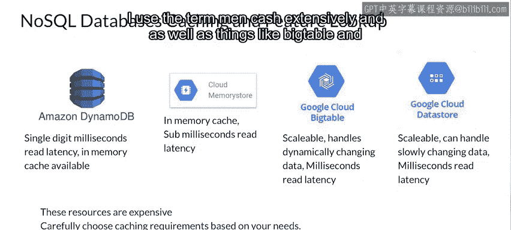

# 吴恩达《机器学习工程师的生产实践（MLOps）Machine Learning Engineering for Production》中英字幕 - P140：11_在线推理.zh_en - GPT中英字幕课程资源 - BV1pi4y167g5

Earlier， you explored different infrastructures for serving models。

 as well as techniques and technologies for horizontal and vertical scaling。

You also got hands on with a coab to show you how to serve a simple model。

 But next you'll look at model serving and some of the things you need to take into account as you serve models with online inference。

A typical interaction between a model and a call or online looks a bit like this。

 indeed the coabab that you did earlier followed this approach。

The interface between the outside world and the collar is via a rest API。

You'll typically have some form of data about the user often called an observation upon which you want to get a prediction。

 This might be， for example， context about a customer that can be used to predict what type of purchases may be appropriate for them so that you could have a recommended list。

Or perhaps it might be something like a smart reply generator where in a conversation。

 the text can be used to auto generaterate replies that the user can select。

The observation is posted to the model via arrest rest API and the return prediction is rendered。

In week one， I discussed the metrics to optimize for making inferences in a general scenario。

 so let's revisit them in the context of online inference。😊。

So if you want to optimize a system like this， you should think about this in three different axes。

You want to optimize for latency and how long does it take for the data to be passed to the server for the inference to execute and then for the response to be handled。

 but it's not just that latency comes in many forms， but from the user's perspective。

 it's the delay between their action and the response of their app。 It's not just the inference。

You could have a poorly designed app that has a fabulous model。

 and if latency is introduced by the transport of the data or even the rendering of the results。

 the user will see a delay。😊，So it's key to manage latency in all parts of your application design。😊。

The focus of this course of course， is on the model and the infrastructure。

 but it is important for you to keep an eye on the total latency of your system。

Which leads to the need to understand throughput in the system。How do you optimize this。

 and it could be often with the type of horizontal scaling we spoke about earlier this week？

While throughput is important for all systems， the throughput measured in requests managed per unit time is often more important for non customer facing systems like intensive data processing apps Still。

 it's important for you to keep it in mind for all of your systems。And of course， there's cost。

Most budgets aren't unlimited， so work that you do to make latency and throughput as efficient as possible will have a cost。

 You need to take this into account always， there are multiple costs in your system。

 not just hardware， but things like engineering and testing， time and effort， software licenses。

 opportunity costs for slow updates and lost costs for a new applications' break。

 They and many others will have to be taken into account。Okay。

 now that you've seen the things that you need to optimize in an ML serving system。

 let's explore some strategies for optimization along with some technologies that can be used to optimize for latency and Thrput。

😊，There are three main areas you can focus on if you want to optimize your inference。

The first is the infrastructure used to serve the models and handle the user input and output。

This can be scaled with additional or powerful hardware。

 as well as containerized of virtualized environments like the ones we presented earlier this week。😊。

The second， of course， is to understand your model architecture and the metrics it was trained and tested with。

Often there's a trade off between inference speed and accuracy if a 99% accurate model is 10 times slower than a 98% accurate model。

 is it really worth the extra cost？😊，And the third is model compilation。

If you know the hardware on which you're going to deploy the model， for example。

 a particular type of GPU， there's often a post training step that consists of creating a model artifact and a model execution runtime that's finally adapted to the underlying support hardware。

You can refine your model graph and inference runtime to reduce memory consumption and latency。

Additionally， there are some optimizations that could be performed on the application layer。

So for example， consider the scenario where you're doing a shopping prediction。

 giving your customer a list of products that they might want to buy next。😊。

The app will receive details about the customer， including some form of identifier。😊。

This data is used by the model to generate an inference。

 and the model will return a bunch of IDs of products that might suit that customer。

So the app has to look these up in a data store in order to get details about them。😊。

Which it then returns to the client as a prediction。

Now there's a lot of hitting databases going on here。

 so an obvious optimization you can do is to consider common scenarios to be cached in something faster than a typical data store。

😊，So for example， if you have a number of hot popular products。

 these could be stored in faster data storage。Of course， the faster the storage。

 the more expensive it is， so there's a trade off here。

 and it may not be feasible for all of your data to be in such a store。

If you can find that trade off for how many to put in there。

 you can maximize for latency while minimizing your extra costs。😊。

Fast data caching is usually achieved using NosQL databases or memory caching。

 There's a few products out there that can handle this such as Amazon's Dynamo Db。

 Google Cloud's memory store， which used to be calledMcash。

 And if you go back to the boy band case study that I used earlier， I used the termMcash extensively。

😊，And as well as things like Big Table and Cloud Datastore that can handle large data sets quickly。😊。

Here you've looked at how online inference works from a very high level before going into a discussion about some scenarios and techniques for where you can optimize your ML inference in particular。

 looking at managing data within your app。😊，There's another area where you can consider optimization and that's in the data past in and out of the model。

 so you'll look next at preprocesing and post processing your data。

