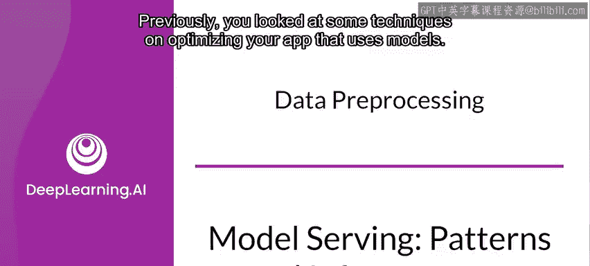
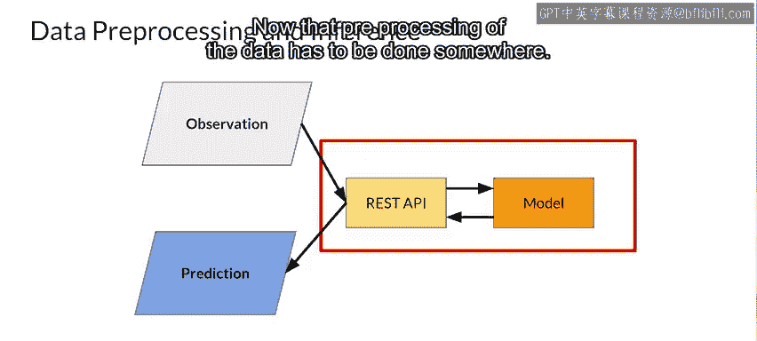
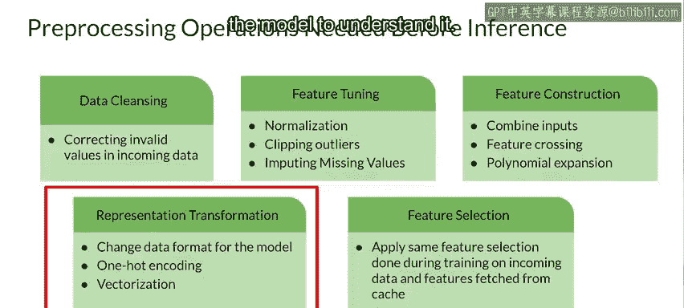
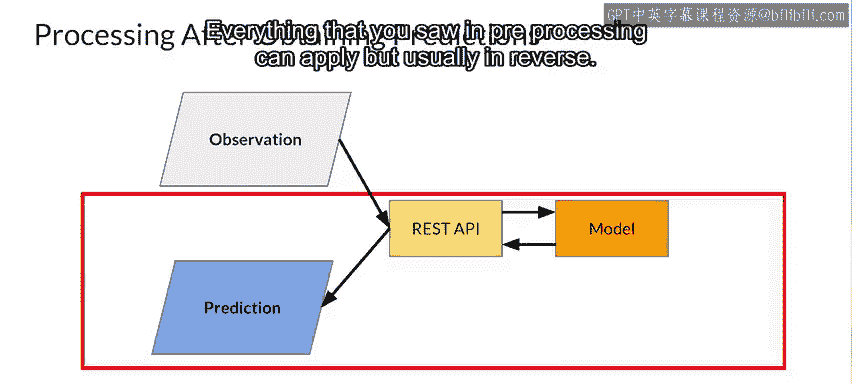

# 吴恩达《机器学习工程师的生产实践（MLOps）Machine Learning Engineering for Production》中英字幕 - P141：12_数据预处理.zh_en - GPT中英字幕课程资源 - BV1pi4y167g5

Previously， you looked at some techniques in optimizing your app that uses models you've explored hardware and container strategies。

 model architectures and things like caching in your app to make sure that data access doesn't become a bottleneck。

 but there are other places where you can optimize so let's start a look and start by considering the input data to your app。

😊。

If you go back to this very simple high level diagram of an app。

 remember that the observation data being passed into the system may be in one format。

 but that's not necessarily the same format that the model was designed to take in。

The data has to be converted somehow， so for example。

 consider a simple language model where maybe the observation is a sentence that the user typed and is stored as a string。

😊，The model is designed to classify that text to see if it's toxic NLP models like this are trained on input vectors where words are transformed into high dimensional vector。

 and sentences are sequences of these vectors。😊，Now that preprocessing of the data has to be done somewhere。

 and that's just a relatively simple example of where you need to do a translation of data from one format to another。

😊。

Other areas to consider when preprocessing are things like data cleansing。

 where you correct invalid values in incoming data。😊，For example。

 maybe you're building an image classifier and the user sends you a picture that's invalid because it's too big。

 you could reject it of course， or you could take on the process of resizing it to get a valid picture size。

Then there's feature tuning， where do some transformation under data to make it suitable for the model in the case of an image this could be normalization where instead of us having a 32 bit value to represent a pixel。

 you might convert it to three，8 bit values for red， green and blue。

 ignoring the alpha channel and then instead of these having values between 0 and 255 you could convert them to values between 0 and1。

 as neural networks tend to deal better with normalized values like that。😊。

Or with the example of a string coming in， it's encoding the string into the vocabulary representation that the model uses。

 which could clip outliers such as infrequently used words。😊。

Often models will require data preprocessing to involve feature construction so for example。

 when it comes to a model that， for example might predict the price of a house。

 the input data might have multiple columns such as the number of rooms and the size of each。

 but the model is trained on the total floor space of the house so then feature crossing could be used to multiply the values that you have out to get the feature type that the model uses。

Other scenarios here could be a polynomial expansion where a new feature is calculated from a formula of the original feature。

Maybe the data contains temperature and Celsius， but the model expects Fahrenheit。

Feature tuning and feature construction can also be a form of representation transformation where the input data needs to be transformed for the model to understand it。

😊。

One classic use of this is one heart encoding of data。

And then there's the smart caching of features that you could have done during training， for example。

 in our sentence example， there may be common sentences such as good morning that instead of us going through cleansing tuning。

 construction and representation transformation that you could just have the input data format。

 pretransform and cached and you use just that。But don't forget about post processing so once your model is given its predictions back to the app。

 you still need to do something with those so for example in a smart reply app the model may give a few predictions about what the best next sentences could be。

😊，And these may be a sequence of vectors representing words in a sentence。

 but not the sentence itself。Your app will need to convert these into a string before returning them to the user。

 This is post processing of data。 Everything that you saw in pre processings can apply。

 but usually in reverse。

So now that you've seen what post processing looks like。

 let's explore a few products that are out there that can give you shortcuts to doing this task。

Next up， I'm providing a reading note that introduces you to Apache beam and Tensorflow transform。

 which really help with the task of pre processingcess。😊。

