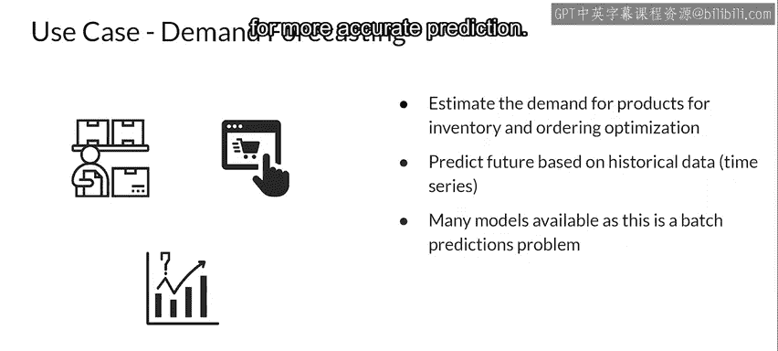

# 吴恩达《机器学习工程师的生产实践（MLOps）Machine Learning Engineering for Production》中英字幕 - P142：13_批量推理场景.zh_en - GPT中英字幕课程资源 - BV1pi4y167g5

You've looked at model scaling as well as architectures for inference。

 so now let's consider model performance and resource requirements for batch inference。

After you train， evaluate， and tune a machine learning model。

 the model is deployed to production to generate predictions。

An ML model can provide predictions in batches， which will be applied to a use case at some time in the future。

😊，Prediction based on batch inference is when your ML model is used in a batch scoring job for a large number of data points where predictions are not required or not feasible to generate in real time。

😊，In batch recommendations， for example， you might only use historical information about customer item interactions to make the prediction without any need for real time information。

😊，Bch recommendations are usually performed in retention campaigns for inactive customers that have a high propensity to churn or in promotion campaigns and stuff like that。

😊，Batch jobs for prediction are usually generated on some recurring schedule like daily at night or maybe weekly。

Predictions are usually stored in a database that can then be made available to developers and users。

Batch inference has some important advantages。 you can use complex machine learning models in order to improve the accuracy of your predictions since there's no constraint on inference time and also caching of predictions like this is usually not required。

Employing a caching strategy for features needed for prediction will increase the overall cost of your ML system。

The data retrieval can take some time if no caching strategy is employed。

Batch inference can also wait for data retrieval to make predictions since the predictions are not available in real time。

😊，However， batch influence also has a few disadvantages。

Predictions cannot be made available for real time purposes。

 update latency of predictions can be hours or sometimes even days。😊。

So predictions are often made using old data and this is problematic in certain scenarios。

 supposeuppose a service like a movie streaming one generates recommendations at night if a new user signs up。

 they may not be able to see personalized recommendations right away。😊，To get around this。

 the system is designed to show recommendations from other users in a similar demographic like the same age bracket。

 or maybe the same geoloc as a new user。😊，So let's review a few use cases of batch inference。😊。

The most important metric to optimize while performing batch predictions is throughP。

You should always aim to increase the throughput in batch predictions rather than the latency。

When data is available in batches， the model should be able to process large volumes of data at a time。

As throughput increases， the latency with which each prediction is generated increases also。😊。

But this is not a big concern in batch prediction systems。

 since predictions need not be available immediately。

 predictions are usually stored for later use and hence latency can be compromised。

Throughput of an ML model or a production system processing data in batches can be increased by usage of hardware accelerators like GPUs。

 GPUs， and all that。You can also increase the number of servers or workers in which the model is deployed。

You can load several instances of the model to multiple workers to increase the throughput。

So let's look at some use cases of batch predictions。😊，First。

 new product recommendations on an e-commerce site can be generated on a recurring schedule。

 and then caching these predictions for easy retrieval rather than generating them every time you user logs in makes it much easier and this can save inference costs since you don't need to guarantee the same latency as realtime inference needs to have。

😊，You can also use more predictions to train more complex models since you don't have the constraint of prediction latency。

😊，This helps personalization to a greater degree but using delayed data that may not include new information about the user。

😊，Let's look at a sentiment analysis problem。Based on the user's reviews， usually in text format。

 you might want to predict if a review was positive， neutral， or negative。

Systems that analyze user sentiment for your products or services based on customer reviews can make use of a batch prediction on a recurring schedule。

Some systems might generate product sentiments on a weekly basis， for example。

Real time prediction is not needed in this case since the customers and stakeholders are not waiting to complete an action in real time based on the predictions。

Sentiment predictions can be used for improvements of services or products over time。

 and as you can see it's not really a real time business process。A CNN。

 RNN or LSTM based approach can be used for sentiment analysis， I tend to like LSTM。

These models are more complex， but they often provide higher accuracy。

And that makes it more cost effective for you to use them with batch prediction。

Let's look at a different example， forecasting demand for products or services。

You can use batch predictions for models that estimate the demand for your products perhaps on a daily basis。

 for inventory and ordering optimization。😊，It can be modeled as a time series problem since you're predicting future demand based on historical data。

Since batch predictions have minimal latency constraints， time series models like Ama， serma。

 or an RNN can be used over approaches like linear regression for more accurate prediction。😊。

