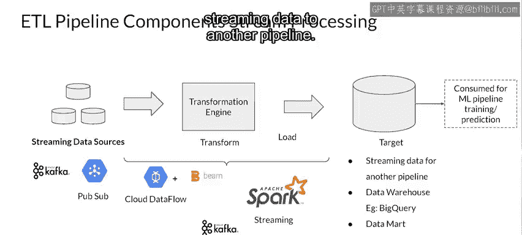

# 吴恩达《机器学习工程师的生产实践（MLOps）Machine Learning Engineering for Production》中英字幕 - P143：14_使用ETL进行批处理.zh_en - GPT中英字幕课程资源 - BV1pi4y167g5

Okay， now that you've seen batch processing of static data。

 now let's explore what it looks like with time series data or other data types that are updated frequently and which you need to read in as a stream。

Data can be of different types based on the source。

 largege volumes of batch data are available in data lakes from CSV files， log files， etctera， etc。

Streaming data， on the other hand， arrives in real time。

 one example of such data could be data from sensors。

Before data is used for making batch predictions， it has to be extracted from the multiple sources like the log files and the CSV files we spoke about。

 but it could also be APIs， other apps， streaming sources and all of that kind of thing。😊。

The extracted data should be transformed so as to make ML predictions and then load it into a database from where it can be sent in batches for prediction。

😊，The entire pipeline that prepares data is known as an ETL pipeline。

 and ETL stands for extracttract， transform， and load。

ETL pipelines are a set of processes for extracting data from data sources。

 then transforming the data， and then loading the data into an output destination like a data warehouse from where it might be used for multiple purposes。

 including running batch predictions， performing other analytics。

 doing data mining and all that good stuff。Extraction from data sources and transformation on data can be performed in a distributed manner。

Data is split into chunks and then can be parallel processed by multiple workers。

The results of the ETL workflow are stored in a database。

 and the results are a lower latency and higher throughput of data processing。

Let's take a look at the various frameworks that can be used for batch processing of data in ETL pipelines before they're sent for inference。

😊，Data can come from multiple sources like CSV files， XML files， JSON APIs。

 or data lakes like Google Cloud Stage， the ETL on data is performed by engines like Apache Spark or Google Cloud Dataflowlow making use of the Apache Beaam programming paradigm。

😊，The transform data is stored into data warehouses like BigQury and can be sent back into a data lake like Google Cloud Stage before it's sent for batch prediction。

😊，Continuously updating data sources like sensors can be connected to Apache Kafka。

 Google Cloud PubS， and products like these。Cloud Dataflowlow using Apache Beaam can perform ETL on streaming data also。

Spark has a product specifically for processing streaming data。

An Apache Kafka can also act as an ETL engine for streaming data。😊。

This data may in turn be collected into a data warehouse like BigQuery or into a data mar or data lake。

 it can also serve as a source for streaming data to another pipeline。

Let's now put that into practice by exploring a scenario on the Google Cloud platform where you use beamM and TensorFlow。

😊，And while the data you use， molecular data about carbon， hydrogen。

 nitrogen and oxygen is static and not streamed， it will give you an idea for how all of the components in beam based systems will work together for learning。

