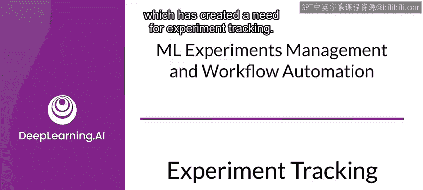
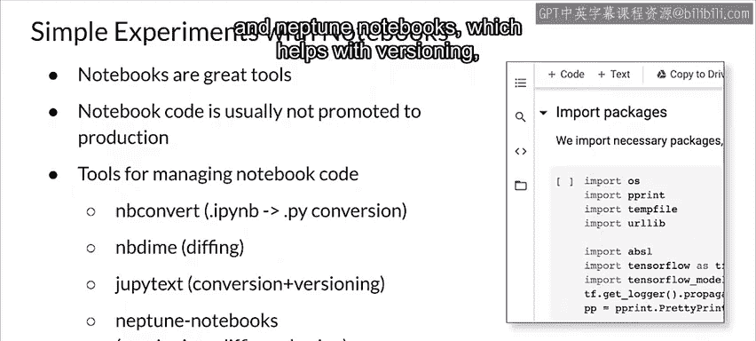
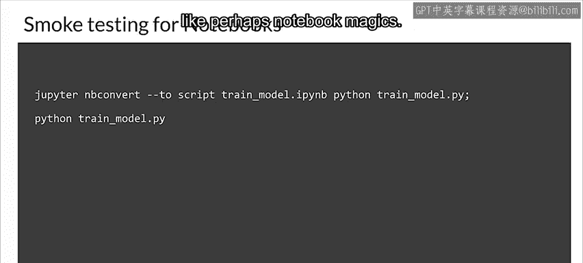
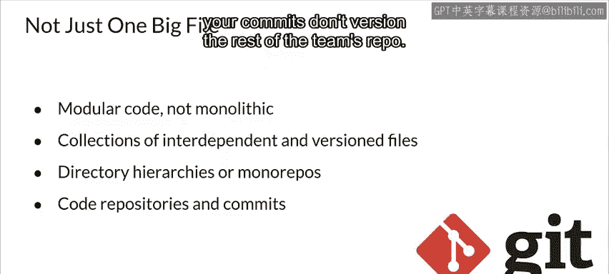
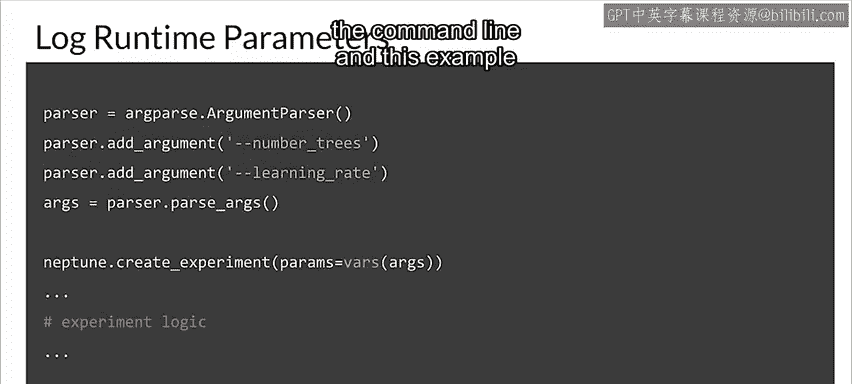
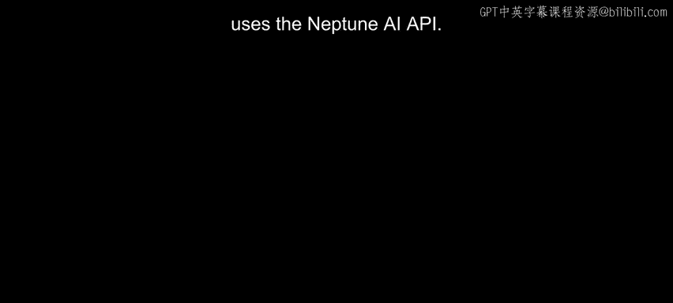

# 吴恩达《机器学习工程师的生产实践（MLOps）Machine Learning Engineering for Production》中英字幕 - P144：15_实验跟踪.zh_en - GPT中英字幕课程资源 - BV1pi4y167g5

Welcome back。 We've got a lot to cover this week， really focusing on areas related to production and L processes。

 including different types of deployments。 We'll be discussing experiment tracking。

 focus on M L ops at different levels of maturity。😊。

We'll also be developing components for orchestrated workflows。

 and we'll take a look at model versioning and continuous delivery and progressive delivery。

 So as you can see， we have a lot to cover。 Let's get started。😊，In many ways。

 machine learning can be considered an experimental science since its experimenting and analyzing results is at the heart of Em development。

We need rigorous processes and reproducible results。

 which has created a need for experiment tracking。 We'll discuss that now。

Experiments are fundamental to data science and machine learning。

 ML in practice is more of an experimental science than a theoretical one。

 so tracking the results of experiments， especially in production environments。

 is critical to being able to make progress toward your goals。

Debugging in M L is often fundamentally different than debugging in software engineering。

 because it's often about a model not converging or not generalizing instead of some functional error like a Seg fault。

Keeping a clear record of the changes of the model and data over time can be a big help when you're trying to hunt down the source of the problem。

Even small changes like changing the width of a layer or its learning rate can make a big difference in both the model's performance and the resources required to train the model。

So again， tracking even small changes is important。And don't forget that running experiments。

 which means training your model over and over again， can be very time in consuming and expensive。

 This is especially true for large models and large data sets。

 especially when you're using expensive accelerators like GPus to speed things up。

 So making the maximum use of each experiment is important。

Let's step back and think for a minute about what it means to track experiments。First。

 you want to keep track of all the things that you need in order to duplicate a result。

Some of us have had the unfortunate experience of getting a good result and then making a few changes that were maybe not well tracked and then finding it hard to get back to the setup that produced that good result。

Another important goal is being able to meaningfully compare results。

 This helps guide you when you're trying to decide what to do next in your experiment。

But without good tracking， it can be hard to make comparisons of more than a small number of experiments。

So it's important to track and manage all of the things that go into each of your experiments。

 including your code， your hyperparameters， and the execution environment。

 which includes things like the versions of the libraries that you're using and the metrics that you're measuring。

Of course， it helps to organize them in a meaningful way。

Many people start out taking free form notes， which is fine for a small number of simple experiments。

 but quickly becomes a mess。And finally， because you're probably working in a team with other people。

 good tracking helps when you want to share your results with your team。

 That usually means that as a team， you need to share common tooling and be consistent。

At a basic level， especially when you're just starting out on a project。

 most or all of your experiments might be in a note book。

 Note bookss are powerful and friendly tools for Ml data and model development。

 and allow for a nice iterative development process， including in line visualizations。😊，However。

 notebook code is usually not directly promoted to production and is often not well structured。

One of the reasons that it's not usually promoted is that notebooks aren't just product code。

 they often contain notebook magics， special annotations that only work in the notebook environment。

Coode to check the value of things and code to generate visualizations。

 which you rarely want to do in a production workflow。When you're experimenting with notebooks。

 you want to make sure to track those experiments， And there are some tools that help with that。

 These include N B convert， which， among other things。

 can be used to extract the Python from a notebook。En be dime。

 which enables diffing and merging of Jupiter notebooks。Juoppy text。

 which converts and synchronizes pairs of notebooks with a matching Python file and much more。

And Neptune notebooks， which helps with versioning， diffing and sharing notebooks。

So， for example， to make sure that when you extract the Python from your notebook。

 it will actually run always a good thing。You can use commands like this to extract the code from your notebook and then try running it。

 If it fails， then there were things happening in your notebook that your code depended on。

 like perhaps notebook magics。

But as you move from simple， small experiments into production level experiments。

 you'll quickly outgrow the pattern of putting everything in a notebook。

 You should plan to write modular code， not monolithic code。 and the earlier in the process。

 the better。😊，Because you'll tend to do many core parts of your work over and over again。

 you'll develop reusable modules that will become high level tools。

 often specific to your environment， infrastructure and team。

Those will save you a lot of time and be much more robust and maintainable。

 They'll also make it easier to understand and reproduce experiments。

The simplest form of these is just a directory hierarchy。

 especially if your whole team is working in a mono repo。

But in more advanced and distributed workflow。Coode repositories and versioning with commits are powerful and widely available tools for managing large projects。

 including experiments。 In these cases， you probably want to keep experiments separate if you're using a shared Monte repo with your team so that your commits don't version the rest of the team's repo。

As you perform experiments， you're often changing runtime parameters。

 including your model's hyper parametersa。 It's important to include the values of those parameters in your experiment tracking and how you set them will determine how you do that。

A simple and robust method is to use configuration files and change those values by editing those files。

 The files can be versioned along with your code for tracking。

 Another option is to set your parameters on the command line。

 But this requires additional code to save those parameter values and associate them with your experiment。

This means including code， along with your experiment to save those values in a data store somewhere。

 This is an additional burden， but it also makes those values easily available for analysis and visualization。

 rather than having to parse them amount of a specific commit of a code of a config file。😊，Of course。

 if you do use config files， you can also include the code along with your experiment to save those values in a data store somewhere。

 which gives you the best of both worlds。This is an example of what the code to save your runtime parameter of values might look like in this case where you're setting your runtime parameters on the command line and this example uses the Neptune AI API。

