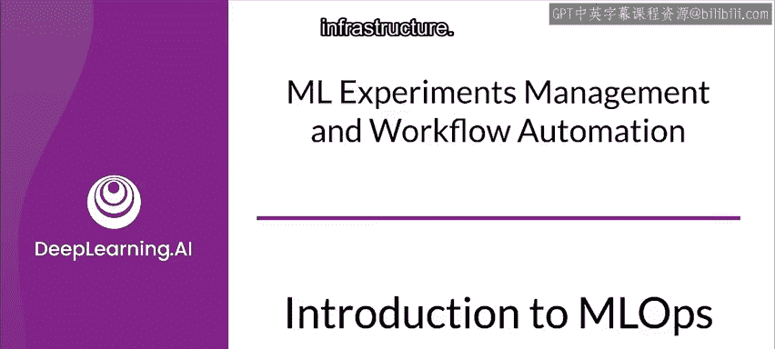
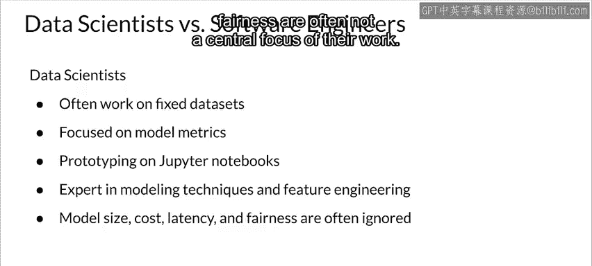
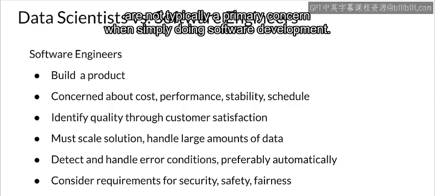
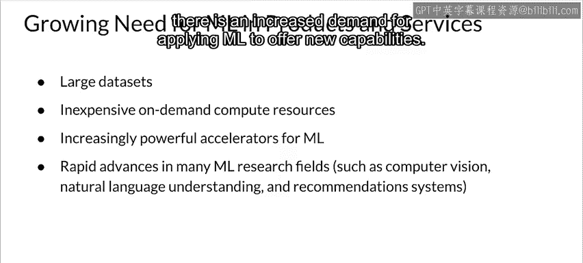
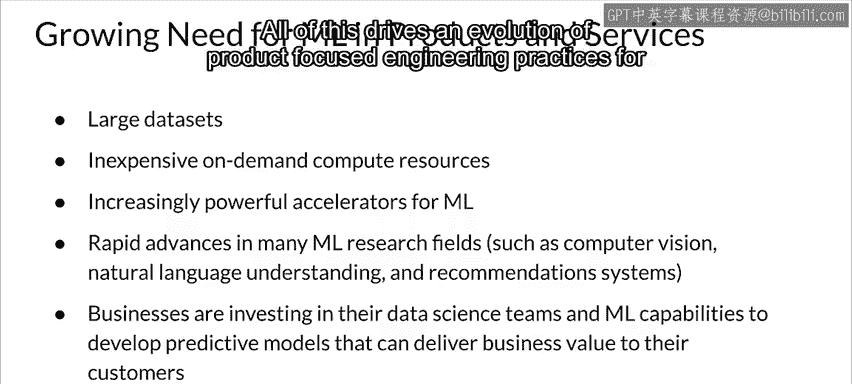
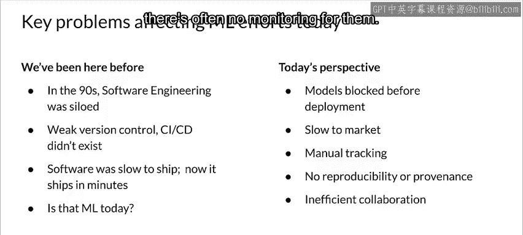
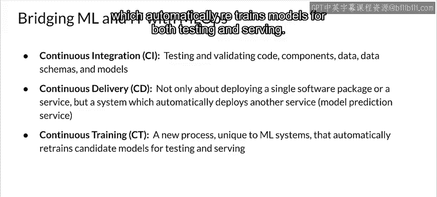
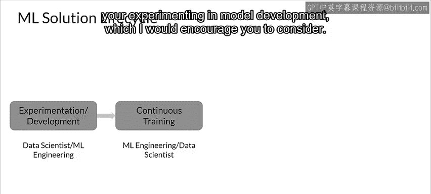
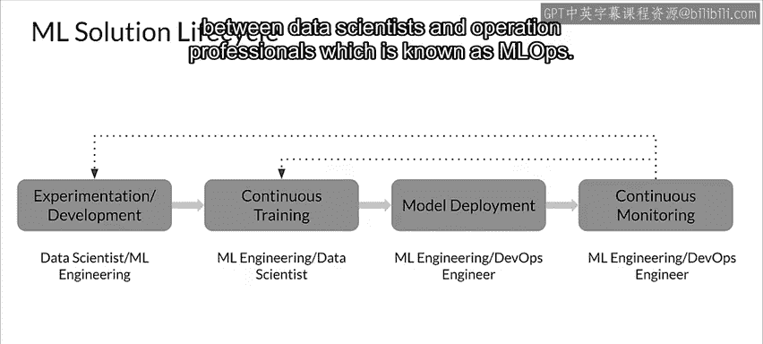
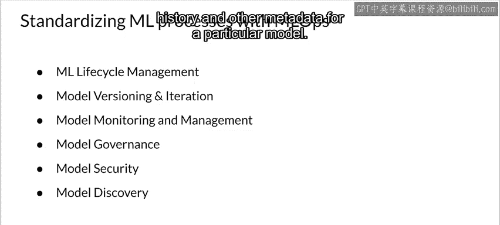

# 吴恩达《机器学习工程师的生产实践（MLOps）Machine Learning Engineering for Production》中英字幕 - P146：17_MLOps简介.zh_en - GPT中英字幕课程资源 - BV1pi4y167g5

Almost everything that we've talked about and will talk about in these courses can be considered M L ops。

 in a broad sense。But now let's take a closer look at Mops in a more narrow sense and develop an understanding of different levels of maturity of Mlops processes and infrastructure。

First， let's understand the two key roles within a typical engineering team。

 data scientist and software engineer。Thinking about these roles will help you to understand why production ML requires data scientists to evolve into domain experts who can both develop predictive models and build production machine learning solutions You'll also learn how AI components are parts of larger systems and explore the challenges in engineering and AI enabled system。

Thinking first about data scientists， especially those coming from a research or academic background。

 they often focus on fixed data sets and focus on optimizing model metrics such as accuracy while doing prototyping in notebooks。

 Their training usually makes them experts in modeling and feature engineering and model size， cost。

 latency and fairness are often not a central focus of their work So engineers， however。

 are much more focused on building products。 So concerns such as cost and performance， stability。

 scalability， Mainability and schedule are much more important to them。

They identify strongly with customer satisfaction and recognize infrastructure needs such as scalability。

They have a strong focus on quality， testing and detecting and mitigating errors。

And are keenly aware of the need for security， safety and fairness。 They also， however。

 tend to view their product as basically static， with changes being primarily the result of bug fixes or new features。

Changes in the data as the world around them changes are not typically a primary concern when simply doing software development。

Increasingly， data science and ML are becoming core capabilities for solving complex real world problems。

 transforming industries， and delivering value。Currently。

 the ingredients for applying ML have already been made available or accessible with large data sets。

 inexpensive on demand compute resources and increasingly powerful accelerators for ML such as GPUs and TPUs on several cloud platforms like AWS。

 Azure and Google Cloud。There have been rapid advances in M L research in computer vision。

 natural language understanding and recommendation systems。

 where there's an increased demand for applying M to offer new capabilities。 With all that in mind。

 many businesses have already started investing in their data science teams and M L capabilities to develop predictive models that can deliver business value to their customers。

All of this drives an evolution of product focused engineering practices for M。

 which is the basis for the development of M L ops。

There are a number of problems affecting AI efforts today。

 so there is an increasing focus on improving our machine learning workflows。

But it turns out that software engineering faced a similar situation in the recent past。

There's no denying that in the 90s， software Engine  too was once siloed。Back then。

 even basic version control was fairly weak compared to what is currently used today。

 and things that you take for granted like C ICD didn't even exist。

This resulted in software taking a long time to ship。So thinking about what it was like back then。

 is that where ML is today？In today's perspective。For many teams。

 it can take months to deploy their models to production once they've trained them。In some cases。

 being that slow to market means missing opportunities or deploying models that are already decayed。

Moreover， traditional data science projects lack tracking。

 and then there are problems like manual tracking and models not being reproducible and data lacking provenance and a general lack of good tools and processes for collaboration between different teams。

And once models do get deployed to production， there's often no monitoring for them。

DeevOs and is an engineering discipline which focuses on developing and managing software systems。

 It was developed over decades of experience and learning in the software development industry。

Some of the potential benefits that it offers include reducing development cycles。

 increasing deployment velocity， and ensuring dependable releases of high quality software。

 like DevOs， MLOs is an ML engineering culture and practice that aims at unifying ML system development or Dev an ML system operation or ops。

Unlike DevOs， NL systems present unique challenges to core DevOps principles。

 like continuous integration， which for ML means that you not only just test and validate code and components。

 but also do the same for data， schemas and models。Continuous delivery， on the other hand。

 isn't just about deploying a single piece of software or a service， but is a system。

 more precisely an M L pipeline。That deploys a model to a prediction service automatically。

As M emerges from research， disciplines like software engineering， DevOs and M L need to converge。

 forming M L ops。So with that comes the need to employ a novel DevOs automation techniques dedicated for training and monitoring machine learning models。

That includes continuous training， a new property that is unique to M L systems。

 which automatically retrains models for both testing and serving。

And once you have models in production， it's important to catch errors and monitor inference data and performance metrics with continuous monitoring。

Now， let's consider the major phases in the life cycle of an ML solution。

Usually a data scientist or an ML engineer。And you start by shaping data and developing an ML model and continue by experimenting until you get results which meet your goals。

 After that， you typically go ahead and set up pipelines for continuous training unless you already use the pipeline structure for your experimenting and model development。

Which I would encourage you to consider。Then you turn to model deployment。

 which involves more of the operations and infrastructure aspects of your production environment and processes。

And then continuous monitoring of your model， systems and data from your incoming requests。

The data from those incoming requests will become the basis for further experimentation and continuous training。

 So as you go from continuous training to model deployment。

 the tasks evolve into something that traditionally a Devops engineer would be responsible for。

 that means that you need a Devops engineer who understands Ml deployment and monitoring。

 And now let's move on to a new practice for collaboration and communication between data scientists and operation professionals。

 which is known as M L ops。

MLOs provides capabilities that will help you build。

 deploy and manage machine learning models that are critical for ensuring the integrity of business processes。

 it also provides a consistent and reliable means to move models from development to production by managing the ML lifecycle。

Models generally need to be iterated and versioned to deal with an emerging set of requirements。

 The models change based on further training or real world data that's closer to the current reality。

 Mopps also includes creating versions of models as needed and maintaining model version history。

And as the real world and its data continuously change， it's critical that you manage model decay。

With MLOs， you can ensure that by monitoring and managing the model results continuously。

 you can make sure that accuracy， performance and other objectives and key requirements are acceptable。

MLOs platforms also generally provide capabilities to audit compliance， access control， governance。

 testing and validation and change in access logs。 The logged information can include details related to access control like who is publishing models。

 why modifications are done and when models were deployed or used in production。

You also need to secure your models from both attacks and unauthorized access MLLO Solutions can provide some functionality to protect models from being corrupted by infected data being made unavailable by denial of service contracts or being inappropriately accessed by unauthorized users。

Once you've made sure your models are secure， trustable， and good to go。

 it's often a good practice to establish a platform where they can be easily discovered by your team。

Eops can do that by providing model catalogs for models produced。

 as well as a searchable model marketplace。 These model discovery solutions will provide information to track the data origination。

 significance， model architecture and history and other metadata for a particular model。😊。

