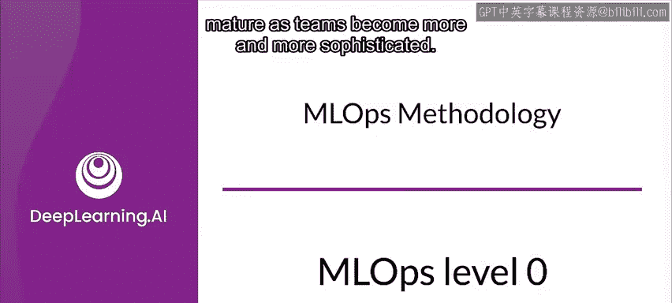
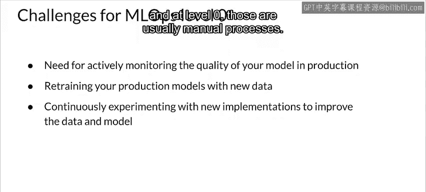

# 吴恩达《机器学习工程师的生产实践（MLOps）Machine Learning Engineering for Production》中英字幕 - P147：18_MLOps级别0.zh_en - GPT中英字幕课程资源 - BV1pi4y167g5

Let's look now at how MOops processes evolve and mature as teams become more and more sophisticated。

Fundamentally， the level of automation of the data， modeling， deployment。

 and maintenance systems determines the maturity of the MLFs process。With increased maturity。

 the available velocity for the training and deployment of new models is also increased。

The objective of an MOs team is to automate the training and deployment of MLL models into the core software system and provide robust and comprehensive monitoring。

Ideally， this means automating the complete ML workflow with as little manual intervention as possible。

Triggers for automated model training and deployment can be calendar events。

 messaging or monitoring events， as well as changes in data， model training code。

 and application code， or detected model decay。Many teams have data scientists and ML researchers who can build state of the art models。

 but their process for building and deploying ML models is entirely manual。

This is considered the basic level of maturity， or level 0。

This is generally script or notebook driven for the most part， and every training step is manual。

 including data analysis， data preparation， model training and validation。

It requires manual execution of each step and manual transition from one step to another。

 This process is usually driven by experimental code that is written and executed in notebooks by data scientists interactively until a workable model is produced。

This creates a disconnect between the ML and operations teams among other things。

 this opens the door for a potential training serving SU。To better understand what's going on here。

 let's assume data scientists hand over a trained model to the engineering team to deploy on their infrastructure for serving or batch prediction。

This form of manual handoff could include putting the train model in a file system somewhere。

 checking the model object into a code repository， or uploading it to a model registry。

Then engineers who deploy the model need to make the required input features available in production potentially for low latency serving。

 which can lead to training serving Sw。A level zero process assumes that your data science team manages a few models that don't change frequently because of either changes in model implementation or retraining the model with new data or both。

A new model version is probably only deployed a couple of times a year。

So because of fewer code changes， continuous integration or CI。

 and often even unit testing is totally ignored。Usually。

 testing the code is part of the notebooks or script execution。

The scripts and notebooks that implement the experiment steps are often source controlled。

 and they produce artifacts such as trained models， evaluation metrics and visualizations。

 And also because there aren't many model versions that need to be deployed。

 continuous deployment or C Ds isn't even considered。

A level 0 process is concerned only with deploying the train model as a prediction service。

 for example， a microservice with a rest API， rather than deploying the entire M L system。Also。

 here you do not track or log the model predictions and actions which are required in order to detect model performance degradation and other model behavioral drifts。

MLOs level 0 is common in many businesses that are beginning to apply ML to their use cases。

This manual data science driven process might be sufficient when models are rarely changed or retrained。

 In practice， models often break when they are deployed in the real world。

The models fail to adapt the changes in the dynamics of the environment or changes in the data that describes the environment。

To address these challenges and to maintain your model's accuracy and production， you need。

 first of all， to address the lack of active performance monitoring。

Active monitoring your model lets you detect performance degradation and model decay。

It acts as a cue that it's time for new experimentation and retraining of the model on new data。

Then there's the problem of continuously adapting your model to the latest trends。To overcome this。

 you need to retrain your production models often with the most recent data to capture the evolving and emerging patterns。

For example， if your app recommends fashion products using Mho。

 its recommendation should adapt to the latest trends and products。Of course。

 that requires you to have new data and to label it somehow。 And at level 0。

 those are usually manual processes。

