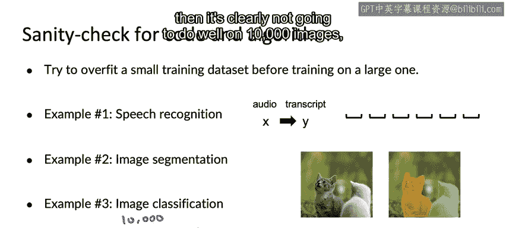

# 吴恩达《机器学习工程师的生产实践（MLOps）Machine Learning Engineering for Production》中英字幕 - P14：13_开始提示.zh_en - GPT中英字幕课程资源 - BV1pi4y167g5

Let me share with you a few tips for getting started on a machine learning project this video will be a little bit of a grab bag of different ideas。

 but I hope nonetheless many of these ideas will be useful to you we've talked about how machine learning is an itative process where you start with a model data hyper parameterss trade a model。

 carry out error analysis and then use that to drive further。

Imrovveement and after you've done this a few times gone around the loop enough times when you have a good enough model。

 you might then carry out a final performance audit before taking it to production in order to get started on this first step of coming with a model here are some suggestions when I'm starting on the machine learning project。

 I almost always start with a quick literature search to see what's possible so you can look at online courses。

 look at blogs， look at open source projects and my advice to you。

If you goal to build a practical production system and not to do research is don't obsess about finding the latest greatest algorithm instead spend half a day。

 maybe a small number of days reading blog posts and pick something reasonable that lets you get sorted quickly if you can find an open source implementation that can also help you establish a baseline more efficiently I find that for many practical applications a reasonable algorithm with good data will often do just fine and in fact outperform a great algorithm with not so good data so don't obsess about taking the algorithm that was just published in some conference last week that is the most cutting edge algorithm instead find something reasonable find a good open source implementation and use that to get going quickly because being able。

To get started。On this first step of this loop。Can make you more efficient in iterating through more times and that will help you get to good performance more quickly second question I've oftenmin asked is hey Andrew。

 do I need to take into account deployment constraints such as compute constraints when picking a model my answer is yes you should take deployment constraints such as compute constraints into account if the baseline already established and you're relatively confident that this project will work and does you go is to build and deploy a system。

But if you've not yet even established a baseline or if you're not yet sure if this project will work and be worthy of deployment。

 then I would say no or maybe not necessarily， and if you are in a state of the project where your first goal is to just establish a baseline and determine what is possible and if this project is even work pursuing for the long term。

 then it might be okay to ignore deployment constraints and just find some open source implementation and try it out to see what might be possible even if that open source implementation is so computationally intensive that you know you will never be able to deploy that Of course know harm taking deployment constraints into account as well at this phase of the project。

 but it might also be okay if you don't and focus on more efficiently establishing the baseline first Finally when trying out the learning algorithm for the first time before。

Running it on all your data， I would urge you to run a few quick sanity checks for your code and your algorithm。

 For example， I will usually try to overfit a very small training dataset before spending hours or sometimes even overnight or days training the algorithm on a large data maybe even try to make sure you can fit one training example。

 especially if the output is a complex output。 For example。

 I was once working on a speech recognition system where the goal was the input audio and have a learning algorithm output the transcript when I trained my algorithm on just one example one audio clip when I trained my speech recognition system on just one audio clip on the training set which is just one audio clip my system outputs this it output space space。

 space， space space space so clearly it wasn't working and because my speech system couldn't even accurately trans one。

Any example。There wasn't much point to spending hours and hours training on a giant training set or for image segmentation。

 if your goal is to take us input pictures like this and segment out the cats in the image then before spending hours training your system on hundreds or thousands of images a worthy sanity check would be to feed it just one image and see if it can at least overfit that one training example before scaling up to a larger data and the advantage of this is you may be able to train your algorithm on one or a small handful of examples in just。

Minutes or maybe even seconds and this lets you find bugs much more quickly Finally。

 for image classification problems， even if you have 10。

000 images or 100000 images or a million images in your training set。

 it might be worthwhile to very quickly train your algorithm on a small subset of just 10 or maybe 10 images because you can do that quickly and if your algorithm can't even do well on 100 images well then it's clearly not going to do well on 10。

000 images， so this would be another useful sanity check for your code Now after you've trained a machine learning model after you've trained your first model。

 one of the most important things is how do you carry out error analysis to help you decide how to improve the performance of your algorithm let's go on to the next video to dive into error analysis and performance auditing。

