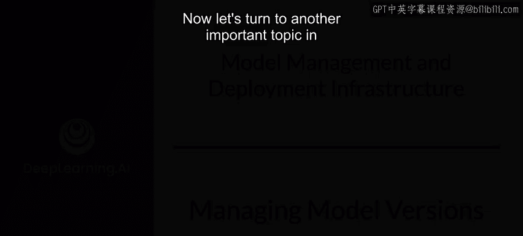
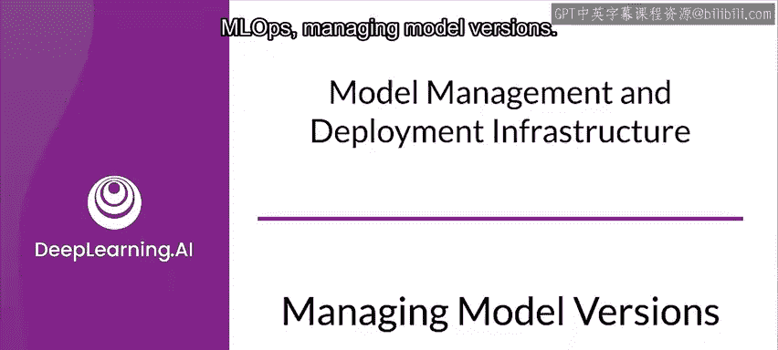
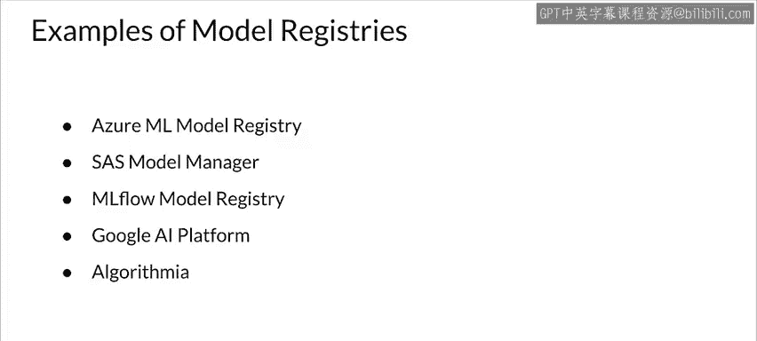

# 吴恩达《机器学习工程师的生产实践（MLOps）Machine Learning Engineering for Production》中英字幕 - P150：21_管理模型版本.zh_en - GPT中英字幕课程资源 - BV1pi4y167g5

Now it's turned to another important topic in MLOs， managing model versions。

Let's look now at why version control is so important and some of the challenges of versioning models。

In normal software development， especially with teams。

 organizations rely on version control software to help teams manage and control changes to their code。

But imagine if you didn't have that。How would you enable multiple developers to stay in sync。

 How do you roll back when there are problems？How would you do continuous integration？Well。

 just like with software development， when you're developing models。

 you have all of these needs and more。Generating models is an iterative process During development。

 you typically generate several models and compare one against the other to evaluate the performance of each model。

Each model version may have different code， data and configuration。

 you need to keep track of all of this to properly reproduce results。

This is where model versioning is important。Versioning will improve collaboration at different levels from individual developers to teams all the way up to organizations。

So how should you version your models？First， let's think about how you version software。

In most cases， you version software with a combination of three numbers。

These numbers are the major version， the minor version， and a patch number of the release。

The major version usually increases when you make incompatible API changes。

The minor version number is increased when you add functionality in a backwards compatible way。

 and the patch number is increased when you make backwards compatible bug fixes。

So can you take a similar approach with your models？As of now。

 there's no uniform standard which is widely accepted across the industry diversion models。

Different companies have adopted their own conventions for versioning and as a developer in their organization。

 you need to understand how they version their models。

Here's one possible approach that I'd like to propose。

 which is simple to understand and is in line with normal software versioning。

Let's use a combination of three numbers and denote these as major minor and pipeline versions。

Does it sound familiar？The major version will increment when you have an incompatible data change。

 such as a schema change or target variable change that can render the model incompatible with its prior versions when it's used for predictions。

The minor version will increment when you believe that you've improved or enhanced the model's output。

Finally， the pipeline version will correspond to an update in the training pipeline。

 but it need not improve or even change the model itself。

Other versioning styles include arbitrary grouping。

 blackbox functional models and pipeline execution versioning， but I will not discuss them here。

 rather， I'd like to focus on how to retrieve older models， leverage model lineage。

 and use model registries to simplify production workflow。

One way to test a versioning style is to ask， can you leverage a model's framework's capability to retrieve previously trained models？

You may have an intuition that for an ML framework to retrieve older models。

 the framework has to be internally versioning the models through some versioning technique。

Different ML frameworks may use different techniques to retrieve previously trained models。

One technique is by making use of model lineage。Model lineage is a set of relationships among the artifacts that resulted in the trained model。

To build model artifacts， you have to be able to track the code that builds them and the data。

 including pre processing operations that the model was trained and tested with。

EmL orchestration frameworks like TFX will store this model lineage for many reasons。

 including recreating different versions of the model when necessary。

Note that model lineages usually only includes those artifacts and operations that were part of model training。

Post training artifacts and operations are usually not part of the lineage。

Now let's take a look at model registries。A model registry is a central repository for storing trained models。

Model registries provide an API for managing trained models throughout the model development lifecycle。

Model registries are essential in supporting model discovery， model understanding and model reuse。

 including in large scale environments with hundreds or thousands of models。As a result。

 model registries have become an integral part of many open source and commercial ML platforms。Next。

 let's look at the metadata which is stored in most of the open source and commercial model registries。

Metadata usually includes the different model versions available。

 Some model registries provide storage for serialized model artifacts in order to improve the model discoverability within the model registry。

 It's important to store some free text annotations and other structured or searchable properties of the models。

And in order to promote the model lineage。Registries sometimes include links to other MO artifact and metadata stores。

Model registries are really very useful things to have。

 Model registries promote model search and discoverability within your organization。

 and that can help improve the understanding of the model among your team。😊。

Model registries can help enforce a set of approval guidelines which need to be followed when uploading models。

 which can help improve governance。By sharing models with your team。

 you're improving the chances of collaboration among your coworkers。

Model registries can also help streamline deployments。

 Model registries can even provide a platform for continuous evaluation。

 monitoring and staging and promotions。Here's a list of some of the currently available model registries。

 as you can see there are quite a few。And each has somewhat different feature sets。

 I won't do a comparison here。 This is really just to make you aware of some of the offerings that are available。

 So， for example， there's Azure M L model reiststry， S A S model manager， M L flow model registry。

 the Google AI platform and Althia。

